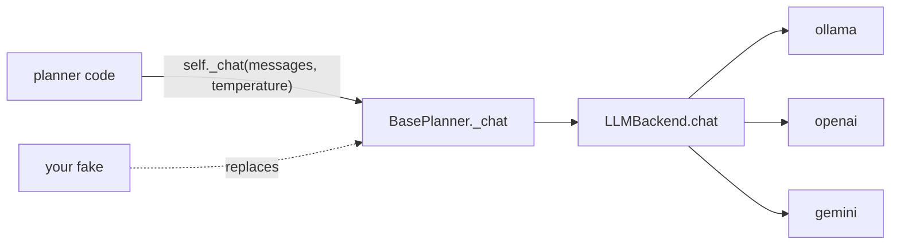

# LLM calls and cost

Every planner in embodiplan talks to a language model, and the algorithms differ mainly in how many calls they make and what each call asks. This page shows how a call is made, how calls and tokens are counted, and how to run any planner offline by replacing the one method that reaches the model.

!!! abstract "In this page"
    - All planners call the LLM through one method, `self._chat(messages, temperature)`. This makes the backend swappable and lets you test without a server.
    - Calls are spent in five ways: one call; generate then critique; one step per call; decompose then expand; translate to PDDL.
    - `PlanMetrics` counts calls itself (each planner adds 1 per `_chat`) and sums the tokens that `_chat` returns.
    - The **fake-`_chat` recipe** below runs a real planner with a scripted reply.

!!! code "Where in the code"
    - [`base.py:187-270`](https://github.com/mtbui2010/embodiplan/blob/a69064255c69/embodiplan/base.py#L187-L270): `LLMBackend` (host, key, dispatch)
    - [`base.py:322-421`](https://github.com/mtbui2010/embodiplan/blob/a69064255c69/embodiplan/base.py#L322-L421): the Ollama request
    - [`base.py:550-571`](https://github.com/mtbui2010/embodiplan/blob/76da520/embodiplan/base.py#L550-L571): `BasePlanner._chat`
    - [`base.py:471-472`](https://github.com/mtbui2010/embodiplan/blob/a69064255c69/embodiplan/base.py#L471-L472): the token estimate

!!! warning "The default host is a remote server"
    A planner built without `host=` sends its prompts to `http://ollama.aistations.org` ([`base.py:23`](https://github.com/mtbui2010/embodiplan/blob/a69064255c69/embodiplan/base.py#L23)). Pass `host="http://localhost:11434"` (or your own server) to keep prompts local.

## One door: `_chat`



A planner builds a list of messages (`{"role": "system" | "user", "content": ...}`) and calls `self._chat(messages, temperature=...)`. It gets back `(content, input_tokens, output_tokens)`. No planner talks to HTTP itself, with one exception: the verifier step of the LLM Router planner (see below). Because the door is a plain method, you can swap the backend (change `provider`) or replace the method with a function that returns fixed text.

### Backends

| provider | key | where the request goes |
|---|---|---|
| `ollama` (default) | none | `<host>/api/chat`, plain `requests` call |
| `openai` | `api_key=`, else env `OPENAI_API_KEY` | OpenAI chat completions URL |
| `gemini` | `api_key=`, else env `GEMINI_API_KEY` | Gemini `generateContent` URL |

Anything else is an error. `provider="anthropic"` is **not supported**:

```text
ValueError: Unknown provider 'anthropic'. Use: ollama, openai, gemini
```

(real output of `LLMBackend(provider="anthropic").chat([])`, raised at [`base.py:270`](https://github.com/mtbui2010/embodiplan/blob/a69064255c69/embodiplan/base.py#L270)). Some docstrings and the README say Anthropic is supported; the code does not. OpenAI and Gemini calls use `max_tokens` 2048 and a 60 s timeout; the OpenAI call without a key raises `ValueError: OpenAI API key not set...`. Keys are never printed by the library; use placeholders such as `"sk-..."` in your own examples.

### Host rules (Ollama)

The host string is normalised in [`base.py:217-233`](https://github.com/mtbui2010/embodiplan/blob/a69064255c69/embodiplan/base.py#L217-L233). A host without `http://` or `https://` gets a scheme: `http://` if it starts with `localhost`, `127.`, `192.168.`, `10.` or `172.`, otherwise `https://`. A trailing slash is removed. Real results:

```text
localhost:11434 -> http://localhost:11434
ollama.example.org -> https://ollama.example.org
http://localhost:11434 -> http://localhost:11434
```

### Ollama settings

| setting | default | effect |
|---|---|---|
| env `OLLAMA_TIMEOUT` | `120` (seconds) | request timeout |
| env `OLLAMA_STREAM=1` | off | stream the reply, to keep a proxy from cutting a long generation |
| env `OLLAMA_NUM_CTX` | unset | adds `num_ctx` to the request options |
| `seed` (argument of `LLMBackend`) | `None` | adds `seed` to the options for repeatable sampling. `BasePlanner` does not forward it, so planners cannot set it |

Errors surface as exceptions: a refused connection becomes `ConnectionRefusedError`, a non-200 status or an empty reply becomes `RuntimeError`.

## How the families spend calls

| family | pattern | planners |
|---|---|---|
| single call | one call returns the whole plan | Direct, CoT, Few-Shot CoT |
| generate then critique | draft, then check and fix | Self-Refine (local critique), LLM Router (external verifier) |
| one step per call | the model picks the next action each time | ReAct, SayCan |
| decompose then expand | sub-goals first, then steps for each | Hierarchical, Hierarchical Few-Shot, SAGE |
| translate to PDDL | the model writes a planning problem, a solver plans | LLM+P |

More calls can mean better plans, but each call adds latency and tokens. This page makes no claim about quality or speed: no real model was called while writing it.

### Calls per algorithm

Counts come from reading the code. `N` is the number of sub-goals or steps. Temperatures are the values passed to `_chat`.

| algorithm | calls in `generate_plan` | temperature(s) |
|---|---|---|
| Direct | 1 | 0.2 (the `_chat` default) |
| CoT | 1 | 0.3 |
| Few-Shot CoT | 1 | 0.2 |
| Self-Refine | 1 + 2 per iteration, up to `max_iterations` (default 2). Stops early on `NO_ISSUES` or an unchanged plan | plan 0.2, critique 0.1, refine 0.2 |
| ReAct | 1 per step, plus the final `Done` call, up to `max_steps` (default 15) | 0.2 |
| Hierarchical | 1 decompose + N expand | decompose 0.3, expand 0.2 |
| Hierarchical Few-Shot | 1 decompose + N expand (same pattern) | decompose 0.3, expand 0.2 |
| LLM Router | local Direct call (1) + 1 verifier call. A skipped verification still counts as a call | local 0.2, verifier 0.1 |
| SayCan | 1 scoring call per decoded step | 0.0 |
| LLM+P | 1 to 2 translate calls (`repair_retries=1`), plus 1 fallback call if no plan | translate 0.0, fallback 0.2 |
| SAGE | 1 decompose + N expand + refine calls (up to `max_refines` per block, default 1). With caller-given `subgoals=` there is no decompose call, and a sub-goal given with its own steps has no expand and no refine call | decompose 0.3, expand 0.2, refine 0.1 |

!!! note "SAGE: a call budget (0.2.7)"
    `SAGEPlanner.generate_plan(..., budget=)` and `replan(..., budget=)` take an object with a `take()` method. SAGE overrides `_chat`: before every LLM call it runs `budget.take(what="planner")` ([`sage.py:437-447`](https://github.com/mtbui2010/embodiplan/blob/76da520/embodiplan/sage.py#L437-L447)). If `take()` raises, SAGE stops between two calls (the sub-goal expand, refine and repair calls included) and the budget's own exception reaches the caller unchanged. With `budget=None` (the default) nothing changes. Replacing `planner._chat` with a fake (recipe below) also skips the budget check, because the check lives inside SAGE's `_chat`.

`replan` uses a similar budget: one call for Direct, CoT and Few-Shot, one repair call (and at most one refine) for SAGE's local repair, and a full re-run for Self-Refine and Hierarchical. See [Replanning](replanning.md).

!!! note "The LLM Router verifier does not use `_chat`"
    The router's local plan goes through `_chat` (inside an inner `DirectPlanner`), but the verifier call is a direct `requests.post` to OpenAI or Gemini ([`llm_router.py:57-119`](https://github.com/mtbui2010/embodiplan/blob/a69064255c69/embodiplan/llm_router.py#L57-L119)). A fake `_chat` on the router object does not reach the inner planner; fake `planner._local._chat` instead. Without an API key the verifier is skipped and no request is sent. That path was run here; a real verifier call was not.

## How metrics count calls and tokens

- **Calls.** There is no counter in `_chat`. Each planner adds 1 to its own `llm_calls` after each `_chat` it makes, then writes the total into `PlanMetrics`. A planner that fails on its first call still reports `llm_calls=1` (Direct, Self-Refine).
- **Tokens.** `_chat` returns `(content, input_tokens, output_tokens)` and the planner sums them over its calls.
    - Ollama: the server's `prompt_eval_count` and `eval_count`; if the server gives none (zero or missing), the estimate `max(1, len(text) // 4)` is used ([`base.py:390-393`](https://github.com/mtbui2010/embodiplan/blob/a69064255c69/embodiplan/base.py#L390-L393), [`base.py:471-472`](https://github.com/mtbui2010/embodiplan/blob/a69064255c69/embodiplan/base.py#L471-L472)). The input estimate uses all message texts joined by a space.
    - OpenAI and Gemini: the usage numbers from the reply, or `0` if the reply has none. There is no estimate on these two paths.
- **Latency.** `time.perf_counter` around the whole `generate_plan` call, in seconds.
- `total_tokens`, `tokens_per_step` and `to_dict()` are described in [Planner interface and registry](../reference/interface.md).

A fake `_chat` decides the token numbers itself, so numbers from a fake are not measurements.

## Fake `_chat`: run a planner offline

The recipe: build the planner with a placeholder host, then set `planner._chat` to a function with the same signature, `(messages, temperature=0.2)`, that returns `(text, input_tokens, output_tokens)`. The planner's own code (prompt building, parsing, fallbacks, metrics) runs for real. Only the model's text is fixed. Nothing is sent over the network.

```python
from embodiplan import get
REPLY = '{"steps": [{"action": "MoveTo", "object": "Kitchen"}, {"action": "Find", "object": "Mug"}, {"action": "Pick", "object": "Mug"}]}'
planner = get("Direct", host="http://127.0.0.1:1", model="fake")
seen = []
def fake_chat(messages, temperature=0.2):
    seen.append((messages[-1]["role"], temperature))
    return REPLY, 100, 20
planner._chat = fake_chat
steps, m = planner.generate_plan("make coffee", "Kitchen.", ["Mug", "CoffeeMachine"])
print(steps)
print(m.to_dict())
print(seen)
```

Output, with a scripted LLM reply (the token numbers 100 and 20 are the fake's):

```text
[Direct] 3 steps in 0.0s
[{'action': 'MoveTo', 'object': 'Kitchen'}, {'action': 'Find', 'object': 'Mug'}, {'action': 'Pick', 'object': 'Mug'}]
{'method': 'Direct', 'model': 'fake', 'backend': 'ollama', 'latency_s': 0.0, 'llm_calls': 1, 'input_tokens': 100, 'output_tokens': 20, 'total_tokens': 120, 'num_steps': 3, 'tokens_per_step': 40.0, 'parse_ok': True, 'notes': ''}
[('user', 0.2)]
```

The first line is the planner's own `print`; most planners print one summary line. The list `seen` shows the temperature that Direct passes.

Rules for the recipe:

1. **Signature.** Accept `messages` and `temperature`. Planners call `self._chat(messages, temperature=...)`, and Direct calls it with `messages` only.
2. **Return a tuple of three.** `(text, in_tokens, out_tokens)`.
3. **One reply per call.** For multi-call planners, return replies from a queue in the order the planner asks. If the queue is empty the code raises `IndexError`, which most planners handle like an LLM error.
4. **Set it on the object that makes the call.** For the LLM Router use `planner._local._chat`. For SAGE tests the repository subclasses `SAGEPlanner` and overrides `_chat` to route by the prompt text ([`tests/test_sage_repair.py:17-35`](https://github.com/mtbui2010/embodiplan/blob/a69064255c69/tests/test_sage_repair.py#L17-L35)).
5. **Raise to test failure.** A fake that raises makes the planner use its own error path.

Three more real runs, all with a scripted LLM reply. First, a queue of replies for four planners; each prints `calls`, `steps`, summed tokens and the temperatures `_chat` received:

```python
import json
from embodiplan import get
def run(name, replies, **kw):
    p = get(name, host="http://127.0.0.1:1", model="fake", **kw)
    q = list(replies); temps = []
    def fake(messages, temperature=0.2):
        temps.append(temperature)
        return q.pop(0), 100, 20
    p._chat = fake
    steps, m = p.generate_plan("make coffee", "Kitchen.", ["Mug"])
    print(f"{name:13} calls={m.llm_calls} steps={m.num_steps} in={m.input_tokens} out={m.output_tokens} temps={temps}")
S = lambda *a: json.dumps({"steps":[{"action":x,"object":y} for x,y in a]})
run("Direct", [S(("Find","Mug"),("Pick","Mug"))])
run("CoT", ['<reasoning>r</reasoning><plan>'+S(("Find","Mug"))+'</plan>'])
run("Self-Refine", [S(("Pick","Mug")), "- Missing Find", S(("Find","Mug"),("Pick","Mug")), "NO_ISSUES"])
run("Hierarchical", ['{"subgoals":["get mug"]}', S(("Find","Mug"),("Pick","Mug"))])
run("ReAct", ["Thought: a\nAction: Find | Mug | | x", "Done"])
```

```text
Direct        calls=1 steps=2 in=100 out=20 temps=[0.2]
CoT           calls=1 steps=1 in=100 out=20 temps=[0.3]
Self-Refine   calls=4 steps=2 in=400 out=80 temps=[0.2, 0.1, 0.2, 0.1]
Hierarchical  calls=2 steps=2 in=200 out=40 temps=[0.3, 0.2]
ReAct         calls=2 steps=1 in=200 out=40 temps=[0.2, 0.2]
```

(The planners' own summary lines, such as `[CoT] 1 steps in 0.0s`, were removed from this listing.) These are call counts for these scripted replies. They agree with the table above: Self-Refine ran generate, critique, refine, critique; ReAct ran one `Find` call and one `Done` call.

Second, the LLM Router and a failing call, with a scripted LLM reply and a scripted failure, no API key in the environment:

```python
from embodiplan import get
R = '{"steps": [{"action": "Find", "object": "Mug"}]}'
p = get("LLM Router", host="http://127.0.0.1:1", model="fake")
p._local._chat = lambda messages, temperature=0.2: (R, 100, 20)
s, m = p.generate_plan("make coffee", "Kitchen.", ["Mug"])
print(m.llm_calls, m.input_tokens, m.notes)
d = get("Direct", host="http://127.0.0.1:1", model="fake")
def boom(messages, temperature=0.2): raise ConnectionRefusedError("scripted failure")
d._chat = boom
s, m = d.generate_plan("make coffee", "Kitchen.", ["Mug"])
print(s, m.parse_ok, m.llm_calls)
```

```text
2 100 no OPENAI_API_KEY — skipped verification
[] False 1
```

The router reports 2 calls although the second sent nothing (the skipped verification is counted), and its tokens are only the local ones. The Direct planner turned the exception into an empty plan with `parse_ok=False` and `llm_calls=1`; the error text is not kept in the metrics.

## Failure modes

- **Remote default host.** See the warning at the top. A planner without `host=` sends prompts to `http://ollama.aistations.org`.
- **`_chat` always re-raises.** What happens next depends on the planner. Direct returns `[]` and drops the error text; CoT keeps it in `extra["reasoning"]`; Self-Refine puts it in `extra["error"]` for a first-call failure. See the planner pages.
- **Call counts can be higher than real requests.** The LLM Router counts a skipped verification.
- **Estimated tokens.** On Ollama, when the server returns no counts, tokens are a rough `len // 4`. With a fake they are whatever the fake returns.
- **Seed is not reachable** from planner constructors.
- **Server timeout.** The default Ollama timeout is 120 s. A very long generation can exceed it; raise `OLLAMA_TIMEOUT` or set `OLLAMA_STREAM=1`. This was read from the code and not run.

## Tests

No test checks `LLMBackend` or the call counts directly. The repository's own fake-`_chat` examples are [`tests/test_sage_repair.py:17-35`](https://github.com/mtbui2010/embodiplan/blob/a69064255c69/tests/test_sage_repair.py#L17-L35) and [`tests/test_action_model.py:230-237`](https://github.com/mtbui2010/embodiplan/blob/a69064255c69/tests/test_action_model.py#L230-L237). The scripted runs on this page were executed with plain Python; `pytest` was not available.
