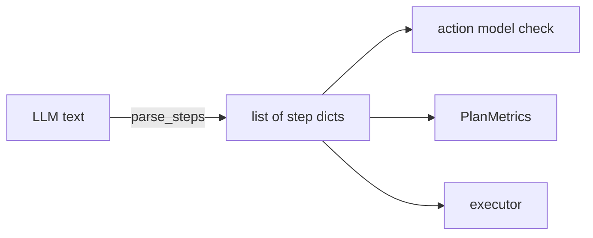

# Plan format and metrics

Every planner in embodiplan returns the same two things: a plan and a metrics record. This page shows what a plan looks like, which actions it may use, how raw LLM text is turned into a plan, and what each metrics field means. All outputs below were run offline.

!!! abstract "In this page"
    - A plan is a Python list of small dicts: `{"action": ..., "object": ...}`.
    - There are 14 actions. Three more can be switched on with an environment variable.
    - `parse_steps` is tolerant, but it reads only the key `steps`. `{"plan": [...]}` gives `[]`.
    - `PlanMetrics` records calls, tokens, time and step count. `extra` is not part of `to_dict()`.

!!! code "Where in the code"
    - [`ROBOT_ACTIONS` and the opt-in actions](https://github.com/mtbui2010/embodiplan/blob/a69064255c69/embodiplan/base.py#L53-L68)
    - [`STEP_SCHEMA`](https://github.com/mtbui2010/embodiplan/blob/a69064255c69/embodiplan/base.py#L72-L102)
    - [`PlanMetrics`](https://github.com/mtbui2010/embodiplan/blob/a69064255c69/embodiplan/base.py#L144-L181)
    - [`parse_steps`, `_text_fields`](https://github.com/mtbui2010/embodiplan/blob/76da520/embodiplan/base.py#L475-L520)

## What a plan is

A plan is an ordered list of steps. Each step is a dict with two required keys:

| key | meaning | example |
|---|---|---|
| `action` | one word from the action list below | `"MoveTo"` |
| `object` | the target, in CamelCase | `"CoffeeMachine"` |

Some steps carry extra keys: ReAct's parser adds `target` and `reason` ([`react.py`](https://github.com/mtbui2010/embodiplan/blob/a69064255c69/embodiplan/react.py#L55-L58)), and the prompt text shows `target` after the object when present. The symbolic checks read only `action` and `object`. Names are CamelCase because the household simulator AI2-THOR uses names such as `CoffeeMachine` and `Fridge` (see [The planning problem](planning-problem.md)).

```python
[{"action": "MoveTo", "object": "Kitchen"},
 {"action": "Find",   "object": "Mug"},
 {"action": "Pick",   "object": "Mug"}]
```



## The 14 actions

`ROBOT_ACTIONS` is the fixed vocabulary. The value below was printed by running the code:

```text
['MoveTo', 'Find', 'Pick', 'Place', 'PutIn', 'Open', 'Close', 'TurnOn', 'TurnOff', 'Wash', 'Sit', 'LieOn', 'Serve', 'Wait']
```

| group | actions |
|---|---|
| move and look | `MoveTo`, `Find` |
| hands | `Pick`, `Place`, `PutIn` |
| containers and devices | `Open`, `Close`, `TurnOn`, `TurnOff` |
| other | `Wash`, `Sit`, `LieOn`, `Serve`, `Wait` |

`MoveTo` is for rooms and furniture. `Find` is for objects that can be picked up. The rules the LLM reads are in `STEP_SCHEMA`; the rules the code enforces are in [Symbolic state](symbolic-state.md).

!!! note "Opt-in extra actions"
    If the environment variable `EMBODIPLAN_EXTRA_ACTIONS` (for example `"Heat,Cool,Clean"`) is set **before** `import embodiplan`, those names are appended to `ROBOT_ACTIONS`, and a short note is appended to `STEP_SCHEMA`. The old name `PYPLANNER_EXTRA_ACTIONS` still works. Without the variable, the default prompt text does not change. The list is built once, at import time.

## From LLM text to a plan: `parse_steps`

`parse_steps(raw)` never raises on bad text. It tries three things in order:

1. Remove code fences (the markers ```` ```json ```` and ```` ``` ````). Parse the whole text as JSON. A dict gives `data.get("steps", [])`. A list is returned as it is.
2. If that fails, find the first `[ ... ]` span and parse it.
3. If that fails, collect every `{...}` object that has no nested braces and has an `"action"` key.

If nothing works, it returns `[]`.

Then `_text_fields` cleans the list (since 0.2.6): an item that is not a dict is dropped, and a value of `action`, `object` or `target` that is not text (for example `{"action": "Wait", "object": 5}`) is turned into text (`'5'`); `None` stays `None`. Before, a number there made later `.strip()` calls fail. `parse_steps` is a thin wrapper: `_parse_steps` does the three tries, `_text_fields` the clean-up.

Real results (each input is one string):

| LLM text | result |
|---|---|
| `{"steps": [{"action": "MoveTo", "object": "Kitchen"}]}` | `[{'action': 'MoveTo', 'object': 'Kitchen'}]` |
| a fenced block holding `[{"action": "Find", "object": "Mug"}]` | `[{'action': 'Find', 'object': 'Mug'}]` |
| prose with two bare `{...}` objects (`Sure! First {...} then {...} done.`) | both steps, found by the regex fallback |
| `I cannot help with that.` | `[]` |
| `{"plan": [{"action": "MoveTo", "object": "Kitchen"}]}` | `[]` |

!!! warning "Only the key `steps` is read"
    A reply shaped as `{"plan": [...]}` is valid JSON, so step 1 succeeds and returns `data.get("steps", [])`, which is `[]`. The fallbacks are not tried. The steps are lost without an error. Ask for `{"steps": [...]}` (the prompts do) and check for an empty result.

Other limits that follow from the code: the parser does not check that `action` is in `ROBOT_ACTIONS` and does not check the keys of a step. Items that are not dicts are dropped by `_text_fields`; a dict with no `action` key is kept. Validation is the job of the [action model](symbolic-state.md).

## `PlanMetrics`

Every `generate_plan` and `replan` call returns `(steps, metrics)`.

| field | type | meaning |
|---|---|---|
| `method` | str | planner name |
| `model` | str | model name |
| `backend` | str | `ollama`, `openai` or `gemini` |
| `latency_s` | float | wall time in seconds |
| `llm_calls` | int | number of LLM calls made |
| `input_tokens` | int | prompt tokens |
| `output_tokens` | int | reply tokens |
| `num_steps` | int | number of steps in the plan |
| `parse_ok` | bool | default `True` |
| `notes` | str | free text |
| `extra` | dict | per-method details; **not** in `to_dict()` |

Two read-only properties: `total_tokens` (input plus output) and `tokens_per_step` (total divided by `num_steps`, or `0.0` when there are no steps). `to_dict()` rounds `latency_s` to 3 places and `tokens_per_step` to 1 place.

Run offline. The numbers are the ones typed into the constructor, not a measurement:

```python
from embodiplan import PlanMetrics
m = PlanMetrics(method="CoT", model="llama3.2", backend="ollama", latency_s=2.3456,
                llm_calls=1, input_tokens=500, output_tokens=80, num_steps=5)
print(m.to_dict())
```

```text
{'method': 'CoT', 'model': 'llama3.2', 'backend': 'ollama', 'latency_s': 2.346, 'llm_calls': 1, 'input_tokens': 500, 'output_tokens': 80, 'total_tokens': 580, 'num_steps': 5, 'tokens_per_step': 116.0, 'parse_ok': True, 'notes': ''}
```

Planners that need to report more (for example SAGE) put it in `metrics.extra`. If you save metrics with `to_dict()`, read `extra` yourself first. See the [planner overview](../planners/index.md) for the keys per planner and [LLM calls and cost](llm-calls.md) for how tokens are counted.

## Next

- [Symbolic state](symbolic-state.md): how a parsed plan is checked.
- [Planner interface and registry](../reference/interface.md): the full API.
