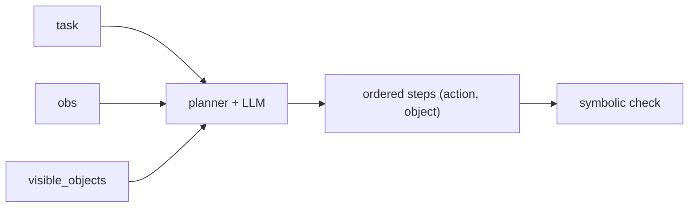

# The planning problem

This page explains what task planning means for a household robot, what the three inputs to a planner are, and what a good answer looks like. It also says why embodiplan pairs a language model with a symbolic check. It uses one real record from the dataset that ships with the package.

!!! abstract "In this page"
    - Input: a task in words, a text of what the robot sees (`obs`), and object names (`visible_objects`). Output: an ordered list of robot actions.
    - A good plan is not only sensible. Every step must be allowed in the state the robot will be in when it reaches that step.
    - A language model writes plans well but can break simple rules. A small symbolic check catches that without a model call.

!!! code "Where in the code"
    - [`base.py:604-610`](https://github.com/mtbui2010/embodiplan/blob/76da520/embodiplan/base.py#L604-L610): `_context_str`, the text a planner sends as the situation
    - [`embodiplan/data/eval_dataset_gt.json`](https://github.com/mtbui2010/embodiplan/blob/a69064255c69/embodiplan/data/eval_dataset_gt.json): the bundled tasks

## What task planning is

A person says "make a cup of coffee". A robot cannot act on that sentence. It needs a list of small actions, in order, such as go to the mug, pick it up, go to the coffee machine, turn the machine on. Finding that list is **task planning**. The planner embodiplan provides takes the sentence and the scene and returns the list.

The robots here live in a simulated house. embodiplan was built around [AI2-THOR](https://ai2thor.allenai.org/), a simulator of household rooms where objects have fixed type names written in CamelCase, such as `CoffeeMachine`, `Fridge` and `Toaster`. That explains the names you see below. This site covers only the planning part, not the simulator.

## The inputs

| input | type | meaning | value in the example below |
|---|---|---|---|
| `task` | `str` | what the user wants, in plain words | `"Make a cup of coffee using the coffee machine"` |
| `obs` | `str` | free text about the scene: position, what the robot holds, nearby objects with their state and distance | `"Location: (-1.00, 1.00), facing 270°\nHolding: nothing\nNearby objects: ..."` |
| `visible_objects` | `list[str]` | names of the objects the robot can see now | `["Cabinet", "CoffeeMachine", "Fridge", "Toaster"]` |

Only the first 30 names of `visible_objects` go into the prompt. The signature is in [Planner interface and registry](../reference/interface.md).

## One real example

The package ships `embodiplan/data/eval_dataset_gt.json`. It is a dict with a `samples` list; this file has 38 records (checked by loading it). Each record has `task_id`, `task_desc`, `room`, `scene`, `obs`, `visible_objects`, `reference_steps`, `expected_objects` and `difficulty`. Here is the first one, `K01`, trimmed (the `obs` object list is cut to three lines, and `_meta` and `fail_injection` are left out):

```json
{
  "task_id": "K01",
  "task_desc": "Make a cup of coffee using the coffee machine",
  "room": "kitchen",
  "scene": "FloorPlan1",
  "obs": "Location: (-1.00, 1.00), facing 270°\nHolding: nothing\nNearby objects:\n  - CreditCard [closed, off] (0.6m)\n  - Apple [closed, off] (0.8m)\n  - Cabinet [closed, off] (0.9m)\n  ...",
  "visible_objects": ["Cabinet", "CoffeeMachine", "Fridge", "Toaster"],
  "reference_steps": [
    {"action": "Navigate", "object": "Mug", "target": "", "reason": "Move to the mug"},
    {"action": "Grab", "object": "Mug", "target": "", "reason": "Pick up the mug"},
    {"action": "Navigate", "object": "CoffeeMachine", "target": "", "reason": "Move to the coffee machine"},
    {"action": "TurnOn", "object": "CoffeeMachine", "target": "", "reason": "Start brewing"}
  ],
  "expected_objects": ["Mug", "CoffeeMachine"],
  "difficulty": "easy"
}
```

The `obs` text lists each nearby object with its state (`closed`/`open`, `off`/`on`) and its distance. Note that `Mug` is **not** in `visible_objects`: the plan has to go and find it. The `reference_steps` use older action names (`Navigate`, `Grab`); the library maps them to its own names (`MoveTo`, `Pick`) when it checks them. The step format is in [Plan format and metrics](plan-format.md).

### What the planner sends

A planner turns the three inputs into one text with `_context_str`. This is the real text for `K01` (run offline; `Direct` was built with a placeholder host and nothing was sent):

```python
import json
from embodiplan import get
d = json.load(open("embodiplan/data/eval_dataset_gt.json"))
s = d["samples"][0]
p = get("Direct", host="http://127.0.0.1:1", model="fake")
print(p._context_str(s["task_desc"], s["obs"], s["visible_objects"]))
```

```text
User request: Make a cup of coffee using the coffee machine

Current robot observation:
Location: (-1.00, 1.00), facing 270°
Holding: nothing
Nearby objects:
  - CreditCard [closed, off] (0.6m)
  - Apple [closed, off] (0.8m)
  - Cabinet [closed, off] (0.9m)
  - Drawer [closed, off] (1.0m)
  - Egg [closed, off] (1.1m)
  - Bread [closed, off] (1.2m)
  - Toaster [closed, off] (1.2m)
  - Book [closed, off] (1.2m)

Objects currently visible:
Cabinet, CoffeeMachine, Fridge, Toaster
```

Each planner adds its own instructions before this text. They are in [Prompts](../reference/prompts.md).



## What a good output looks like

The output is a list of dicts, not prose. A program has to run each step, so it needs the action name and the object as separate fields, from a fixed list of actions. A good plan has three properties:

1. **Valid format.** Every step has a known action and an object name.
2. **Allowed in order.** A step must be allowed in the state the earlier steps leave. You cannot pick up a mug you have not found, or put an item in a closed fridge.
3. **Reaches the goal.** The steps achieve what the user asked.

The first two can be tested by rules. The third needs the simulator or a person, and this site does not cover it.

## Why an LLM plus a symbolic check

A language model understands "make a cup of coffee" and writes a reasonable plan in one call. But it works on text and has no model of the robot. It can write `Pick Mug` before any `Find Mug`, or forget to open a container. A small program that tracks a few facts (where the robot is, what it holds, which things are open) can test such rules exactly, costs no model tokens, and gives a clear reason when a step fails.

You can see this on the reference plan itself. Replaying its four steps through the symbolic rules (run offline):

```python
from embodiplan.action_model import simulate
print(simulate(s["reference_steps"]).summary())
```

```text
FAIL (1 violation(s)):
  step 2: [no_find_before_pick] Pick requires a preceding Find of the target object (Pick Mug)
```

The reference plan goes to the mug and grabs it, but never runs `Find Mug` first. Under embodiplan's rules that is an error. This shows that the rules are strict and specific to this action model, not that the dataset record is wrong for the simulator. The rules are in [Action model](../reference/action-model.md) and [Symbolic state](symbolic-state.md). The planner families that use the check are in the [planners overview](../planners/index.md).

## Next

- [Getting started](../getting-started.md): install and run a first plan offline.
- [Plan format and metrics](plan-format.md): the step dict and the action list.
