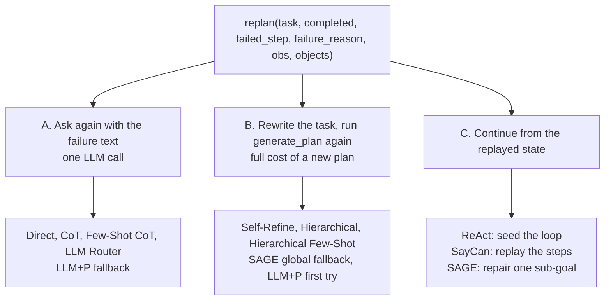

# Replanning

A plan can fail while a robot runs it. A door is shut, an object is not where the plan said, a step is refused. `replan` is the method every planner has for this case. You give it the task, what already ran, the step that failed and the reason. It returns new steps for the rest of the task.

!!! abstract "In this page"
    - `replan` has the same inputs for all 11 planners and returns `(steps, PlanMetrics)`. The steps are meant to be the **remaining** steps only.
    - The code has three strategies: ask the LLM again with the failure text, rewrite the task and plan again, or continue from the replayed state.
    - One planner, SayCan, never shows the failure reason to the LLM.
    - The table at the end gives, for each planner, the strategy, the use of `failure_reason`, and the `extra` keys.

!!! code "Where in the code"
    - [`BasePlanner.replan`](https://github.com/mtbui2010/embodiplan/blob/a69064255c69/embodiplan/base.py#L572-L581) (the contract; the body is `...`)
    - [`BasePlanner._replan_context`](https://github.com/mtbui2010/embodiplan/blob/a69064255c69/embodiplan/base.py#L592-L605)
    - Each planner's own `replan` is linked from its page in the table below.

## The contract

```python
planner.replan(task, completed, failed_step, failure_reason, obs, visible_objects)
```

| argument | type | meaning |
|---|---|---|
| `task` | `str` | the same task string given to `generate_plan` |
| `completed` | `list[dict]` | steps that ran well, in order. `[]` is allowed |
| `failed_step` | `dict` | the step that failed (`action`, `object`, and maybe `target`) |
| `failure_reason` | `str` | free text from the executor, for example `"Mug not reachable"` |
| `obs` | `str` | the text of the scene now |
| `visible_objects` | `list[str]` | object names now; prompts list at most the first 30 |

The base method only declares this signature ([`base.py:572-581`](https://github.com/mtbui2010/embodiplan/blob/a69064255c69/embodiplan/base.py#L572-L581)). It returns `(steps, PlanMetrics)`, the same pair as `generate_plan`. See [Planner interface](../reference/interface.md) and [Plan format and metrics](plan-format.md).

!!! note "What "remaining steps only" means in code"
    Only ReAct and SayCan cut the list in code: they return what they produced after `completed`. The other planners ask for "only the remaining steps" in the prompt. Nothing checks that the reply obeys. If the LLM repeats a completed step, that step is in the result.

## The shared failure text

Direct, CoT, Few-Shot CoT, the LLM Router (through Direct) and the LLM+P fallback build their user message with `_replan_context`. This is its real output for the task "make coffee", with `MoveTo Kitchen` done and `Pick Mug` failed (run offline; no LLM is involved in building this text):

```text
User request: make coffee

Steps already completed:
  1. MoveTo Kitchen

Failed step:
  action : Pick
  object : Mug
  target : 
  reason : Mug not reachable

Current observation:
Kitchen, a counter

Visible objects:
Mug, CoffeeMachine

Generate ONLY the remaining steps. Do NOT repeat completed steps. Fix the root cause.
```

CoT and Few-Shot CoT add one more closing line after it. The system prompt is the planner's usual one.

## Three strategies



**A. Ask again with the failure text.** One call with the `_replan_context` message. Nothing else changes. The planner does not run its checks again. The reply is parsed like a normal plan.

**B. Rewrite the task and plan again.** The planner builds a longer task string that holds the done steps (or only the failed step) and the reason. It then runs `generate_plan` on that string. A replan costs as much as a new plan. The only difference from the first plan is the task text. Examples of the text:

- Self-Refine: `"<task>. Previous step failed — <action> <object>: <reason>. Generate only the remaining steps, fixing the failure."` It ignores `completed`.
- Hierarchical, Hierarchical Few-Shot and SAGE global: `"<task>. Already done: <steps>. Last action failed (<action> <object>): <reason>. Generate only the remaining steps."`
- LLM+P: a note added after the task, then the PDDL translate-and-solve code runs again; it falls back to strategy A when that gives no steps.

**C. Continue from the state.** The planner keeps the done steps and goes on from there.

- ReAct puts `completed` as the first steps of the loop, adds a `[FAILURE] ...` line to `obs`, and runs for at most `max_steps - len(completed)` turns.
- SayCan replays `completed` into a fresh symbolic state and decodes again. It does not use `failure_reason` or `obs`.
- SAGE finds the sub-goal that holds the failed step and asks for the rest of that sub-goal from the believed state. Later sub-goals are kept as they are. It falls back to strategy B when there is no earlier plan for the same task string, or when `enable_local_repair=False`. See [SAGE, repair and editing](../planners/sage-repair.md).

## Comparison: how each planner replans

"Run" in the last column means a scripted-LLM run of this `replan` (the planner code runs, the LLM text is fixed). A cell marked "not run" is read from the code only. "Calls" is for the replan; the number of calls in a loop depends on the scripted or real replies.

| planner (key) | strategy | `failure_reason` used? | uses `completed`? | LLM calls in `replan` | `extra` keys returned | status |
|---|---|---|---|---|---|---|
| Direct (`"Direct"`) | A: `_replan_context`, one call, T 0.2 | yes, in the prompt | yes, in the prompt | 1 | none (`{}`) | run |
| CoT (`"CoT"`) | A: `_replan_context` + "Think carefully about the failure", T 0.3 | yes, in the prompt | yes, in the prompt | 1 | `reasoning` | run |
| Few-Shot CoT (`"Few-Shot CoT"`) | A: `_replan_context` + "Now generate the Reasoning and remaining Plan:", T 0.2, NL fallback kept | yes, in the prompt | yes, in the prompt | 1 | `reasoning`, `fallback_used` | run |
| Self-Refine (`"Self-Refine"`) | B: one new task text, then the full plan-critique-refine loop | yes, in the new task text | no, ignored | same as `generate_plan`: 1 + 2 per round (up to `max_iterations`) | `critiques`, `iterations` | run |
| ReAct (`"ReAct"`) | C: loop seeded with `completed`; `[FAILURE]` line appended to `obs` | yes, in `obs` | yes, as the seed; only steps after it are returned | 1 per step, plus the `Done` call, within `max_steps - len(completed)` | `thoughts` | run |
| Hierarchical (`"Hierarchical"`) | B: new task text, full decompose and expand | yes, in the new task text | yes, as text | 1 + N (N = sub-goals) | `subgoals` | run |
| LLM Router (`"LLM Router"`) | A through the inner Direct `replan`, then the external check again | yes (inner Direct prompt); the verifier does not see it | yes (inner Direct prompt); the verifier does not see it | inner 1, plus 1 for the check (counted even when skipped) | none (`{}`); the check note is in `notes` | run for the skipped-check path; a real verifier call not run |
| Hierarchical Few-Shot (`"Hierarchical Few-Shot"`) | B: same text as Hierarchical; example retrieval runs again on the longer string | yes, in the new task text | yes, as text | 1 + N | `subgoals`, `retrieved_tasks` | run; whether retrieval picks other examples: not run |
| SAGE (`"SAGE"`), local | C: suffix repair of one sub-goal from the believed state, T 0.1; later blocks kept | yes, in the repair prompt | yes: to find the sub-goal and the state; the last 6 are shown | 1, plus up to one refine when the gate rejects (`notes="local_repair"`) | `repaired_subgoal`, `refines`, `verifier_rejections`, `refine_rejected`, `suffix_len`, `kept_future_len` | run |
| SAGE, global fallback | B: same text as Hierarchical, then the full SAGE flow | yes, in the new task text | yes, as text | decompose + N expand + refines (`notes="global_replan_fallback"`) | the seven `generate_plan` keys (`subgoals`, `retrieved_tasks`, `refines`, ...) | run |
| LLM+P (`"LLM+P"`) | B first (note added to the task, PDDL translate and solve), then A as a fallback | yes, in the task note and in the fallback prompt | yes, as text in the note, and in the fallback prompt | translate calls (1 or 2), plus 1 for the fallback | `llmp_fallback`, `llmp_error` (no `llmp_solve_s`) | fallback path run; the classical solve not run (`pyperplan` not installed) |
| SayCan (`"SayCan"`) | C: replay `completed` into a fresh state, then score candidates again, T 0.0 | **no**: it is not in the prompt | yes: replayed without a check | 1 per step, plus the final `done` call | none (`{}`); `notes="replan_after:<action>"` | run |

Each planner page has the exact prompts, the code link and an example in its `replan` section:
[Direct, CoT, Few-Shot CoT](../planners/single-call.md), [Self-Refine and LLM Router](../planners/critique.md), [ReAct and SayCan](../planners/stepwise.md), [Hierarchical and Hierarchical Few-Shot](../planners/hierarchical.md), [LLM+P](../planners/llm-p.md), [SAGE planning](../planners/sage.md) and [SAGE repair](../planners/sage-repair.md).

!!! warning "Things to know before you rely on `replan`"
    - **The world state is not checked in strategies A and B.** Only SAGE (local) and SayCan track a symbolic state across a replan. For the others the LLM must infer the state from the text.
    - **`extra` is empty for Direct, the LLM Router and SayCan.** Do not read `metrics.extra[...]` without a default. `extra` is also not part of `PlanMetrics.to_dict()` ([Plan format and metrics](plan-format.md)).
    - **Cost.** Strategy B costs as much as a new plan. See [LLM calls and cost](llm-calls.md) for the per-planner call counts; no latency or token number is given here because none was measured.
    - **Host.** A planner built without `host=` sends its prompts to `http://ollama.aistations.org`. Pass `host=` (for example `http://localhost:11434`) for a local server.

## Example (scripted)

Every planner was called with the same `replan` arguments and a fake `_chat` that returns fixed text, with the API keys unset. The planner code is real; only the text is fixed. The numbers below are counts from the code path, not model output. This is the line for Direct, **with a scripted LLM reply**:

```python
from embodiplan import DirectPlanner

p = DirectPlanner(host="http://127.0.0.1:1", model="fake")   # nothing is sent: _chat is replaced
p._chat = lambda messages, temperature=0.2: (
    '{"steps":[{"action":"Find","object":"Mug"},{"action":"Pick","object":"Mug"}]}', 0, 0)
steps, m = p.replan("make coffee", [{"action": "MoveTo", "object": "Kitchen"}],
                    {"action": "Find", "object": "Mug"}, "Mug not visible", "Kitchen", ["Mug"])
print(len(steps), m.llm_calls, sorted(m.extra))
```

```text
2 1 []
```

The `extra` keys and call counts in the table were confirmed the same way for all 11 registry planners (a loop over `embodiplan.REGISTRY`, not shown here).

## Next

- [Planner overview and comparison](../planners/index.md): the same 11 planners by family.
- [Symbolic state](symbolic-state.md): the state that SayCan and SAGE replay.
