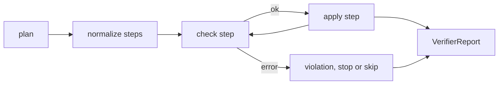

# Symbolic state

Before a robot runs a plan, you can check it without calling an LLM. embodiplan keeps a tiny model of the world and of each action's rules. It replays the plan on that model and reports which step breaks which rule. The check is deterministic and costs no tokens.

!!! abstract "In this page"
    - The world is five fields: `arrived`, `found`, `holding`, `opened`, `on`.
    - Each action has preconditions (`check`) and effects (`apply`). `simulate` runs them over a whole plan.
    - Rule breaks are typed codes such as `hand_full`. Errors make a plan fail. Warnings do not.
    - The robot body matters: with one hand (the default) the Fridge plan below fails. With two hands it passes.
    - The model has no idea what is inside a container.

!!! code "Where in the code"
    - [`Capabilities`](https://github.com/mtbui2010/embodiplan/blob/a69064255c69/embodiplan/action_model.py#L56-L80) and [`SymbolicState`](https://github.com/mtbui2010/embodiplan/blob/a69064255c69/embodiplan/action_model.py#L98-L134)
    - [`check`](https://github.com/mtbui2010/embodiplan/blob/a69064255c69/embodiplan/action_model.py#L260-L367), [`apply`](https://github.com/mtbui2010/embodiplan/blob/a69064255c69/embodiplan/action_model.py#L378-L416), [`simulate`](https://github.com/mtbui2010/embodiplan/blob/a69064255c69/embodiplan/action_model.py#L422-L481)
    - SAGE calls it through its own [`_simulate`](https://github.com/mtbui2010/embodiplan/blob/a69064255c69/embodiplan/sage.py#L426-L428), which adds the planner's capabilities.

## The state

The model is in the style of classic STRIPS planning: a state, preconditions that must hold before an action, and effects that change the state after it.

| field | type | meaning |
|---|---|---|
| `arrived` | str or None | last `MoveTo` target |
| `found` | str or None | last `Find` target (the thing the robot can act on) |
| `holding` | str or None | object in the hand |
| `opened` | set | containers that are open |
| `on` | set | devices that are on |

`SymbolicState` also has a `visible` set (filled from `visible_objects`); the rules above do not use it. `as_text()` prints the five fields on one line, and that text is what prompts show.

## Preconditions and effects

`check(step, world)` returns a list of violations and does not change the world. `apply(step, world)` returns a **copy** of the world after the step (pass `inplace=True` to change it). Main rules, read from the code:

| action | precondition (error code if broken) | effect |
|---|---|---|
| `MoveTo` | object not empty (`empty_object`); already there gives warning `already_there` | `arrived` = target; `found` is cleared unless it equals the target |
| `Find` | not already holding it (`find_held`) | `found` = target |
| `Pick` | hand free (`already_holding`); a `Find` came first (`no_find_before_pick`); object equals last `Find` (`pick_not_found`) | `holding` = object; `found` cleared |
| `Place`, `PutIn` | holding something (`place_without_holding`); at the target (`place_wrong_location`); for `PutIn` into a container, it is open (`putin_closed_container`) | `holding` cleared |
| `Open`, `Close`, `TurnOn`, `TurnOff`, `Wash` | within reach (`interact_without_find`); not already in that state (`already_open`, `close_not_opened`, `already_on`, `turnoff_not_on`) | update `opened` or `on` |
| `Open`, `Close` | hand free if one hand (`hand_full`) | |
| `Serve` | holding something, otherwise warning `serve_without_holding` | none |
| `Sit`, `LieOn`, `Wait` | none | none |

Two more codes: `unknown_action` (name not in `ROBOT_ACTIONS`, after alias mapping such as `grab` to `Pick`) and `find_wrong_place` / `not_openable` / `treat_without_holding`, which apply only when you pass `object_places`, `openable`, or enable the extra actions. Warnings are `already_there` and `serve_without_holding`. `check` lists errors before warnings; for a step, `simulate` records only the first error.

"Within reach" means the robot is at the object (`arrived`) or, when `find_reaches` is true, has found it.

## Capabilities: the robot's body

```python
Capabilities(hands=1, find_reaches=True)
```

- `hands`: with fewer than 2 hands, `Open` and `Close` need the hand to be empty. This is the `hand_full` rule.
- `find_reaches`: `True` means a `Find` brings the target within reach, as in AI2-THOR. `False` is for a robot whose `Find` only looks.

You can pass a `Capabilities` object or a dict. `hands` can be a number or a list (its length is used); `arms` is read if `hands` is missing. Running `Capabilities.from_any({"hands": ["left", "right"]})` printed `Capabilities(hands=2, find_reaches=True)`. The default is one hand.



## `simulate`: a whole plan

`simulate(plan, ...)` normalizes the steps, then for each step calls `check` and, if there is no error, `apply`. It returns a `VerifierReport` with `ok`, `violations` (errors), `warnings`, `final_state` and `num_steps`. By default it stops at the first error. With `stop_on_error=False` it keeps going and skips the effects of the rejected step (or applies them if `apply_on_error=True`).

## Worked example: a Fridge plan

Plan: `MoveTo Fridge`, `Open Fridge`, `Find Apple`, `Pick Apple`, `Close Fridge`. Run offline, with no LLM.

```python
from embodiplan.action_model import simulate
plan = [{"action": a, "object": o} for a, o in [
    ("MoveTo", "Fridge"), ("Open", "Fridge"), ("Find", "Apple"),
    ("Pick", "Apple"), ("Close", "Fridge")]]
r = simulate(plan)
print(r.ok); print(r.summary())
r2 = simulate(plan, capabilities={"hands": 2})
print(r2.ok, r2.summary()); print(r2.final_state.as_text())
```

```text
False
FAIL (1 violation(s)):
  step 5: [hand_full] cannot Close 'Fridge' while holding 'Apple' (one hand) (Close Fridge)
True OK (5 steps verified)
arrived: Fridge | found: ∅ | holding: Apple | opened: ∅ | on: ∅
```

The state after each prefix, from `apply` (copied from the run):

| after step | state |
|---|---|
| 1 `MoveTo Fridge` | `arrived: Fridge \| found: ∅ \| holding: ∅ \| opened: ∅ \| on: ∅` |
| 2 `Open Fridge` | `arrived: Fridge \| found: ∅ \| holding: ∅ \| opened: ['Fridge'] \| on: ∅` |
| 3 `Find Apple` | `arrived: Fridge \| found: Apple \| holding: ∅ \| opened: ['Fridge'] \| on: ∅` |
| 4 `Pick Apple` | `arrived: Fridge \| found: ∅ \| holding: Apple \| opened: ['Fridge'] \| on: ∅` |
| 5 `Close Fridge` | `arrived: Fridge \| found: ∅ \| holding: Apple \| opened: ∅ \| on: ∅` |

The plan is sensible for a robot with two hands (one holds the apple, one closes the door). With one hand, closing while holding is rejected.

!!! warning "The prompt examples hit this rule"
    The container example in the prompt text (`JSON_EXAMPLE`) and the "typical" container sequence in `STEP_SCHEMA` also fail `hand_full` under the default one-hand setting, as the plan above does. They pass with `hands=2`. If your robot (or AI2-THOR's agent) can close a door while holding an item, pass `capabilities={"hands": 2}`.

## Other real outputs

All from the same offline run:

```text
check(Pick Mug, empty state)        -> no_find_before_pick (error)
check(MoveTo Kitchen, at Kitchen)   -> already_there (warning)
simulate([Pick Mug, Place Sofa], stop_on_error=False)
  step 1: [no_find_before_pick] Pick requires a preceding Find of the target object (Pick Mug)
  step 2: [place_without_holding] Place requires holding an object (Place Sofa)
simulate([Hop x])                   -> [unknown_action] action 'Hop' not in the action vocabulary
```

In the second `simulate`, `Place Sofa` also fails `place_wrong_location`, but only the first error per step is recorded.

## What the model does not know

!!! warning "No containment"
    The world has no record of which object is inside which container. `MoveTo Fridge`, `Find Apple`, `Pick Apple` with the Fridge **closed** is accepted. The run printed `True` for exactly that plan. The rule "open the container first" is enforced only for `PutIn` into a container. Another limit: `MoveTo` clears `found` unless the destination equals it, so `Find X` then `MoveTo Y` then `Pick X` fails.

## How planners use it

SAGE simulates each sub-plan, turns violations into feedback text for a refine call, and uses the state at a failure point to repair a plan; SayCan uses the checks as an affordance term. See [SAGE planning](../planners/sage.md), [SAGE repair](../planners/sage-repair.md) and the [action model reference](../reference/action-model.md).
