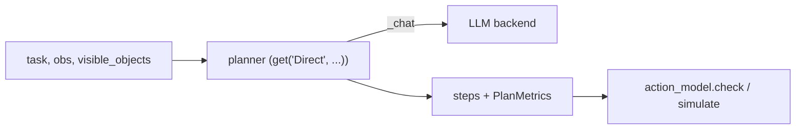

# Getting started

This page takes you from nothing to a first plan. You install the package, pick a language-model backend, make one planning call, read the result, and check the plan with the symbolic rules. The call that uses a real model is shown but was **not run** (no LLM server was available when these docs were written). The same call is then run fully offline with a scripted reply, and that output is real.

!!! abstract "In this page"
    - Install from a clone or from GitHub. Python 3.10 or newer.
    - Backends are `ollama`, `openai` and `gemini`. `anthropic` is not supported.
    - The default host is a remote server. Pass `host=` for a local one.
    - You can run and test everything offline by replacing `_chat`.

!!! code "Where in the code"
    - [`__init__.py:113-140`](https://github.com/mtbui2010/embodiplan/blob/76da520/embodiplan/__init__.py#L113-L140): `get`
    - [`base.py:23`](https://github.com/mtbui2010/embodiplan/blob/76da520/embodiplan/base.py#L23): `DEFAULT_HOST`
    - [`base.py:260-270`](https://github.com/mtbui2010/embodiplan/blob/76da520/embodiplan/base.py#L260-L270): the provider dispatch and its `ValueError`
    - [`pyproject.toml`](https://github.com/mtbui2010/embodiplan/blob/76da520/pyproject.toml): version, Python and dependencies



## 1. Install

`pyproject.toml` names the package `embodiplan` (version `0.2.7`) and requires Python `>=3.10`. The core dependencies are `ollama>=0.2.0` and `requests>=2.31.0`.

=== "From a clone"

    ```bash
    git clone https://github.com/mtbui2010/embodiplan.git
    cd embodiplan
    pip install -e .
    ```

=== "From GitHub"

    ```bash
    pip install git+https://github.com/mtbui2010/embodiplan.git
    ```

Optional extras from `pyproject.toml`: `memory` (Chroma for SAGE memory), `llmp` (`pyperplan` for LLM+P), `all`. For example `pip install -e ".[memory]"`.

!!! note "About PyPI"
    The README shows `pip install embodiplan`. No page here checked that the package is published there, so the two commands above are the ones to use. These install commands were not run when this page was written.

Check that the import works:

```python
import embodiplan
print(len(embodiplan.REGISTRY))
```

It prints `11`, the number of planners.

## 2. Choose a backend

| `provider` | needs | notes |
|---|---|---|
| `ollama` (default) | a server at `host` | no key. Default model is `llama3.3:70b` |
| `openai` | `api_key=` or env `OPENAI_API_KEY` | OpenAI chat completions |
| `gemini` | `api_key=` or env `GEMINI_API_KEY` | Gemini `generateContent` |

`provider="anthropic"` is not supported: the backend raises `ValueError`, but a planner hides it and returns an empty plan (see the last section). Details are in [LLM calls and cost](concepts/llm-calls.md).

!!! warning "The default host is a remote server"
    A planner built without `host=` sends its prompts to `http://ollama.aistations.org`. For a server on your machine, pass `host="http://localhost:11434"`.

## 3. The call with a real model (not run)

```python
from embodiplan import get

planner = get(
    "Direct",
    host="http://localhost:11434",   # your own Ollama server
    model="llama3.3:70b",            # a model you have pulled
)
steps, metrics = planner.generate_plan(
    task="make coffee",
    obs="Kitchen.",
    visible_objects=["Mug", "CoffeeMachine"],
)
```

For OpenAI or Gemini, add `provider="openai", api_key="sk-..."` (a placeholder; use your own key) and a model name of that provider. This code was **not run**: it needs a live model, and the reply would differ between runs.

## 4. The same call, offline

Every planner calls the model through one method, `self._chat(messages, temperature)`. If you replace it with a function that returns fixed text, the planner's own code (prompt building, parsing, metrics) still runs and nothing goes over the network. This is the recipe used by the repository's tests ([`tests/test_sage_repair.py:17-35`](https://github.com/mtbui2010/embodiplan/blob/76da520/tests/test_sage_repair.py#L17-L35)).

```python
from embodiplan import get

REPLY = '{"steps": [{"action": "MoveTo", "object": "Kitchen"}, {"action": "Find", "object": "Mug"}, {"action": "Pick", "object": "Mug"}]}'
planner = get("Direct", host="http://127.0.0.1:1", model="fake")
planner._chat = lambda messages, temperature=0.2: (REPLY, 100, 20)
steps, m = planner.generate_plan("make coffee", "Kitchen.", ["Mug", "CoffeeMachine"])
for i, s in enumerate(steps, 1):
    print(i, s["action"], s["object"])
print(m.num_steps, m.parse_ok, m.llm_calls, m.total_tokens)
```

Output, with a scripted LLM reply (the token numbers 100 and 20 are the fake's, not a measurement):

```text
[Direct] 3 steps in 0.0s
1 MoveTo Kitchen
2 Find Mug
3 Pick Mug
3 True 1 120
```

The first line is the planner's own summary print.

## 5. Read the result

`steps` is a list of dicts. Each has an `action` and an `object`; some planners add `target` and `reason`. `metrics` is a `PlanMetrics`.

| field | value above | meaning |
|---|---|---|
| `num_steps` | `3` | length of the plan |
| `parse_ok` | `True` | a plan was parsed from the reply |
| `llm_calls` | `1` | Direct makes one call |
| `total_tokens` | `120` | input plus output tokens (from the fake) |

An empty `steps` with `parse_ok=False` means the reply could not be parsed or the call failed. See [Plan format and metrics](concepts/plan-format.md) and [Planner interface and registry](reference/interface.md).

## 6. Check the plan

The rules in `action_model` need no LLM. `check` tests one step in one world state; `simulate` replays a whole plan.

```python
from embodiplan.action_model import SymbolicState, check, simulate

print([(v.code, v.severity) for v in check({"action": "Pick", "object": "Mug"}, SymbolicState())])
print(simulate(steps).summary())
print(simulate([{"action": "Pick", "object": "Mug"}]).summary())
```

Real output (`steps` is the plan from step 4):

```text
[('no_find_before_pick', 'error')]
OK (3 steps verified)
FAIL (1 violation(s)):
  step 1: [no_find_before_pick] Pick requires a preceding Find of the target object (Pick Mug)
```

`Pick` without an earlier `Find` is rejected; the plan from step 4 finds the mug first and passes. More in [Action model](reference/action-model.md) and [Symbolic state](concepts/symbolic-state.md).

## 7. A common error: `anthropic`

```python
from embodiplan.base import LLMBackend
LLMBackend(provider="anthropic").chat([])
```

```text
ValueError: Unknown provider 'anthropic'. Use: ollama, openai, gemini
```

The README and some docstrings mention Anthropic; the code does not support it. Use `ollama`, `openai` or `gemini`.

!!! warning "A planner hides this error"
    `get("Direct", provider="anthropic", ...).generate_plan(...)` does **not** raise. Direct catches the exception and returns `[]` with `parse_ok=False` and `llm_calls=1` (real result, run offline). If you get an empty plan, check the provider, host and key first.

A second surprise: `from embodiplan import cot` gives a factory **function**, not the module `embodiplan/cot.py`. Use `from embodiplan.cot import CoTPlanner` to reach the class.

## Next

- [Planners overview](planners/index.md): the 11 planners and when to use each.
- [The planning problem](concepts/planning-problem.md): what the inputs mean, with a real example.
- [Pitfalls](pitfalls.md): the known traps in one list.
