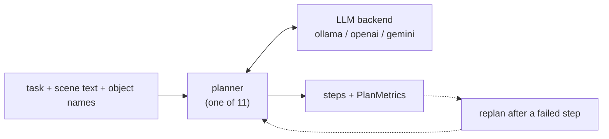

---
hide:
  - navigation
---

# embodiplan

**Turn a household task into a checked, step-by-step robot plan with an LLM, using one interface for 11 planning algorithms.**

You give a planner a task in words ("make coffee"), a short description of the scene, and the names of the objects the robot can see. You get back a list of steps such as `MoveTo Kitchen`, `Find Mug`, `Pick Mug`, plus metrics (LLM calls, tokens, time). This is useful because you can compare algorithms with one call, and because some planners check each plan with a symbolic action model before they return it.



## In one minute

The planner's own code runs here. Only the LLM reply is fixed by hand, so no server is needed.

```python
from embodiplan import get
REPLY = '{"steps": [{"action": "MoveTo", "object": "Kitchen"}, {"action": "Find", "object": "Mug"}, {"action": "Pick", "object": "Mug"}]}'
planner = get("Direct", host="http://127.0.0.1:1", model="fake")
planner._chat = lambda messages, temperature=0.2: (REPLY, 100, 20)
steps, m = planner.generate_plan("make coffee", "Kitchen.", ["Mug", "CoffeeMachine"])
print(steps)
print(m.llm_calls, m.num_steps, m.parse_ok)
```

Output, with a scripted LLM reply:

```text
[Direct] 3 steps in 0.0s
[{'action': 'MoveTo', 'object': 'Kitchen'}, {'action': 'Find', 'object': 'Mug'}, {'action': 'Pick', 'object': 'Mug'}]
1 3 True
```

A real backend needs `host=` (a server you run) or an API key. This call was not run:

```python
planner = get("Direct", host="http://localhost:11434")   # not run: needs a running Ollama server
```

!!! warning "Default host"
    A planner built without `host=` sends its prompts to `http://ollama.aistations.org` ([`base.py:23`](https://github.com/mtbui2010/embodiplan/blob/76da520/embodiplan/base.py#L23)). Pass `host=` for a local server. The backends are `ollama`, `openai` and `gemini`; `provider="anthropic"` raises `ValueError`.

## What it gives you

| The problem | What embodiplan does |
|---|---|
| Each LLM-planning method has its own code and output shape | One `BasePlanner` interface: `generate_plan` and `replan`, with `PlanMetrics` for every planner |
| LLM text is messy | A tolerant parser turns it into steps over a fixed set of 14 actions |
| An LLM plan can break simple rules (pick up something you have not found) | A zero-token symbolic action model replays the plan and lists violations; SAGE and SayCan use it |
| Testing a planner needs a live model | Every planner calls the model through one method, `_chat`, so you can replace it with a fake (the LLM Router verifier is the one exception) |
| A step fails in the middle of a run | `replan` takes the completed steps and the failure; SAGE re-plans only the failed sub-goal |
| Cost is unclear | Each result reports `llm_calls` and token counts; the call pattern of each family is documented |
| A robot has fewer actions than the default set | `SAGEPlanner(actions=[...], robot_description=...)` rewrites the prompts |

## The 11 planners

Direct, CoT, Few-Shot CoT, Self-Refine, ReAct, Hierarchical, LLM Router, Hierarchical Few-Shot, SAGE, LLM+P and SayCan. See the [overview and comparison](planners/index.md).

## Verified so far

The repository's offline tests (`tests/`) were run with `pytest` on the merged 0.2.7 code (commit 76da520): **104 passed**. The code examples on these pages were run offline with a scripted LLM reply.

**Not yet done:**

- No real LLM call was made, so this site gives no latency, token or accuracy numbers.
- Chroma-based retrieval and the LLM+P solver were not run.

robot_agent, a separate repository, uses embodiplan's SAGE planner and action model as its planning backend.

## Where to go next

- [Key ideas](key-ideas.md): the eight ideas behind the library.
- [Getting started](getting-started.md): install and run a first planner.
- [Known pitfalls](pitfalls.md): defects and how to avoid them.

embodiplan is released under the MIT licence. Source: [github.com/mtbui2010/embodiplan](https://github.com/mtbui2010/embodiplan).
