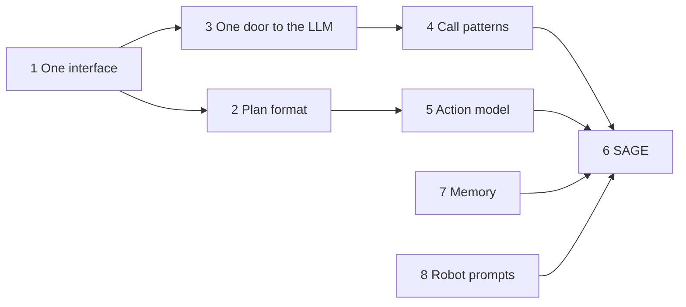

# Key ideas

embodiplan rests on eight ideas. Read them in order: each one builds on the one before. For each idea you get the statement, why it matters, the code that shows it, and where to read more.

!!! abstract "In this page"
    - Ideas 1 to 4 are about **structure**: one interface, one plan format, one door to the LLM, and a few ways to spend LLM calls.
    - Ideas 5 to 8 are about **checking and context**: a symbolic action model, SAGE, retrieved examples, and robot-specific prompts.
    - The planner pages show the details. This page only points to them.

## 1. One interface, many algorithms

**Every planner is a `BasePlanner` with the same two methods, `generate_plan` and `replan`.**

Callers change the algorithm by changing a registry key, and the returned `PlanMetrics` can be compared across algorithms. The registry holds 11 planners.

- Evidence: [`base.py:506-581`](https://github.com/mtbui2010/embodiplan/blob/a69064255c69/embodiplan/base.py#L506-L581) (the base class), [`__init__.py:98-110`](https://github.com/mtbui2010/embodiplan/blob/a69064255c69/embodiplan/__init__.py#L98-L110) (the registry).
- Read more: [The planning problem](concepts/planning-problem.md), [Planner interface and registry](reference/interface.md).

## 2. A plan is a list of small dicts over a fixed action vocabulary

**A plan is a list of `{"action": ..., "object": ...}` steps. There are 14 actions, and a tolerant parser turns LLM text into steps.**

Everything after the LLM (the checker, the metrics, an executor) reads only `action` and `object`, so one format serves all planners.

- Evidence: [`ROBOT_ACTIONS`, `base.py:53-57`](https://github.com/mtbui2010/embodiplan/blob/a69064255c69/embodiplan/base.py#L53-L57), [`parse_steps`, `base.py:475-500`](https://github.com/mtbui2010/embodiplan/blob/a69064255c69/embodiplan/base.py#L475-L500).
- Read more: [Plan format and metrics](concepts/plan-format.md), [Prompts](reference/prompts.md).

## 3. The LLM is reached through one method

**Planners call the model through `self._chat(messages, temperature)`, which returns `(text, in_tokens, out_tokens)`.**

The backend (`ollama`, `openai`, `gemini`) can be swapped, and you can run a planner offline by replacing `_chat` with a function that returns fixed text. The repository's tests do this. One exception: the verifier step of the LLM Router calls `requests.post` directly; only its inner Direct planner uses `_chat`.

- Evidence: [`BasePlanner._chat`, `base.py:530-551`](https://github.com/mtbui2010/embodiplan/blob/a69064255c69/embodiplan/base.py#L530-L551), [the router's verifier, `llm_router.py:57-119`](https://github.com/mtbui2010/embodiplan/blob/a69064255c69/embodiplan/llm_router.py#L57-L119), [a fake `_chat` in a test, `tests/test_sage_repair.py:17-35`](https://github.com/mtbui2010/embodiplan/blob/a69064255c69/tests/test_sage_repair.py#L17-L35).
- Read more: [LLM calls and cost](concepts/llm-calls.md), [Planner overview](planners/index.md).

## 4. Algorithms differ in how they spend LLM calls

**There are five patterns: one call; generate then critique; one step per call; decompose then expand; translate to PDDL.**

The pattern sets the cost (`llm_calls`, tokens) and how a planner fails, so choose the family first and the algorithm second.

- Evidence: each planner file, for example [`sage.py:560-728`](https://github.com/mtbui2010/embodiplan/blob/a69064255c69/embodiplan/sage.py#L560-L728) (decompose, then expand per sub-goal). The call counts are in the table on the LLM calls page.
- Read more: [LLM calls and cost](concepts/llm-calls.md), [Single-call](planners/single-call.md), [Critique](planners/critique.md), [Stepwise](planners/stepwise.md), [Hierarchical](planners/hierarchical.md), [LLM+P](planners/llm-p.md).

## 5. A zero-token symbolic action model checks plans

**A small world of five fields (`arrived`, `found`, `holding`, `opened`, `on`) with a precondition check and an effect for each action replays a plan and reports violations.**

It is deterministic and uses no tokens, so it can check every plan block cheaply. SAGE uses it as a gate; SayCan uses it to score whether an action is allowed.

- Evidence: [`check`, `apply`, `simulate` in `action_model.py:260-481`](https://github.com/mtbui2010/embodiplan/blob/a69064255c69/embodiplan/action_model.py#L260-L481).
- Read more: [Symbolic state](concepts/symbolic-state.md), [Action model reference](reference/action-model.md).

## 6. SAGE combines the pieces

**SAGE decomposes the task, expands each sub-goal, gates each block with the action model, refines at most `max_refines` times, and repairs locally after a failure.** When the caller gives the sub-goals, SAGE skips the decompose ([details](planners/sage.md#when-the-caller-gives-the-sub-goals)).

Violations become text feedback for one refine call per block, and a refine that verifies worse is dropped. When a step fails at run time, only the failed sub-goal is re-planned, starting from the believed state. It is the most complete planner in the library.

- Evidence: [`generate_plan`, `sage.py:560-728`](https://github.com/mtbui2010/embodiplan/blob/a69064255c69/embodiplan/sage.py#L560-L728), [`replan`, `sage.py:733-863`](https://github.com/mtbui2010/embodiplan/blob/a69064255c69/embodiplan/sage.py#L733-L863), [`_worse`, `sage.py:939-947`](https://github.com/mtbui2010/embodiplan/blob/a69064255c69/embodiplan/sage.py#L939-L947).
- Read more: [Replanning](concepts/replanning.md), [SAGE, planning](planners/sage.md), [SAGE, repair and editing](planners/sage-repair.md).

## 7. Retrieved examples steer SAGE, so memory must be clean

**SAGE can paste the top-k similar past plans into its prompts. Its example pool is empty unless you pass `gt_path` or `live_path`.**

A wrong example is copied into the next plan, so `record_episode` stores a plan only when the action model verifies it. With the default constructor nothing is retrieved.

- Evidence: [`MemoryRetriever.retrieve`, `memory_retriever.py:322-338`](https://github.com/mtbui2010/embodiplan/blob/a69064255c69/embodiplan/memory_retriever.py#L322-L338), [`record_episode`, `sage.py:987-1019`](https://github.com/mtbui2010/embodiplan/blob/a69064255c69/embodiplan/sage.py#L987-L1019), [the `gt_path` and `live_path` arguments, `sage.py:350-351`](https://github.com/mtbui2010/embodiplan/blob/a69064255c69/embodiplan/sage.py#L350-L351).
- Read more: [Retrieval memory (SAGE)](concepts/memory.md), [SAGE, planning](planners/sage.md).

## 8. A robot's own action list reshapes SAGE's prompts

**`SAGEPlanner(actions=[...], robot_description=...)` rewrites the four system prompts so they list only that robot's actions.**

The same planner can serve a robot without an arm. With no arguments the default prompts stay byte-identical to version 0.2.3; a test compares them with a stored file.

- Evidence: [`system_prompts`, `robot_prompt.py:144-164`](https://github.com/mtbui2010/embodiplan/blob/a69064255c69/embodiplan/robot_prompt.py#L144-L164), [`tests/test_robot_prompt.py:49-53`](https://github.com/mtbui2010/embodiplan/blob/a69064255c69/tests/test_robot_prompt.py#L49-L53).
- Read more: [Prompts](reference/prompts.md), [SAGE, planning](planners/sage.md).

## What to read next

[Getting started](getting-started.md) runs the first planner. [Known pitfalls](pitfalls.md) lists the defects to avoid.
