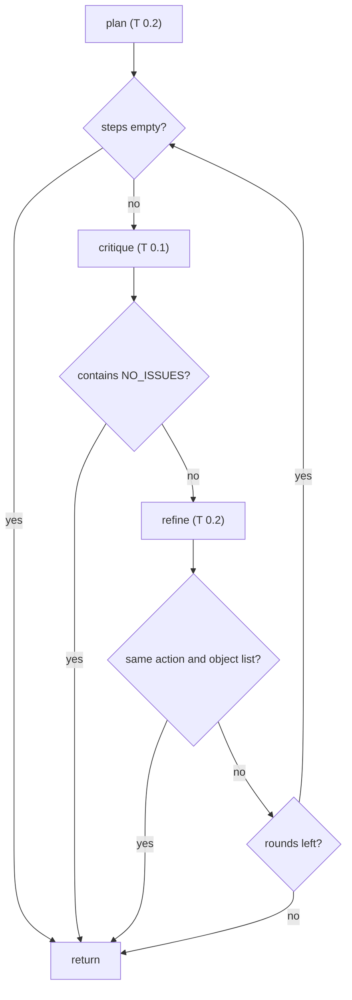
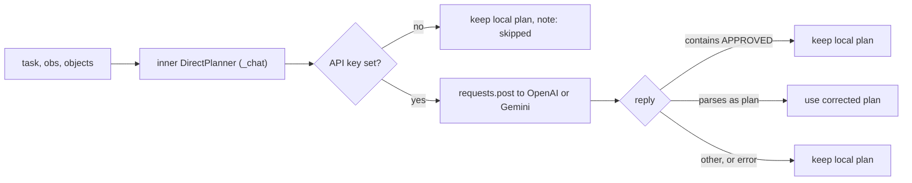

# Critique loops (Self-Refine, LLM Router)

These two planners first write a plan, then ask an LLM to check it. If the check finds a problem, the plan is changed. This page explains both, what they send to the LLM, what they return, and the ways they can go wrong. Every example was run offline with a scripted LLM reply.

!!! abstract "In this page"
    - **Self-Refine** uses one model for everything: plan, critique, rewrite. It makes up to 1 + 2N calls (N = `max_iterations`, default 2).
    - **LLM Router** uses a local model for the plan and one external API (OpenAI or Gemini) as the checker. It makes 2 calls.
    - The router's checker does not use `_chat`. It sends its own HTTP request, so you must fake that request too when you test offline.
    - Both planners can lose a good plan or miss a problem because of how they read the critique text. See the failure modes below.

!!! code "Where in the code"
    - [`self_refine.py`](https://github.com/mtbui2010/embodiplan/blob/a69064255c69/embodiplan/self_refine.py): `SelfRefinePlanner`
    - [`llm_router.py`](https://github.com/mtbui2010/embodiplan/blob/a69064255c69/embodiplan/llm_router.py): `LLMRouterPlanner`
    - [`direct.py`](https://github.com/mtbui2010/embodiplan/blob/a69064255c69/embodiplan/direct.py): the local planner inside the router
    - [factories in `__init__.py`](https://github.com/mtbui2010/embodiplan/blob/a69064255c69/embodiplan/__init__.py#L170-L178) (`self_refine`, `llm_router`)

## Generate, then critique

A single LLM call can write a plan with a plain mistake, for example `Pick Mug` without `Find Mug` first. A critique step asks an LLM to read the plan and name such mistakes. A second step then fixes them. The idea comes from the paper "Self-Refine" (Madaan et al., 2023), cited in the file header.

The critic here is text only. It does not run the symbolic checks from [Symbolic state](../concepts/symbolic-state.md) and [Action model](../reference/action-model.md). For a critique that uses those rules, see [SAGE](sage.md) and [SAGE-Repair](sage-repair.md).

| | Self-Refine | LLM Router |
|---|---|---|
| Registry key | `"Self-Refine"` | `"LLM Router"` |
| Who writes the plan | the model you configure | the same, through an inner `DirectPlanner` |
| Who critiques | the same model | OpenAI or Gemini over HTTP |
| Critique output | free text, or `NO_ISSUES` | `APPROVED`, or a full JSON plan |
| Who rewrites | the same model, with a second prompt | the verifier itself |
| LLM calls | 1 to 1 + 2N (default up to 5) | always 2 (even if the check is skipped) |
| Needs an API key | only if `provider` needs one | yes, for the check |
| Tests in the repo | none | none |

!!! warning "Default host"
    Without `host=`, a planner sends its prompts to `http://ollama.aistations.org` ([`base.py:23`](https://github.com/mtbui2010/embodiplan/blob/a69064255c69/embodiplan/base.py#L23)). Pass `host="http://localhost:11434"` for a local Ollama server. The backends are `ollama`, `openai` and `gemini`; `provider="anthropic"` raises `ValueError` ([`base.py:270`](https://github.com/mtbui2010/embodiplan/blob/a69064255c69/embodiplan/base.py#L270)). Docstrings that mention Claude or Anthropic are wrong.

## Self-Refine

The planner makes a plan, asks for a critique, asks for a fixed plan, and repeats. It stops when the critique says `NO_ISSUES`, when the fixed plan equals the old one, when an error happens, or after `max_iterations` rounds.



### Inputs and options

| name | type | default | meaning |
|---|---|---|---|
| `host`, `model` | str | none (required) | LLM server and model name ([`self_refine.py:84`](https://github.com/mtbui2010/embodiplan/blob/a69064255c69/embodiplan/self_refine.py#L84)) |
| `provider` | str | `"ollama"` | `ollama`, `openai` or `gemini` |
| `api_key` | str | `""` | key for `openai` or `gemini` |
| `max_iterations` | int | `2` | critique-and-refine rounds. `0` gives a plain single call |

`generate_plan(task, obs, visible_objects)` takes the usual three inputs (see [Plan format](../concepts/plan-format.md)). Only the first 30 visible objects go into the prompts.

### What the LLM is asked (prompt and temperature)

Three system prompts, all in `self_refine.py` ([lines 23-56](https://github.com/mtbui2010/embodiplan/blob/a69064255c69/embodiplan/self_refine.py#L23-L56)). The action list and step schema come from `base.py`. Full text of shared fragments: [Prompts](../reference/prompts.md).

| call | system prompt | user message holds | temperature |
|---|---|---|---|
| plan | `PLAN_SYSTEM` | request, scene observation, visible objects | 0.2 |
| critique | `CRITIQUE_SYSTEM`: lists 5 problem kinds; answer exactly `NO_ISSUES` if correct, else 2-5 bullets | task, visible objects, the plan as JSON | 0.1 |
| refine | `REFINE_SYSTEM` | task, visible objects, the plan as JSON, the critique | 0.2 |

The critique and refine messages do not include `obs`. The `obs` argument is passed to both methods but only the first call prints it into the prompt.

### Parsing and fallbacks

- The plan and the refined plan go through `parse_steps` (see [Plan format](../concepts/plan-format.md)).
- The critique is plain text. `_is_no_issues` is `"NO_ISSUES" in critique.upper()` ([line 59](https://github.com/mtbui2010/embodiplan/blob/a69064255c69/embodiplan/self_refine.py#L59-L60)). It matches anywhere in the text, in any case.
- Two plans are "equal" if they have the same length and the same `action` and `object` at every position. Other keys, such as `target`, are ignored.
- If the first call raises, the planner returns `[]` with `parse_ok=False`, `llm_calls=1` and `extra={"error": ...}`.
- If a call inside the loop raises, the error text is added to `critiques` as `[Error in iter N] ...` and the loop stops. The plan from before the error is returned.

The loop itself, copied from the repo:

```python
        # ── Refine loop ──
        for i in range(self.max_iterations):
            if not steps:
                break
            iterations += 1

            try:
                critique, in2, out2 = self._critique(task, steps, obs, visible_objects)
                llm_calls += 1
                total_in  += in2
                total_out += out2
                critiques.append(critique)

                if _is_no_issues(critique):
                    break  # early stop

                prev_steps = steps
                steps, in3, out3 = self._refine(task, steps, critique, obs, visible_objects)
                llm_calls += 1
                total_in  += in3
                total_out += out3

                if _steps_equal(prev_steps, steps):
                    break  # stable — no point continuing
            except Exception as e:
                critiques.append(f"[Error in iter {i+1}] {e}")
                break
```

([`self_refine.py:158-184`](https://github.com/mtbui2010/embodiplan/blob/a69064255c69/embodiplan/self_refine.py#L158-L184))

### Output and `extra` keys

| field | value |
|---|---|
| `steps` | the last plan the loop produced |
| `metrics.method`, `model`, `backend` | `"Self-Refine"`, your model, your provider |
| `metrics.llm_calls` | 1 + critiques + refines that were made |
| `metrics.input_tokens`, `output_tokens` | sums over all calls |
| `metrics.notes` | `"<n> refine iterations"` |
| `metrics.extra["critiques"]` | list of critique texts (and error texts) |
| `metrics.extra["iterations"]` | `n`, the number of rounds started |

`iterations` counts a round when it starts, so it also counts the round where the critique said `NO_ISSUES` and nothing was refined, and a round that ended in an error. The planner also prints one line, `[Self-Refine] <steps> steps, <n> refinements, <s>s`.

### replan

`replan` does not use the list of completed steps. It builds one new task text, "`<task>`. Previous step failed — `<action> <object>`: `<reason>`. Generate only the remaining steps, fixing the failure.", and runs the full `generate_plan` on it ([`self_refine.py:202-209`](https://github.com/mtbui2010/embodiplan/blob/a69064255c69/embodiplan/self_refine.py#L202-L209)). So a replan costs the same as a new plan. `completed` is ignored. See [Replanning](../concepts/replanning.md).

### Example (scripted)

The planner's own code runs. Only the LLM text is fixed: a plan with a missing `Find`, a critique that says so, a fixed plan, then `NO_ISSUES`. Output with a scripted LLM reply:

```python
from embodiplan.self_refine import SelfRefinePlanner

replies = iter([
    '{"steps": [{"action": "Pick", "object": "Mug"}]}',
    "- Missing Find before Pick",
    '{"steps": [{"action": "Find", "object": "Mug"}, {"action": "Pick", "object": "Mug"}]}',
    "NO_ISSUES",
])
temps = []

def fake_chat(messages, temperature=0.2):
    temps.append(temperature)
    return next(replies), 10, 5

p = SelfRefinePlanner(host="http://localhost:11434", model="llama3.2")
p._chat = fake_chat
steps, m = p.generate_plan("pick up the mug", "Kitchen.", ["Mug"])
print(steps)
print(m.llm_calls, m.notes, m.extra, temps)
```

```text
[Self-Refine] 2 steps, 2 refinements, 0.0s
[{'action': 'Find', 'object': 'Mug'}, {'action': 'Pick', 'object': 'Mug'}]
4 2 refine iterations {'critiques': ['- Missing Find before Pick', 'NO_ISSUES'], 'iterations': 2} [0.2, 0.1, 0.2, 0.1]
```

The temperatures show the order: plan 0.2, critique 0.1, refine 0.2, critique 0.1. Nothing was sent over the network.

### Failure modes

All of these were run offline with scripted LLM replies.

- **An unparseable refine reply erases the plan.** If the refine call returns text that `parse_steps` cannot read, `steps` becomes `[]`, even though a good plan existed before. With the replies plan, `- missing Pick`, `Sorry, I cannot.` the result was `[]`, `llm_calls=3`, `parse_ok=False`. The old plan is not kept.
- **`NO_ISSUES` is matched anywhere.** The critique `- We have NO_ISSUES with names but Pick is missing` stopped the loop after 1 critique and 2 calls, and the missing `Pick` was never fixed. A critique that says `no_issues` in lower case also matches.
- **The equality check is shallow.** Two plans that differ only in `target` or `reason` count as equal, and the loop stops.
- **A failed first call gives an empty plan.** `steps == []`, `llm_calls=1`, `extra={"error": "down"}` in the run with a call that raises.
- **An error in the loop ends refinement quietly.** It appears only inside `extra["critiques"]`. `parse_ok` stays `True` if a plan exists.
- **No symbolic check.** The critic is the same LLM that made the plan. It can approve a plan that breaks the rules in [Action model](../reference/action-model.md).
- **Cost.** With the default `max_iterations=2` a plan can take 5 calls. This page gives no timing because none was measured.

To avoid the first two: keep `max_iterations` small and check `parse_ok` and `num_steps` on the result.

### Tests

None. No file in `tests/` imports `SelfRefinePlanner`.

## LLM Router

The "router" is not a switch between backends. It is a two-model pipeline: a local model plans, then an external API reads the plan and either answers `APPROVED` or returns a corrected plan.



### Inputs and options

| name | type | default | meaning |
|---|---|---|---|
| `host`, `model`, `provider`, `api_key` | | | for the local planner, as in any planner. The inner `DirectPlanner` gets these values |
| `verifier_backend` | str | `"openai"` | `"gemini"` selects Gemini. **Any other value, including `"anthropic"`, takes the OpenAI path** |
| `verifier_model` | str | `""` | empty means `gpt-4o-mini` (OpenAI) or `gemini-2.5-flash` (Gemini) |
| `openai_api_key` | str | `""` | falls back to env `OPENAI_API_KEY` |
| `gemini_api_key` | str | `""` | falls back to env `GEMINI_API_KEY` |

Source: [`llm_router.py:129-146`](https://github.com/mtbui2010/embodiplan/blob/a69064255c69/embodiplan/llm_router.py#L129-L146). Endpoints are the constants `OPENAI_URL` and `GEMINI_URL` ([lines 31-35](https://github.com/mtbui2010/embodiplan/blob/a69064255c69/embodiplan/llm_router.py#L31-L35)). The factory `embodiplan.llm_router(...)` takes only `host`, `model`, `verifier_backend`, `verifier_model`, `openai_api_key` and `anthropic_api_key` ([`__init__.py:210-226`](https://github.com/mtbui2010/embodiplan/blob/a69064255c69/embodiplan/__init__.py#L210-L226)). To set `gemini_api_key` or `provider`, build `LLMRouterPlanner` directly, or use `embodiplan.get("LLM Router", ...)` with those keyword arguments.

!!! note "The name `embodiplan.llm_router` is the factory"
    In the package, `embodiplan.llm_router` is the factory function, not the module. To reach the module (for example to patch `requests`), use `sys.modules["embodiplan.llm_router"]` or import the class with `from embodiplan.llm_router import LLMRouterPlanner`.

### What the LLM is asked (prompt and temperature)

| call | how it is sent | system prompt | temperature |
|---|---|---|---|
| local plan | `DirectPlanner.generate_plan` through `_chat` | the Direct prompt | 0.2 (the `_chat` default) |
| verify (OpenAI) | `requests.post`, timeout 30 s, `max_tokens` 1000 | `VERIFY_SYSTEM` | 0.1 |
| verify (Gemini) | `requests.post`, timeout 30 s, `maxOutputTokens` 1000 | `VERIFY_SYSTEM` | 0.1 |

`VERIFY_SYSTEM` ([lines 37-50](https://github.com/mtbui2010/embodiplan/blob/a69064255c69/embodiplan/llm_router.py#L37-L50)) lists four things to check, and says: if correct, answer exactly `APPROVED`; otherwise answer with a corrected plan in the JSON format and nothing else. The user message is `Task: ...` plus the plan as JSON. **It does not include `obs` or the visible objects**, so the verifier cannot tell whether an object exists in the scene.

!!! warning "The verifier call bypasses `_chat`"
    The local plan goes through `_chat`, as in every planner. The verifier call is a direct `requests.post` inside `_call_openai` and `_call_gemini` ([lines 57-119](https://github.com/mtbui2010/embodiplan/blob/a69064255c69/embodiplan/llm_router.py#L57-L119)). To test offline, fake `planner._local._chat` and also replace `requests.post` or leave the key empty. See [LLM calls](../concepts/llm-calls.md). The Gemini request puts the key in the URL query string (`?key=...`, [line 101](https://github.com/mtbui2010/embodiplan/blob/a69064255c69/embodiplan/llm_router.py#L101)). The Gemini path was not run.

### Parsing and fallbacks

`_verify` ([lines 148-162](https://github.com/mtbui2010/embodiplan/blob/a69064255c69/embodiplan/llm_router.py#L148-L162)) picks the key and model, then calls the API. The reply is handled in this order:

1. No key: return the local plan, note `no OPENAI_API_KEY — skipped verification` (or `GEMINI_API_KEY`). No request is sent.
2. `"APPROVED" in content.upper()`: keep the local plan, note `<backend>: approved`.
3. `parse_steps(content)` gives steps: use them, note `<backend>: rewrote <old>→<new> steps`.
4. Otherwise: keep the local plan, note `<backend>: parse failed, keeping original`.
5. Any exception (HTTP error, bad JSON in the reply body, timeout): keep the local plan, note `<backend> error: <text>`, tokens 0.

The notes always say `openai` or `gemini`, taken from the code path that ran, not from `verifier_backend`.

### Output and `extra` keys

| field | value |
|---|---|
| `steps` | the corrected plan, or the local plan |
| `metrics.method` | `"LLM Router"` |
| `metrics.model` | `"<model>+<verifier_backend>"`, for example `llama3.2+openai` |
| `metrics.backend` | `""` (not set in this planner) |
| `metrics.llm_calls` | local calls + 1, always, even when the check was skipped or failed |
| `metrics.input_tokens`, `output_tokens` | local tokens + verifier tokens (0 if skipped or failed) |
| `metrics.notes` | the verifier note |
| `metrics.extra["local_steps"]` | the plan before verification |
| `metrics.extra["verifier_note"]`, `["verifier_backend"]` | the note and `self.backend` |
| `metrics.extra["steps_changed"]` | `final_steps != local_steps` |

### replan

`replan` calls the inner `DirectPlanner.replan` (which uses the failure context from [Replanning](../concepts/replanning.md)), then verifies the new steps the same way. It returns metrics with the same fields, but **`extra` is empty** (not set in [lines 200-210](https://github.com/mtbui2010/embodiplan/blob/a69064255c69/embodiplan/llm_router.py#L193-L211)). The verifier again sees only the task and the new steps, not `completed` or the failure.

### Example (scripted)

Local plan and verifier reply are both fixed. The local `_chat` is replaced on `p._local`, and the HTTP call is replaced with a small object that returns `APPROVED`. Output with a scripted LLM reply:

```python
import sys
import embodiplan
from embodiplan.llm_router import LLMRouterPlanner
lr = sys.modules["embodiplan.llm_router"]   # embodiplan.llm_router is also a factory function

class FakeResp:                              # stands in for the verifier's HTTP reply
    def raise_for_status(self): pass
    def json(self):
        return {"choices": [{"message": {"content": "APPROVED"}}],
                "usage": {"prompt_tokens": 7, "completion_tokens": 3}}

lr.requests.post = lambda *a, **k: FakeResp()
p = LLMRouterPlanner(host="http://localhost:11434", model="llama3.2",
                     openai_api_key="sk-...")
p._local._chat = lambda messages, temperature=0.2: (
    '{"steps": [{"action": "Pick", "object": "Mug"}]}', 10, 5)
steps, m = p.generate_plan("pick up the mug", "Kitchen.", ["Mug"])
print(steps)
print(m.llm_calls, m.input_tokens, m.output_tokens, m.model, repr(m.notes))
print(m.extra["steps_changed"], repr(m.backend))
```

```text
[Direct] 1 steps in 0.0s
[LLM Router] local:1 → final:1 | openai: approved | 0.0s
[{'action': 'Pick', 'object': 'Mug'}]
2 17 8 llama3.2+openai 'openai: approved'
False ''
```

The plan still lacks `Find Mug`: the scripted verifier approved it. The tokens 17 and 8 are the fixed local numbers plus the fixed verifier numbers. With the same setup and a verifier reply that is a JSON plan with `Find` and `Pick`, the run printed `openai: rewrote 1→2 steps` and `steps_changed` was `True`. With no key and no network, the note was `no OPENAI_API_KEY — skipped verification` and `llm_calls` was still 2. A real verifier call was not run.

### Failure modes

Each item below was read in the code and reproduced offline (scripted replies, a fake `requests.post`).

- **A skipped check counts as a call.** With no key, no request is sent, but `llm_calls` is `local + 1` ([line 177](https://github.com/mtbui2010/embodiplan/blob/a69064255c69/embodiplan/llm_router.py#L177)). The plan is the unchecked local plan, and the only sign is `notes`. Check `notes` and `extra["verifier_note"]`, or set the key.
- **"NOT APPROVED" counts as approval.** The check is `"APPROVED" in content.upper()` ([line 82](https://github.com/mtbui2010/embodiplan/blob/a69064255c69/embodiplan/llm_router.py#L82), Gemini: [line 111](https://github.com/mtbui2010/embodiplan/blob/a69064255c69/embodiplan/llm_router.py#L111)). With a verifier reply `NOT APPROVED. Corrected: {"steps": [... Find Mug, Pick Mug ...]}` the run printed `openai: approved` and kept the one-step local plan; the correction was dropped. The same happens for any reply that contains the word `approved` anywhere.
- **`anthropic_api_key` is silently ignored.** The factory passes it ([`__init__.py:225`](https://github.com/mtbui2010/embodiplan/blob/a69064255c69/embodiplan/__init__.py#L225)), but `LLMRouterPlanner.__init__` has no such parameter, so it falls into `**kwargs` and is dropped. After `embodiplan.llm_router(..., anthropic_api_key="sk-ant-...")` the planner had no `anthropic_api_key` or `anthropic_key` attribute. Nothing in the planner calls Anthropic.
- **`verifier_backend="anthropic"` uses OpenAI.** Anything other than `"gemini"` goes to the OpenAI branch. The run printed `openai: approved` and `model` was `llama3.2+anthropic`. Use `"openai"` or `"gemini"`.
- **HTTP errors are hidden in `notes`.** A request that raised `HTTP 401` returned the local plan, `llm_calls=2` and `notes="openai error: HTTP 401"`. No exception reaches the caller.
- **A failed local plan is still verified.** `DirectPlanner` turns an exception into `[]`. The router then still sends the empty plan to the verifier. In the run, the scripted verifier approved it and the result was `[]` with `llm_calls=2` and `parse_ok=False`.
- **The verifier sees no scene.** Only the task and the plan are sent, so it cannot catch a wrong object name for this scene.
- **An unreadable reply keeps the local plan.** Note `openai: parse failed, keeping original`.

To avoid these: set the key and check `extra["verifier_note"]` after each plan, use `"openai"` or `"gemini"` as the backend, and do not rely on the planner to detect a rejection phrased with the word "approved".

### Tests

None. No file in `tests/` imports `LLMRouterPlanner`. A real verifier call (network and key) was not run for this page.
