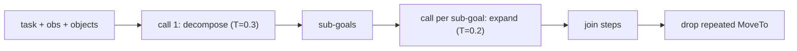

# Decomposition (Hierarchical, Hierarchical Few-Shot)

These two planners split a task in two levels. The first LLM call turns the task into a short list of sub-goals in plain words, such as "go to kitchen" and "get mug". Then one more call per sub-goal turns that sub-goal into robot steps. The idea is that each call is a smaller question than "plan the whole task". Hierarchical Few-Shot does the same, and also pastes the most similar worked examples into every prompt.

!!! abstract "In this page"
    - Cost is `1 + N` LLM calls, where `N` is the number of sub-goals the model returns. Nothing in the code limits `N` to the "2-5" that the prompt asks for.
    - Hierarchical Few-Shot picks 3 of 22 stored examples by word overlap. It does not call an LLM or an embedding model to do this.
    - Both planners crash with `KeyError: 'action'` if an expanded step has no `action` key and is not the first step. This is current behaviour; see "Failure modes".
    - The sub-goal parser can turn a list of words into one sub-goal per word. Each one costs a call.

!!! code "Where in the code"
    - [`HierarchicalPlanner`](https://github.com/mtbui2010/embodiplan/blob/a69064255c69/embodiplan/hierarchical.py#L57-L165)
    - [`HierarchicalFewShotPlanner`](https://github.com/mtbui2010/embodiplan/blob/a69064255c69/embodiplan/my_planner.py#L141-L297)
    - [retrieval helpers](https://github.com/mtbui2010/embodiplan/blob/a69064255c69/embodiplan/my_planner.py#L48-L106)
    - registry keys: [`__init__.py`](https://github.com/mtbui2010/embodiplan/blob/a69064255c69/embodiplan/__init__.py#L104-L106)

Both planners use the shared plan format and metrics from [Plan format and metrics](../concepts/plan-format.md), and the LLM transport described in [LLM calls](../concepts/llm-calls.md). A planner built without `host=` sends its prompts to the default host `http://ollama.aistations.org`. Pass `host=` (for example `http://localhost:11434`) to use a local server.



## Hierarchical

Registry key `"Hierarchical"`, class `HierarchicalPlanner` in `embodiplan/hierarchical.py`.

### Inputs and options

`generate_plan(task, obs, visible_objects)` is the standard call. The class adds no constructor option. It also has a factory, `embodiplan.hierarchical(host=, model=, provider=, api_key=)`.

| name | type | meaning | example |
|---|---|---|---|
| task | str | the user request | `"bring me a mug"` |
| obs | str | free-text observation | `"Kitchen."` |
| visible_objects | list[str] | only the first 30 go into the prompts | `["Mug", "CoffeeMachine"]` |

### What the LLM is asked (prompt and temperature)

| call | system prompt | user message | temperature |
|---|---|---|---|
| 1 decompose | `HI_SYSTEM`: break the task into 2-5 ordered sub-goals; return only `{"subgoals": [...]}` | task, observation, visible objects, then "Break this into ordered sub-goals:" | 0.3 |
| 2..N+1 expand | `LO_SYSTEM`: action list, step schema, JSON example | overall task, the one sub-goal, observation, visible objects, then "Expand this sub-goal into action steps:" | 0.2 |

Each expand call sees only its own sub-goal. It does not see the steps that earlier sub-goals produced, and the observation is not updated between calls. The full prompt texts are listed in [Prompts](../reference/prompts.md). The expand user message for the first sub-goal in the example below is:

```text
Overall task: bring me a mug
Current sub-goal: go to kitchen

Scene observation:
Kitchen.

Visible objects: Mug, CoffeeMachine

Expand this sub-goal into action steps:
```

### Parsing and fallbacks

- **Sub-goals** go through `_parse_subgoals` ([L43-L54](https://github.com/mtbui2010/embodiplan/blob/a69064255c69/embodiplan/hierarchical.py#L43-L54)). It removes code fences, then tries `json.loads`. A dict gives the list under `subgoals`. A bare list is also accepted. If the text is not valid JSON, the fallback collects every quoted string of 5 or more characters.
- **Steps** go through the shared `parse_steps` (see [Plan format](../concepts/plan-format.md)).
- **Decompose call fails** (any exception, including a network error): the planner prints a message and uses one sub-goal, the task text itself. The call is not counted in `llm_calls`.
- **One expand call fails**: the planner prints a message and skips that sub-goal. The call is not counted either.
- **Dedupe**: after joining, a `MoveTo` is dropped if the step before it is a `MoveTo` to the same object. The code reads the step keys without a guard:

```python
        # Deduplicate consecutive identical Navigate steps
        deduped = []
        for s in all_steps:
            if (deduped and s["action"] == "MoveTo"
                    and deduped[-1]["action"] == "MoveTo"
                    and deduped[-1]["object"] == s["object"]):
                continue
            deduped.append(s)
```

[Source: hierarchical.py L129-L136](https://github.com/mtbui2010/embodiplan/blob/a69064255c69/embodiplan/hierarchical.py#L129-L136)

### Output and `extra` keys

Returns `(steps, metrics)`. Fields set by this planner:

| field | value |
|---|---|
| `method` | `"Hierarchical"` |
| `llm_calls` | successful decompose call (0 or 1) plus successful expand calls |
| `input_tokens`, `output_tokens` | sums over the counted calls |
| `num_steps` | length after dedupe |
| `parse_ok` | `True` if at least one step remains |
| `notes` | always empty |
| `extra["subgoals"]` | the list of sub-goal strings that were expanded |

`extra` is not part of `PlanMetrics.to_dict()`.

### replan

`replan(task, completed, failed_step, failure_reason, obs, visible_objects)` builds one new task string: the original task, the completed steps as `Action Object` text, the failed step with its reason, and the words "Generate only the remaining steps." Then it calls `generate_plan` on that string. So a replan costs `1 + N` calls again. The text goes into the decompose prompt as the task:

```text
Task: make coffee. Already done: MoveTo Kitchen. Last action failed (Find Mug): not visible. Generate only the remaining steps.
Scene observation: Kitchen.
Visible objects: Mug, CoffeeMachine

Break this into ordered sub-goals:
```

That output was printed by running `replan` with a scripted LLM reply. See [Replanning](../concepts/replanning.md) for the general idea.

### Example (scripted)

Only the LLM text is fixed here. The planner code, the prompts, the parsing and the dedupe all run for real. The output is with a scripted LLM reply, not model output.

```python
import embodiplan

replies = iter([
    '{"subgoals": ["go to kitchen", "get mug"]}',
    '{"steps": [{"action": "MoveTo", "object": "Kitchen"}]}',
    '{"steps": [{"action": "MoveTo", "object": "Kitchen"},'
    ' {"action": "Find", "object": "Mug"}, {"action": "Pick", "object": "Mug"}]}',
])
planner = embodiplan.get("Hierarchical", host="http://localhost:11434")
planner._chat = lambda messages, temperature=0.2: (next(replies), 0, 0)

steps, m = planner.generate_plan("bring me a mug", "Kitchen.", ["Mug", "CoffeeMachine"])
print(steps)
print(m.llm_calls, m.num_steps, m.extra)
```

Output, with a scripted LLM reply:

```text
[Hierarchical] 2 sub-goals → 3 steps in 0.0s
[{'action': 'MoveTo', 'object': 'Kitchen'}, {'action': 'Find', 'object': 'Mug'}, {'action': 'Pick', 'object': 'Mug'}]
3 3 {'subgoals': ['go to kitchen', 'get mug']}
```

Four steps came back from the two expand calls. The second `MoveTo Kitchen` repeats the first, so the dedupe dropped it. The temperatures seen by the fake `_chat` were `0.3, 0.2, 0.2`. The latency printed here is that of the fake and has no meaning.

### Failure modes

!!! warning "Current behaviour, not features"
    - **`KeyError: 'action'`.** If an expanded step has no `action` key, and it is not the first step, the dedupe loop raises and `generate_plan` does not catch it. The `try` blocks cover the LLM calls only. Reproduced with a scripted LLM reply that returns `{"steps": [{"object": "Mug"}, {"object": "Cup"}]}`:
      ```text
      File ".../embodiplan/hierarchical.py", line 132, in generate_plan
          if (deduped and s["action"] == "MoveTo"
                          ~^^^^^^^^^^
      KeyError: 'action'
      ```
      A single step without `action` does not raise (the dedupe list is empty, so the check is skipped); it ends up in the plan. A missing `object` on a `MoveTo` raises `KeyError: 'object'` in the same place by the same reading of the code (not run). To avoid it, call the planner inside a `try`, or run the plan through a check before use.
    - **One sub-goal per word.** If the model answers `{"subgoals": ["MoveTo","Kitchen","Find","Mug"]}`, the parser returns four sub-goals and the planner makes four expand calls. Run offline, `_parse_subgoals` returned `['MoveTo', 'Kitchen', 'Find', 'Mug']`. SAGE got a fix for this in 0.2.5 ([CHANGELOG](https://github.com/mtbui2010/embodiplan/blob/a69064255c69/CHANGELOG.md)); Hierarchical did not.
    - **The quoted-string fallback keeps JSON keys.** For `Sure: {"subgoals": ["go to kitchen", "get mug"]} ok` (valid JSON inside prose), `json.loads` fails and the fallback returns `['subgoals', 'go to kitchen', 'get mug']`. The key `subgoals` becomes a sub-goal. Ask the model for JSON only, which is what the prompt does.
    - **No limit on the number of sub-goals.** The prompt says 2-5; the code accepts any count, including zero. With zero sub-goals no expand call runs and the plan is empty (`parse_ok=False`).
    - **Errors are hidden.** A failed decompose or expand call is printed, not raised, and is missing from `llm_calls`. Check `parse_ok` and `num_steps`.

### Tests

None. No file in `tests/` imports `HierarchicalPlanner`. `tests/test_sage_subgoals.py` tests SAGE's own sub-goal parser, not this one.

## Hierarchical Few-Shot

Registry key `"Hierarchical Few-Shot"`, class `HierarchicalFewShotPlanner` in `embodiplan/my_planner.py`. Its `metrics.method` is `"HierarchicalFewShot"` (no hyphen, no space).

### Inputs and options

| name | type | default | meaning |
|---|---|---|---|
| `top_k` | int | 3 | how many stored examples go into each prompt |
| `generate_plan` arguments | | | same as Hierarchical |

Pass `top_k` through `embodiplan.get("Hierarchical Few-Shot", top_k=2)` or the factory `embodiplan.hierarchical_few_shot(..., top_k=2)`. The constructor parses the 22 examples in `few_shot_examples.py` once. A run printed `22` for the number of parsed examples.

### What the LLM is asked (prompt and temperature)

The calls are the same as in Hierarchical (decompose at 0.3, expand at 0.2), with two changes: the system prompts say "study the retrieved examples", and the user message starts with the retrieved block, then `=== NEW TASK ===` (decompose) or `=== NEW SUB-GOAL ===` (expand). The same block goes into every call of one `generate_plan`.

**How the examples are chosen.** Retrieval is a word overlap score, not an LLM or an embedding:

1. Lowercase the text and keep runs of letters `[a-z]+` as a set of words.
2. Score each stored example task with the Jaccard ratio: shared words divided by all distinct words in both.
3. Sort by score, highest first, and keep the first `top_k`. Ties keep the original order of the examples.

```python
def _tokenize(text: str) -> set[str]:
    """Lowercase word tokens, strip punctuation."""
    return set(re.findall(r"[a-z]+", text.lower()))


def _similarity(query: str, example_task: str) -> float:
    """Jaccard similarity between query and example task word sets."""
    q = _tokenize(query)
    e = _tokenize(example_task)
    if not q or not e:
        return 0.0
    return len(q & e) / len(q | e)


def retrieve_top_k(query: str, examples: list[_Example], k: int = 3) -> list[_Example]:
    """Return the k examples with highest word-overlap similarity to query."""
    scored = sorted(examples, key=lambda ex: _similarity(query, ex.task), reverse=True)
    return scored[:k]
```

[Source: my_planner.py L76-L93](https://github.com/mtbui2010/embodiplan/blob/a69064255c69/embodiplan/my_planner.py#L76-L93)

For the query `"make a cup of coffee"` the top 3 scores were (printed by running `_similarity`):

| score | example task |
|---|---|
| 0.154 | Make coffee — place the mug under the coffee machine and start it |
| 0.083 | Put the cup from the dining table into the sink |
| 0.083 | Put the vase from the bookshelf on the coffee table |

The scores are low. The score is not a measure of how useful an example is; it counts shared words, and words such as "the" and "from" count like any other.

### Parsing and fallbacks

The same as Hierarchical. The file has its own copy of `_parse_subgoals` ([L304-L314](https://github.com/mtbui2010/embodiplan/blob/a69064255c69/embodiplan/my_planner.py#L304-L314)), with the same logic, and its own copy of the dedupe loop ([L247-L255](https://github.com/mtbui2010/embodiplan/blob/a69064255c69/embodiplan/my_planner.py#L247-L255)). A failed decompose call gives one sub-goal, the task. A failed expand call is skipped. Retrieval itself cannot call the network, so it has no error path.

### Output and `extra` keys

As for Hierarchical, with `method="HierarchicalFewShot"`, and `extra` has two keys:

| key | value |
|---|---|
| `subgoals` | list of sub-goal strings |
| `retrieved_tasks` | the task lines of the examples that were pasted into the prompts |

### replan

The same as Hierarchical: one task string with the done steps, the failed step and the reason, then a full `generate_plan`. Retrieval runs again on that longer string. The longer text lowers the overlap with the stored tasks, so a replan may pick other examples than the first plan did (not run).

### Example (scripted)

The output is with a scripted LLM reply. Retrieval and prompt building run for real.

```python
import embodiplan

replies = iter([
    '{"subgoals": ["go to kitchen", "get mug"]}',
    '{"steps": [{"action": "MoveTo", "object": "Kitchen"}]}',
    '{"steps": [{"action": "Find", "object": "Mug"}]}',
])
planner = embodiplan.get("Hierarchical Few-Shot", host="http://localhost:11434", top_k=3)
planner._chat = lambda messages, temperature=0.2: (next(replies), 0, 0)

steps, m = planner.generate_plan("make a cup of coffee", "Kitchen.", ["Mug", "CoffeeMachine"])
print(steps)
print(m.method, m.llm_calls, m.num_steps)
for t in m.extra["retrieved_tasks"]:
    print(" ", t)
```

Output, with a scripted LLM reply:

```text
[HierarchicalFewShot] retrieved=['Make coffee — place the mug under the coffee machine and start it', 'Put the cup from the dining table into the sink', 'Put the vase from the bookshelf on the coffee table'] | 2 sub-goals → 2 steps in 0.0s
[{'action': 'MoveTo', 'object': 'Kitchen'}, {'action': 'Find', 'object': 'Mug'}]
HierarchicalFewShot 3 2
  Make coffee — place the mug under the coffee machine and start it
  Put the cup from the dining table into the sink
  Put the vase from the bookshelf on the coffee table
```

The decompose prompt for this run starts with `=== RETRIEVED EXAMPLE 1 ===` followed by the first example's task, reasoning and plan, and ends with `=== NEW TASK ===`, the task, the observation and the object list.

### Failure modes

!!! warning "Current behaviour, not features"
    - **Same `KeyError: 'action'` as Hierarchical.** The dedupe loop at `my_planner.py` L247-L255 reads `s["action"]` the same way. Reproduced with a scripted LLM reply `{"steps": [{"object": "Mug"}, {"object": "Cup"}]}`: `KeyError: 'action'`.
    - **Same per-word sub-goal behaviour.** The local `_parse_subgoals` has the same code as the one in Hierarchical, so a word list gives one sub-goal per word (read from the code; the Hierarchical copy was the one run).
    - **Weak retrieval.** Overlap of words ignores meaning. A task that shares few words with all 22 examples gets 3 examples that are close to arbitrary, and they still take space in every prompt. The prompts grow with `top_k` times the length of an example, and they are sent again on every expand call.
    - **The 22 examples are fixed.** There is no way to add examples without editing `few_shot_examples.py`.

### Tests

None. No file in `tests/` imports `HierarchicalFewShotPlanner`, `retrieve_top_k` or `_parse_examples`.

## See also

- [Single-call planners](single-call.md) for the one-call baselines that this family is compared with.
- [SAGE](sage.md), which also decomposes, and adds a symbolic check and local repair.
- [Prompts](../reference/prompts.md) for the prompt texts.
