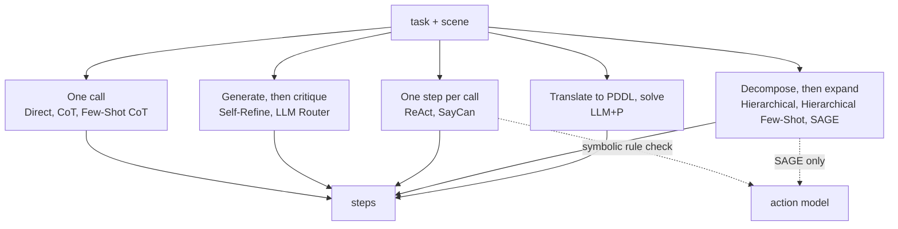

# Overview and comparison

embodiplan has 11 planners. They all take a task and a description of the scene, and they all return a list of robot steps. They differ in how they ask the LLM and in what they check. This page puts them side by side, so that you can find the one you need and jump to its section.

!!! abstract "In this page"
    - One table with all 11 planners: file, family, calls, temperature, parsing, use of the action model, replan strategy and `extra` keys.
    - Five families: one call, critique, one step per call, decompose then expand, and PDDL.
    - Only SAGE and SayCan check steps against the symbolic [action model](../reference/action-model.md) while planning.
    - Nothing here ranks the planners by quality or speed. No real model was called while these pages were written.

!!! code "Where in the code"
    - [`REGISTRY`](https://github.com/mtbui2010/embodiplan/blob/a69064255c69/embodiplan/__init__.py#L98-L110): the 11 keys and their classes
    - [`BasePlanner`](https://github.com/mtbui2010/embodiplan/blob/a69064255c69/embodiplan/base.py#L508-L605): the shared interface
    - Each planner's file is in the table.

!!! warning "The default host is a remote server"
    A planner built without `host=` sends its prompts to `http://ollama.aistations.org` ([`base.py:23`](https://github.com/mtbui2010/embodiplan/blob/a69064255c69/embodiplan/base.py#L23)). For a local server pass `host=` (for example `http://localhost:11434`). The backends are `ollama`, `openai` and `gemini`; `provider="anthropic"` raises `ValueError`.

## The families

The dashed lines show which planners use the symbolic action model: SayCan (inside the family "one step per call") and SAGE (inside "decompose, then expand").

## All 11 planners

Calls are the typical count in `generate_plan`, read from the code; `N` is the number of sub-goals. Temperatures are the values passed to `_chat`. The call and temperature columns agree with [LLM calls and cost](../concepts/llm-calls.md). The replan column agrees with [Replanning](../concepts/replanning.md).

| key | file | family | LLM calls | temperature | parsing | action model | replan | `extra` keys | section |
|---|---|---|---|---|---|---|---|---|---|
| `Direct` | `direct.py` | one call | 1 | 0.2 | `parse_steps` | no | ask again with the failure text | none | [Direct](single-call.md#direct) |
| `CoT` | `cot.py` | one call | 1 | 0.3 | `<reasoning>` and `<plan>` tags, then `parse_steps` | no | ask again with the failure text | `reasoning` | [CoT](single-call.md#cot) |
| `Few-Shot CoT` | `few_shot.py` | one call | 1 | 0.2 | `Reasoning:` and `Plan:` sections, `parse_steps`, then a natural-language fallback | no | ask again with the failure text | `reasoning`, `fallback_used` | [Few-Shot CoT](single-call.md#few-shot-cot) |
| `Self-Refine` | `self_refine.py` | critique | 1 + 2 per round, up to `max_iterations` (default 2) | plan 0.2, critique 0.1, refine 0.2 | `parse_steps`; the critique ends the loop when it contains `NO_ISSUES` | no | rewrite the task, run the full loop again | `critiques`, `iterations` | [Self-Refine](critique.md#self-refine) |
| `LLM Router` | `llm_router.py` | critique | local call (1) + 1 verifier call | local 0.2, verifier 0.1 | `parse_steps`; `APPROVED` keeps the plan | no (an outside LLM checks the plan) | inner Direct replan, then the outside check again | `local_steps`, `verifier_note`, `verifier_backend`, `steps_changed` (empty on replan) | [LLM Router](critique.md#llm-router) |
| `ReAct` | `react.py` | one step per call | 1 per step, plus the `Done` call, up to `max_steps` (default 15) | 0.2 | regular expressions for `Thought:` and `Action:` | no | loop seeded with the completed steps | `thoughts` | [ReAct](stepwise.md#react) |
| `SayCan` | `saycan.py` | one step per call | 1 per step, plus the final `done` call, up to `max_steps` (default 18) | 0.0 | `_parse_scores` (JSON, then a regular expression) | yes, each candidate is rule-checked (one hand) | replay completed steps into a fresh state | `saycan_steps`, `saycan_calls` (empty on replan) | [SayCan](stepwise.md#saycan) |
| `Hierarchical` | `hierarchical.py` | decompose | 1 + N | decompose 0.3, expand 0.2 | `_parse_subgoals`, then `parse_steps` | no | rewrite the task, run the full method again | `subgoals` | [Hierarchical](hierarchical.md#hierarchical) |
| `Hierarchical Few-Shot` | `my_planner.py` | decompose | 1 + N | decompose 0.3, expand 0.2 | same as Hierarchical | no (examples come from `few_shot_examples.py`) | rewrite the task, run the full method again | `subgoals`, `retrieved_tasks` | [Hierarchical Few-Shot](hierarchical.md#hierarchical-few-shot) |
| `LLM+P` | `llmp.py` | PDDL | 1 to 2 translate calls, plus 1 if the fallback runs | translate 0.0, fallback 0.2 | extract the PDDL problem, solve, map to steps; fallback uses `parse_steps` | no (a fixed PDDL domain instead) | translate and solve again; fallback if no steps | `llmp_fallback`, `llmp_error`, `llmp_solve_s` (no `llmp_solve_s` on replan) | [LLM+P](llm-p.md) |
| `SAGE` | `sage.py` | decompose | 1 + N + refines (up to `max_refines` per block, default 1) | decompose 0.3, expand 0.2, refine 0.1 | sub-goals, `parse_steps`, then the symbolic gate | yes, a gate on each expanded block | repair one sub-goal from the believed state (global fallback if no earlier plan) | `subgoals`, `retrieved_tasks`, `refines`, `verifier_rejections`, `subgoal_block_sizes`, `refined_blocks`, `refine_rejected`; local repair has its own keys | [SAGE](sage.md), [repair](sage-repair.md) |

Notes on the table:

- **Planners built on others.** `LLM Router` holds an inner `DirectPlanner` for its local plan ([`llm_router.py`](https://github.com/mtbui2010/embodiplan/blob/a69064255c69/embodiplan/llm_router.py#L146)). SAGE follows the Hierarchical Few-Shot idea (decompose, then expand with retrieved examples) and adds a symbolic gate, live memory and sub-goal repair ([`sage.py` header](https://github.com/mtbui2010/embodiplan/blob/a69064255c69/embodiplan/sage.py#L8-L10)); it does not share the code of `my_planner.py`. A caller can also give SAGE the sub-goals and fixed steps (0.2.6, 0.2.7, newer than the pin): see [When the caller gives the sub-goals](sage.md#when-the-caller-gives-the-sub-goals).
- **Action model.** "Yes" means the planner's code calls the symbolic checker in `verifier.py` or `action_model.py` while it plans. LLM+P does not use it: it has its own PDDL domain in `pddl/household_domain.pddl`. That file and the copy embedded in `llmp.py` are not identical; see [LLM+P](llm-p.md).
- **Memory.** Only SAGE uses `MemoryRetriever` (seeded from a bundled dataset, plus live episodes); see [Retrieval memory](../concepts/memory.md). Hierarchical Few-Shot picks its 3 examples from the fixed list in `few_shot_examples.py` by word overlap. Few-Shot CoT pastes all 22 examples.
- **`extra`.** `extra` is not part of `PlanMetrics.to_dict()` ([Plan format and metrics](../concepts/plan-format.md)).
- **Aliases.** `"GRACE"` is an alias of `"SAGE"` in the registry.
- **Run status.** The classical solve of LLM+P and a real verifier call of LLM Router were not run; see their pages.

## Which planner when

This guide uses only facts that can be read in the code: the number of LLM calls, and whether a symbolic check exists. It does not say which planner makes better plans or is faster, because nothing was measured.

| if you want ... | look at | the fact it rests on |
|---|---|---|
| the fewest LLM calls | Direct, CoT, Few-Shot CoT | exactly 1 call per `generate_plan` and per `replan` |
| a plan whose steps are checked against the action rules | SAGE, or SayCan | both call the symbolic checker while planning; no other planner does |
| a replan that changes only one part of the plan | SAGE | local repair asks for one sub-goal and keeps the later ones; see [SAGE repair](sage-repair.md) |
| a replan that does not tell the LLM why the step failed | SayCan | `failure_reason` is not in its prompt (this is a fact, not a wish) |
| to see the reasoning text | CoT or Few-Shot CoT | the text is in `extra["reasoning"]` |
| a second opinion from another model | LLM Router | one extra call to OpenAI or Gemini, with your key; without a key the check is skipped |
| a plan that a search program found | LLM+P | needs the optional `pyperplan`; without it the planner falls back to a Direct-style call (2 calls) |
| the call count to depend on the task | ReAct, SayCan | one call per step, so the count grows with the plan length, up to the step cap |
| to give the model similar solved tasks | Few-Shot CoT, Hierarchical Few-Shot, SAGE | they put examples in the prompt: all 22, 3 by word overlap, or from memory |
| a critique loop with no extra service | Self-Refine | the critic is the same local model; up to `2 * max_iterations` extra calls |

Two limits to keep in mind:

- A symbolic check can only find rule breaks that the [action model](../reference/action-model.md) knows. It does not know whether the plan reaches the goal. See [Planning problem](../concepts/planning-problem.md).
- More calls cost more latency and tokens. See [LLM calls and cost](../concepts/llm-calls.md).

## Next

- Start with [Single-call](single-call.md) if you want the simplest planners.
- For a replan strategy table with the failure text, see [Replanning](../concepts/replanning.md).
- For how to write your own planner, see [Planner interface and registry](../reference/interface.md).
