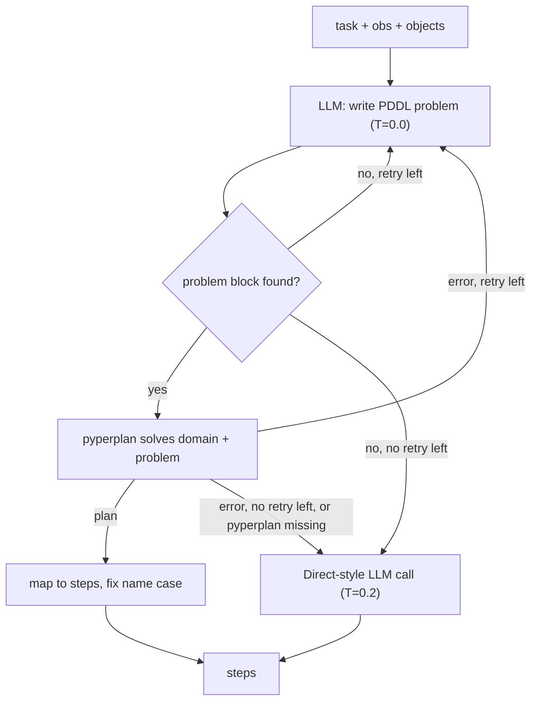

# LLM+P

LLM+P is a different kind of planner. The LLM does not write the plan. It writes a small formal description of the task in PDDL (a standard language for planning problems). A classical search program, `pyperplan`, then finds the plan. The result is mapped back to robot steps. If anything in this chain fails, the planner asks the LLM for a plain plan instead, so it nearly always returns something.

!!! abstract "In this page"
    - The PDDL **domain** (the allowed actions) is fixed and ships with the repository. The LLM writes only the PDDL **problem** (objects, start state, goal), at temperature 0.0.
    - The solver is the optional package `pyperplan` (`pip install "embodiplan[llmp]"`). **It is not installed on the machine used to write this page, so the solver path was not run.**
    - Without `pyperplan`, LLM+P does not stop and does not warn. It makes one translate call, then one Direct-style call: 2 LLM calls, and a note in `metrics.notes`.
    - The domain file and the copy inside the code are not identical. They differ in two preconditions.

!!! code "Where in the code"
    - [`load_domain`](https://github.com/mtbui2010/embodiplan/blob/a69064255c69/embodiplan/llmp.py#L103-L125)
    - [`_solve_pddl`](https://github.com/mtbui2010/embodiplan/blob/a69064255c69/embodiplan/llmp.py#L347-L441)
    - [`pddl_plan_to_steps` and `_recase_steps`](https://github.com/mtbui2010/embodiplan/blob/a69064255c69/embodiplan/llmp.py#L447-L486)
    - [`LLMPPlanner`](https://github.com/mtbui2010/embodiplan/blob/a69064255c69/embodiplan/llmp.py#L492-L708)
    - [`pddl/household_domain.pddl`](https://github.com/mtbui2010/embodiplan/blob/a69064255c69/pddl/household_domain.pddl)

The method follows "LLM+P" by Liu et al. (2023); the file header cites arXiv:2304.11477. Registry key `"LLM+P"`. All planners share the plan format in [Plan format and metrics](../concepts/plan-format.md). A planner built without `host=` sends its prompts to the default host `http://ollama.aistations.org`; pass `host=` (for example `http://localhost:11434`) for a local server.



## LLM+P

### Inputs and options

| name | type | default | meaning |
|---|---|---|---|
| `domain_path` | str or None | None | explicit path to a domain file |
| `search` | str | `"wastar"` | pyperplan search name |
| `heuristic` | str | `"hadd"` | pyperplan heuristic name |
| `repair_retries` | int | 1 | extra translate calls after a parse or solver error (never below 0) |
| `LLMP_SOLVE_TIMEOUT` | env var | `20` | seconds before the solve is stopped |

The options are keyword arguments of the constructor, so `embodiplan.get("LLM+P", host=..., repair_retries=0)` works. There is no factory function for LLM+P, only the registry. `generate_plan(task, obs, visible_objects)` is the standard call; only the first 30 objects go into the prompt.

**Which domain is used.** `load_domain` tries these in order and uses the first non-empty readable file: the `domain_path` argument, the environment variable `EMBODIPLAN_PDDL_DOMAIN` (or the older `PYPLANNER_PDDL_DOMAIN`), then `<repo>/pddl/household_domain.pddl`. If none works it uses a copy of the domain embedded in `llmp.py`. It never raises. A source checkout therefore uses the file. The folder `pddl/` is outside the package `embodiplan*` listed in `pyproject.toml`, so a wheel install most likely falls back to the embedded copy (read from the packaging config; not tested).

**What the domain allows.** Ten operators: `moveto`, `moveto-nofound`, `find`, `pick`, `place`, `putin`, `open`, `close`, `turnon`, `turnoff`. They map to nine robot actions, because both move operators become `MoveTo`. Six predicates: `arrived`, `found`, `holding`, `hand-empty`, `opened`, `turned-on`. There is no operator for `Wash`, `Sit`, `LieOn`, `Serve` or `Wait`, so LLM+P can never produce those through the solver. They can still appear through the fallback call. The domain mirrors the rules in [Symbolic state](../concepts/symbolic-state.md) in spirit, as its comments say; it is a separate hand-written model and not generated from `action_model.py`.

!!! note "The file and the embedded copy differ"
    The comment in `llmp.py` says the embedded copy is byte-compatible with the file. It is not. Besides comments and layout, the file has weaker preconditions: `open` requires only `(found ?c)` and `turnon` requires only `(found ?a)`. The embedded copy also requires `(not (opened ?c))` and `(not (turned-on ?a))`. Which one you get depends on whether the file is found. This was checked by comparing the two texts line by line.

### What the LLM is asked (prompt and temperature)

| call | when | system prompt | user message | temperature |
|---|---|---|---|---|
| translate | always first | `_PROBLEM_SYSTEM`: "you are a PDDL translator", the predicates, rules for the problem, a goal hint | one worked example, then the task, observation and visible objects, ending with "PDDL problem:" | 0.0 |
| translate again | after a parse or solver error, if `repair_retries` allows | same, plus the previous answer and an error message | | 0.0 |
| fallback | when the chain gave no steps | `_FALLBACK_SYSTEM`: action list, step schema, JSON example | task, observation and objects, then "Generate the complete step-by-step plan:" | 0.2 |

The system prompt tells the model to declare every constant in `(:objects ...)`, to use the names from the visible-object list, to include `(hand-empty)` and one `(arrived ...)` fact in `:init`, and to keep the goal solvable. The domain text itself is not sent to the LLM; only the predicate list is.

### Parsing and fallbacks

1. **Find the problem.** `_extract_problem_block` removes code fences, finds `(define (problem`, and reads until the parentheses balance. No match or unbalanced text gives `None` and the error code `no_problem_block`. Comments (`;`) are stripped from the block.
2. **Solve.** `_solve_pddl` writes the domain and problem to two temporary files, parses and grounds them with `pyperplan`, and runs the search. It stops the search after `LLMP_SOLVE_TIMEOUT` seconds with `SIGALRM` (this exists because `pyperplan` has no timeout and some LLM-written problems make it run very long). An empty result raises an error.
3. **Map back.** `pddl_plan_to_steps` turns each grounded operator like `(pick mug)` into a step dict by a fixed table. Unknown operators are dropped. `pyperplan` lowercases every name, so `_recase_steps` restores the case from the visible-object list, and for a name not in the list it only upper-cases the first letter.
4. **Fallback.** If the translate-and-solve part returns no steps, one Direct-style call is made. If that call fails too, the plan is empty.

The error codes and what happens next:

| code in `notes` | meaning | retry? |
|---|---|---|
| (empty) | classical success | n/a |
| `no_problem_block` | the reply had no balanced problem | yes, if retries remain |
| `solve_error:<ExceptionName>` | parse failure, timeout, unsolvable | yes, if retries remain |
| `empty_mapped_plan` | solver plan had no known operators | yes (same prompt again) |
| `pyperplan_missing:<message>` | `pyperplan` cannot be imported | **no**, goes to fallback at once |
| `translate_call_error:<ExceptionName>` | the LLM call raised | no, goes to fallback |
| `...\|fallback_error:<ExceptionName>` | the fallback call raised as well | plan is empty |

The timeout uses `SIGALRM`, which exists only on Unix and can be set only in the main thread. In another thread, `signal.signal` raises `ValueError` before the search starts, and the code counts it as `solve_error:ValueError` (read from the code, not run).

The excerpt shows where a missing `pyperplan` is caught, and the fallback step:

```python
            try:
                grounded = _solve_pddl(
                    self._domain_str, problem_str,
                    search=self._search, heuristic=self._heuristic,
                )
            except ImportError as e:
                # pyperplan absent — cannot do classical solving at all.
                return [], in_tok, out_tok, llm_calls, f"pyperplan_missing:{e}"[:120]
```

[Source: llmp.py L561-L568](https://github.com/mtbui2010/embodiplan/blob/a69064255c69/embodiplan/llmp.py#L561-L568)

### Output and `extra` keys

| field | value |
|---|---|
| `method` | `"LLM+P"` |
| `llm_calls` | translate calls (1 or 2) plus 1 if the fallback ran |
| `notes` | the error code, empty on classical success |
| `parse_ok` | `True` if there is at least one step |
| `extra["llmp_fallback"]` | `True` if the Direct-style call ran |
| `extra["llmp_error"]` | the same text as `notes` |
| `extra["llmp_solve_s"]` | seconds from the start of `generate_plan` to the end, rounded to 3 digits |

!!! note "`llmp_solve_s` is the whole call, not the solve"
    The value is computed as `time.perf_counter() - t0` where `t0` is set at the start of `generate_plan`. It includes the LLM calls. Do not read it as the solver time.

### replan

`replan` adds a note to the task (steps done, the failed step, the reason, "assert completed effects in :init"), and runs the same translate-and-solve code. If that gives no steps it makes a Direct-style call with the shared replan prompt. Its `extra` has only `llmp_fallback` and `llmp_error` (no `llmp_solve_s`). The PDDL problem comes from the LLM, so the result depends on whether the model writes the finished steps into `:init` correctly; nothing checks this.

### Example (scripted)

pyperplan is not installed on this machine. So the **classical solve was not run**, and no example here shows a plan found by the solver. The first example is what the planner does on this machine: the translate reply is a valid problem, the solver import fails, and the second reply is the fallback. The output is with a scripted LLM reply.

```python
import embodiplan

problem = """(define (problem household-task)
  (:domain household)
  (:objects StartPos Kitchen Mug - obj)
  (:init (arrived StartPos) (hand-empty))
  (:goal (holding Mug)))"""
fallback = ('{"steps": [{"action": "MoveTo", "object": "Kitchen"},'
            ' {"action": "Find", "object": "Mug"}, {"action": "Pick", "object": "Mug"}]}')
replies = iter([problem, fallback])
temps = []

def fake_chat(messages, temperature=0.2):
    temps.append(temperature)
    return next(replies), 0, 0

planner = embodiplan.get("LLM+P", host="http://localhost:11434")
planner._chat = fake_chat

steps, m = planner.generate_plan("pick up the mug", "Kitchen.", ["Mug", "CoffeeMachine"])
print(steps)
print(m.llm_calls, m.num_steps, m.parse_ok, temps)
print(repr(m.notes))
print(m.extra["llmp_fallback"], m.extra["llmp_error"])
```

Output, with a scripted LLM reply:

```text
[LLM+P] FALLBACK 3 steps in 0.0s (err=pyperplan_missing:pyperplan unavailable: No module named 'pyperplan')
[{'action': 'MoveTo', 'object': 'Kitchen'}, {'action': 'Find', 'object': 'Mug'}, {'action': 'Pick', 'object': 'Mug'}]
2 3 True [0.0, 0.2]
"pyperplan_missing:pyperplan unavailable: No module named 'pyperplan'"
True pyperplan_missing:pyperplan unavailable: No module named 'pyperplan'
```

So without `embodiplan[llmp]`, LLM+P becomes a Direct-style call plus one extra call (the translate call, whose result is thrown away). The only signs are the printed line, `notes` and `extra`. No exception, no warning from Python.

The back-mapping step can be run without `pyperplan`, because it is plain Python. The input is a list of grounded operator strings of the kind `pyperplan` returns, written by hand here (not produced by a solver run):

```python
from embodiplan.llmp import pddl_plan_to_steps, _recase_steps

grounded = ["(moveto-nofound kitchen startpos)", "(find mug kitchen)",
            "(pick mug)", "(place mug diningtable)"]
steps = pddl_plan_to_steps(grounded)
print(steps)
print(_recase_steps(steps, ["Mug", "DiningTable"]))
print(_recase_steps(pddl_plan_to_steps(["(turnon coffeemachine)"]), []))
```

```text
[{'action': 'MoveTo', 'object': 'kitchen'}, {'action': 'Find', 'object': 'mug'}, {'action': 'Pick', 'object': 'mug'}, {'action': 'Place', 'object': 'diningtable'}]
[{'action': 'MoveTo', 'object': 'Kitchen'}, {'action': 'Find', 'object': 'Mug'}, {'action': 'Pick', 'object': 'Mug'}, {'action': 'Place', 'object': 'DiningTable'}]
[{'action': 'TurnOn', 'object': 'Coffeemachine'}]
```

`kitchen` became `Kitchen` because it is in no list, and the first letter was raised. `coffeemachine` with an empty list became `Coffeemachine`, which is not an AI2-THOR name (`CoffeeMachine`). Pass the real object names in `visible_objects` to avoid this.

Three more runs with a scripted LLM reply, to check the call counts:

| scripted replies | `llm_calls` | `notes` | steps |
|---|---|---|---|
| no problem block, no problem block, valid Direct reply | 3 | `no_problem_block` | 3 |
| translate call raises `ConnectionError`, valid Direct reply | 1 | `translate_call_error:ConnectionError` | 3 |
| translate and fallback both raise `ConnectionError` | 0 | `translate_call_error:ConnectionError\|fallback_error:ConnectionError` | 0 |

In the third row `parse_ok` is `False` and the plan is empty.

### Failure modes

!!! warning "Current behaviour, not features"
    - **Silent downgrade without `pyperplan`.** No error is raised. Check `metrics.extra["llmp_fallback"]` and `metrics.notes`. If you want the real LLM+P, install `embodiplan[llmp]` and confirm that `llmp_fallback` is `False`. A tested install of `pyperplan` and a classical solve were not run for this page.
    - **The wasted translate call.** In the fallback case the PDDL reply is thrown away, so the cost is more than Direct's single call.
    - **Reports as success on a fallback.** `parse_ok` is `True` whenever any steps exist, including fallback steps. Compare against Direct only if you filter on `llmp_fallback`.
    - **The embedded domain is not the file.** See the note above. Set `EMBODIPLAN_PDDL_DOMAIN` or `domain_path` if you need to know which one is used.
    - **Solver time limit.** The limit is 20 seconds by default and uses `SIGALRM`. In a worker thread the alarm cannot be set, so the solve ends in `solve_error:ValueError` and the planner falls back, even if the problem was solvable (read from code, not run). Run LLM+P in the main thread.
    - **Missing actions.** The domain has no `Wash`, `Sit`, `LieOn`, `Serve`, `Wait`. A task that needs them cannot be solved by the solver path.
    - **The goal is whatever the LLM writes.** The solver proves a plan for that goal. If the goal is wrong, the plan is correct for the wrong goal. The same domain model also differs from the rules in [Action model](../reference/action-model.md) in places (the action model has a `hand_full` rule for `Open` and `Close` on one-handed robots, and the domain has no such rule), so a solved plan may still fail the symbolic check.
    - **Name case.** See the `Coffeemachine` example above.

### Tests

None. No file in `tests/` imports `llmp`. Everything on this page about the solver path is read from the code and not run.

## See also

- [Single-call planners](single-call.md): the Direct baseline that LLM+P falls back to.
- [Symbolic state](../concepts/symbolic-state.md) and [Action model](../reference/action-model.md): the rule model that the PDDL domain imitates.
