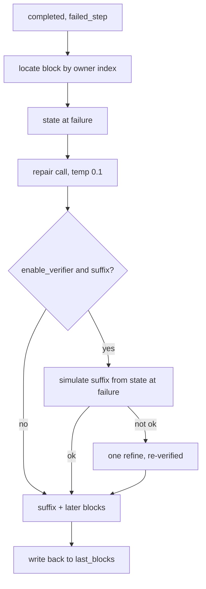

# SAGE, repair and editing

When a step of a plan fails at run time, most planners in embodiplan ask the LLM for a new plan of the whole task. SAGE does not. It finds the sub-goal the failed step belongs to, asks the LLM for the rest of that sub-goal only, and keeps the later sub-goals as they were. This page explains that local repair, the small editing API around it, and `record_episode`, which stores a verified plan in memory.

!!! abstract "In this page"
    - `replan` repairs one sub-goal: one LLM call (temperature 0.1), plus at most one refine call. Later sub-goals are kept.
    - The repair starts from the robot's belief at the failure, not from an empty state.
    - The repaired plan is written back to `last_blocks`, so a second failure is located on the repaired plan.
    - `edit_block`, `last_blocks`, `retrieve_examples` and `flatten` let a caller edit sub-goals itself.
    - `record_episode` stores a plan only if it succeeded and passes the symbolic gate.

!!! code "Where in the code"
    - [`replan`](https://github.com/mtbui2010/embodiplan/blob/76da520/embodiplan/sage.py#L807-L951) and its helpers [`_failed_block_index`](https://github.com/mtbui2010/embodiplan/blob/76da520/embodiplan/sage.py#L984-L989), [`_state_at_failure`](https://github.com/mtbui2010/embodiplan/blob/76da520/embodiplan/sage.py#L991-L1002), [`_remember_repair`](https://github.com/mtbui2010/embodiplan/blob/76da520/embodiplan/sage.py#L1004-L1025), [`_global_replan`](https://github.com/mtbui2010/embodiplan/blob/76da520/embodiplan/sage.py#L1037-L1073)
    - [`edit_block`](https://github.com/mtbui2010/embodiplan/blob/76da520/embodiplan/sage.py#L472-L495), [`SubgoalBlock`](https://github.com/mtbui2010/embodiplan/blob/76da520/embodiplan/sage.py#L163-L170), [`flatten`](https://github.com/mtbui2010/embodiplan/blob/76da520/embodiplan/sage.py#L251-L269)
    - [`record_episode`](https://github.com/mtbui2010/embodiplan/blob/76da520/embodiplan/sage.py#L1075-L1107)

This page assumes you know how SAGE makes its first plan (decompose, expand, gate, refine). That is on [SAGE, planning](sage.md). For why replanning matters in general, see [Replanning](../concepts/replanning.md). The state and the rule codes are in [Symbolic state](../concepts/symbolic-state.md).

!!! warning "The default host"
    A planner built without `host=` sends its prompts to `http://ollama.aistations.org`. For a local server pass `host=`, for example `http://localhost:11434`. The examples below never call a server: they replace the LLM call.

## replan: repair one sub-goal

`replan(task, completed, failed_step, failure_reason, obs, visible_objects, *, state=None, budget=None)` returns `(steps, PlanMetrics)`. `completed` is the list of steps that ran well, `failed_step` is the step that failed, and `steps` is what the robot should run next.

### Inputs and options

| argument | meaning |
|---|---|
| `task` | the same task string given to `generate_plan` |
| `completed` | steps already done (normalised first) |
| `failed_step`, `failure_reason` | the step that failed and why; both go into the prompt |
| `obs`, `visible_objects` | text of the scene (up to 30 object names are listed) |
| `state` | optional belief at the failure: a `SymbolicState` or a dict |
| `budget` | optional object with `take(n=1, what="")`, called before every LLM call (the repair call and the repair refine); a refusal stops the method, see [Failure modes](#failure-modes) |

Two constructor options matter here: `enable_local_repair` (default `True`) and `enable_verifier` (default `True`). `safe_refine` (default `False`) keeps the suffix when a refine returns no steps.

### When it falls back to a global replan

Local repair needs the blocks from an earlier `generate_plan` of the same task. [`replan`](https://github.com/mtbui2010/embodiplan/blob/76da520/embodiplan/sage.py#L841-L843) takes the global path when any of these is true:

- `enable_local_repair` is `False`;
- there are no blocks yet (no `generate_plan` was called);
- `task != _last_task`, that is, the string differs from the one that was planned.

The global path plans again (the same flow as `generate_plan` without `subgoals=`, with the same `budget`) with a longer task text ("... Already done: ... Last action failed ...") and sets `notes="global_replan_fallback"`. The full flow runs again, so it costs a decompose call and an expand call per sub-goal. It keeps `task` as the plan's task, so the next `replan` can be local again.

### How a local repair works



1. **Locate the block.** SAGE keeps, for every step of the flat plan, the index of the block it came from. `flatten` drops steps whose effect already holds (a repeated `MoveTo`), so a step position in the flat plan is not a position in the blocks. The failed step is the one at index `len(completed)`. If `len(completed)` is past the end, the last block is used.
2. **Take the state at failure.** In this order: the `state` argument; the `Robot state:` line of `obs` (see [`belief_from_obs`](https://github.com/mtbui2010/embodiplan/blob/76da520/embodiplan/sage.py#L315-L336)); else the plan's starting belief replayed through `completed`.
3. **Ask for the suffix.** One call, temperature 0.1, system prompt `"repair"`. The user message holds the memory examples (retrieved for the sub-goal text), the overall task, the current sub-goal, the last six completed steps, the failed step and reason, the state, the visible objects and `obs`. It ends with "Generate ONLY the remaining steps to complete the CURRENT sub-goal."
4. **Gate the suffix.** If the verifier is on, the suffix is simulated from the state at failure. On a rule break there is one refine call with the violations as feedback. The refine result is simulated again and dropped if it has more errors than the suffix it replaces (`refine_rejected`).
5. **Build the answer.** `suffix + flattened later blocks`. The later blocks are not sent to the LLM and not checked.
6. **Write back.** [`_remember_repair`](https://github.com/mtbui2010/embodiplan/blob/76da520/embodiplan/sage.py#L1004-L1025) puts the done steps in their blocks, ends the current block with the suffix, and keeps the later blocks. The next failure is located on this new plan.

The prompt-building code, copied from the repository:

```python
        cur_idx = self._failed_block_index(len(completed))
        current_sg = self._last_blocks[cur_idx].name
        future_blocks = self._last_blocks[cur_idx + 1:]
        remaining_after, future_owners = _flatten_owned(future_blocks)
        retrieved, ex_block = self._retrieve_block(current_sg or task)
```

([`sage.py#L845-L849`](https://github.com/mtbui2010/embodiplan/blob/76da520/embodiplan/sage.py#L845-L849))

### Parsing and fallbacks

The reply is read with `parse_steps` and `normalize_plan` (see [Plan format](../concepts/plan-format.md)). If the call raises, SAGE prints `[SAGE] Local repair failed: ...` and uses an empty suffix. The method does not raise. It then returns only the kept later blocks.

### Output and `extra` keys

| field | value |
|---|---|
| returned steps | `suffix + flattened later blocks` |
| `notes` | `"local_repair"` (or `"global_replan_fallback"`) |
| `llm_calls` | `(1 if suffix or tokens else 0) + refines` |
| `extra["repaired_subgoal"]` | name of the repaired sub-goal |
| `extra["refines"]`, `["verifier_rejections"]`, `["refine_rejected"]` | refine count, gate rejections, whether the refine was dropped |
| `extra["suffix_len"]`, `["kept_future_len"]` | steps from the repair, steps kept from later blocks |

### Example (scripted)

The planner's own code runs. Only `_chat` is replaced, so every output below is produced **with a scripted LLM reply**. Task: put the apple on the table. The plan fails at `MoveTo DiningTable` because the table is blocked, and the scripted repair reply is `MoveTo CounterTop, Place CounterTop`.

```python
plan, m = p.generate_plan("put the apple on the table", "", ["Apple","Fridge","DiningTable","CounterTop"])
done, failed = plan[:3], plan[3]
suffix, m = p.replan("put the apple on the table", done, failed, "DiningTable blocked", "",
                     ["Apple","Fridge","DiningTable","CounterTop"])
print(m.notes, m.llm_calls, m.extra)
```

Output, with a scripted LLM reply:

```text
['MoveTo Fridge', 'Find Apple', 'Pick Apple', 'MoveTo DiningTable', 'Place DiningTable']   # the first plan
['MoveTo CounterTop', 'Place CounterTop']                                                  # the suffix
local_repair 1 {'repaired_subgoal': 'put it on the table', 'refines': 0, 'verifier_rejections': 0, 'refine_rejected': False, 'suffix_len': 2, 'kept_future_len': 0}
```

`last_blocks` now shows the write-back. The first block is unchanged and the second ends with the repaired suffix:

```text
[('get the apple', ['MoveTo Fridge', 'Find Apple', 'Pick Apple']), ('put it on the table', ['MoveTo CounterTop', 'Place CounterTop'])]
```

The state sent in the repair prompt came from replaying `completed` (the `obs` was empty): `arrived: Fridge | found: ∅ | holding: Apple | opened: ∅ | on: ∅`. A repair call with another task string, `"another task"`, gave `notes` equal to `global_replan_fallback`.

### Failure modes

- **A budget refusal ends the call.** With `budget=`, `take(what="planner")` runs before the repair call and before the repair refine. When it raises, `replan` re-raises the budget's own exception (the internal `_BudgetStop` never reaches you) and writes nothing back: `last_blocks` and the book-kept owners stay as they were, so a later `replan` with a new budget locates the failure on the same plan. The broad handlers for "Local repair failed" and "Repair-refine error" do not catch it. Run with a scripted backend, this was seen for `generate_plan`; for `replan` it is read from the code and not run.
- **A fixed block can be repaired.** A block the caller gave with its own steps (`fixed=True`, see [SAGE, planning](sage.md#when-the-caller-gives-the-sub-goals)) is not protected from `replan`: the code has no check of `fixed` in the repair path, so the LLM writes the suffix of that block like any other. The steps already done stay, the new suffix is appended, and the rewritten block **keeps `fixed=True`** (`_remember_repair` copies the flag) although its tail came from the LLM. Run with a scripted LLM on a fixed block `MoveTo Sofa, Say dinner` with the first step done, the block became `MoveTo Sofa` plus the two scripted steps and `fixed` stayed `True`. Only `edit_block` leaves a fixed block alone. If a caller wants a fixed block never rewritten, it must not call `replan` for a failure inside it.
- **The task string must match.** A different string (even one extra space) silently gives a global replan and a full planning cost. Use the same variable for both calls.
- **Location uses only `len(completed)`.** SAGE trusts that `completed` is the executed prefix of the plan it returned. If the executor skips or reorders steps, the wrong sub-goal can be repaired. (Read from the code; not run.)
- **A failed repair call looks like a skipped call.** On an exception the suffix is empty and `llm_calls` is 0, although a call was tried. Only the printed line shows the error.
- **A rejected refine keeps an invalid suffix.** When the refine is worse, the first suffix stays, even though it broke a rule. Check `extra["verifier_rejections"]` and `extra["refine_rejected"]`.
- **Later blocks are not re-checked.** If the repair changes the state (for example the robot now holds a different object), a later block may no longer be valid. The gate sees only the suffix.
- **A global fallback drops the fixed blocks.** The fallback plans the remaining task again, without `subgoals=`, so every new block comes from the LLM and none is fixed.
- **Bugs that were fixed, and are pinned by tests** (CHANGELOG 0.2.2): after `flatten` dropped a step, the previous sub-goal was repaired (R1); the repair state was rebuilt from empty (R2); after one global fallback every replan stayed global (R3); the repaired suffix was not written back (R4); a refine result was used without a second check (G1).

### Tests

[`tests/test_sage_repair.py`](https://github.com/mtbui2010/embodiplan/blob/76da520/tests/test_sage_repair.py) has 10 tests that run offline with a `Scripted` subclass of `SAGEPlanner` whose `_chat` answers by the prompt text. They check R1 (the sub-goal after a dedupe, and after an outside edit of a block), R2 (belief from `obs`, from `state`, from replay), the gate from a belief, R3, R4, G1 and recording. [`tests/test_sage_v2_hooks.py`](https://github.com/mtbui2010/embodiplan/blob/76da520/tests/test_sage_v2_hooks.py) covers fixed blocks (`edit_block` returns them unchanged) and the budget for `generate_plan`. The full suite, run with `PYTHONPATH=<repo> python -m pytest tests -q -p no:warnings` at `76da520`, gave **104 passed**. No test covers `replan` on a fixed block or a budget stop inside `replan`.

## Editing a sub-goal yourself

A caller such as a robot assistant loop can edit the plan without `replan`. The public surface:

| name | what it does |
|---|---|
| `last_blocks` | list of `SubgoalBlock(name, steps, refined, refine_rejected, fixed)` from the last `generate_plan`, or `None`. `fixed` is `True` for a block the caller gave with its own steps |
| `retrieve_examples(task)` | memory examples and their prompt block (`""` without memory) |
| `edit_block(block, feedback, *, task, state=None, obs="", visible_objects=None, examples_block=None)` | one refine call for one block; returns the new steps |
| `flatten(blocks)` | the flat plan, with steps whose effect already holds dropped |

`edit_block` sends the "repair sub-goal" prompt (the same one the gate uses for refine) with your `feedback` text. **For a fixed block it returns `list(block.steps)` at once: no LLM call, no feedback used** (checked with `getattr(block, "fixed", False)`, [`sage.py:488-489`](https://github.com/mtbui2010/embodiplan/blob/76da520/embodiplan/sage.py#L488-L489)); for any other block it does **not** change the block, does not verify the result, and uses an empty state when `state` is `None`. It returns `[]` when the reply does not parse, and it raises on LLM errors. It takes no `budget=`. If you change `block.steps` in place, the next `replan` follows the change: owner indices are rebuilt when the blocks differ from the saved copy.

Example, with a scripted LLM reply (the reply is `MoveTo Fridge, Find Apple, Pick Apple`):

```python
blk = SubgoalBlock(name="get the apple", steps=S(("MoveTo","Fridge"),("Pick","Apple")))
new = p.edit_block(blk, "step 2: Pick without Find", task="t")
print(new); print(blk.steps)
```

```text
['MoveTo Fridge', 'Find Apple', 'Pick Apple']
['MoveTo Fridge', 'Pick Apple']
```

The second line shows the block was left alone.

## record_episode: store a verified plan

`record_episode(task, plan, success=True, *, meta=None) -> bool` adds a plan to the live memory (see [Retrieval memory](../concepts/memory.md)). It stores only when all of these hold:

- memory exists (`enable_memory=True`);
- `success` is true and the plan is not empty;
- the plan passes the gate, starting from the plan's start belief when `task` is the last planned task, else from an empty state.

The record carries `verified: true`, the start belief as `init_state`, the action-model version, and your `meta`. Four results, with a stub memory (these did run):

```text
record_episode("t", verified_plan)                -> True
record_episode("t", verified_plan, success=False) -> False
record_episode("t", MoveTo Table, Place Table)    -> False   (nothing held; prints "episode not recorded")
record_episode("t", [])                           -> False
```

With `enable_memory=False` the result is `False` for any plan. A plan after a global fallback does not store `init_state`, because the belief at its start is not the empty one.

!!! warning "Success is your decision"
    `record_episode` checks the plan against the action model. It does not check that the robot reached the goal. Pass `success=True` only when you looked at the result.
