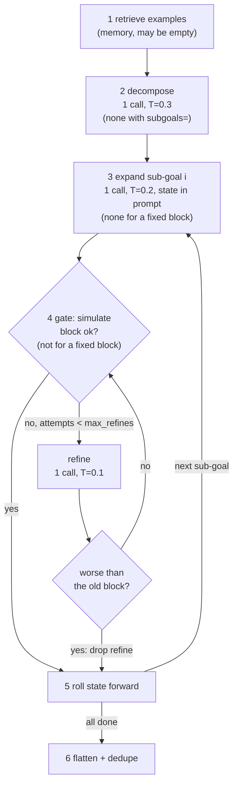
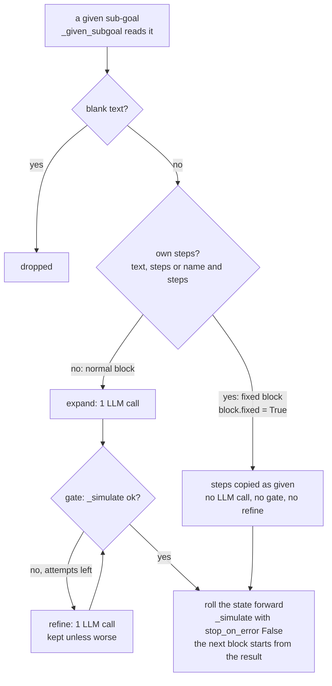
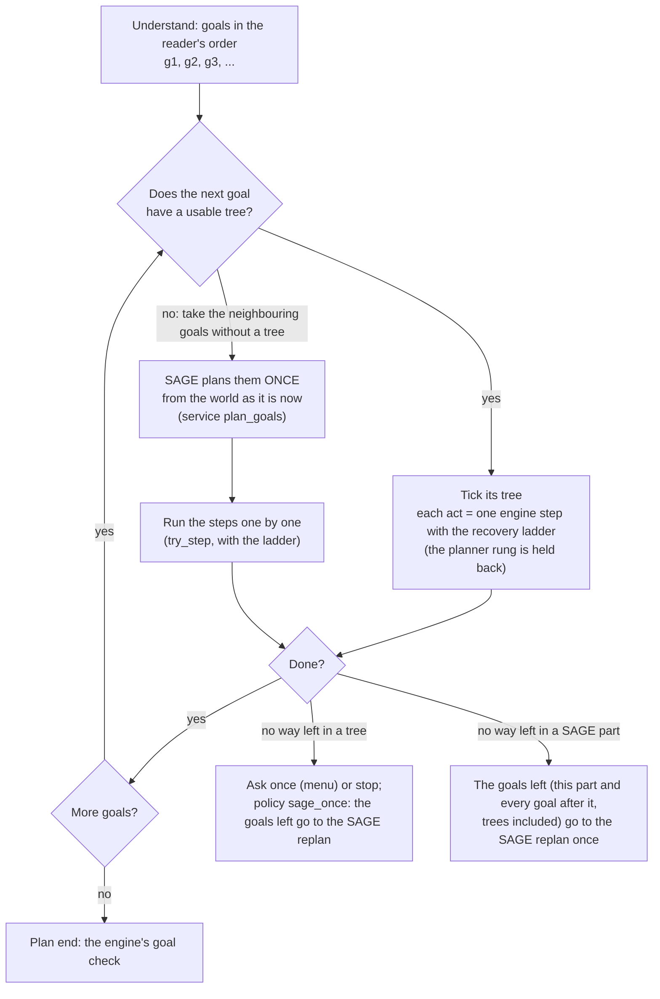

# SAGE, planning

SAGE is the most complete planner in embodiplan. It splits a task into sub-goals, asks the LLM to expand each sub-goal into steps, checks every block with the zero-token [action model](../concepts/symbolic-state.md), asks for one correction when a block breaks a rule, and removes repeated steps at the end. This page covers `generate_plan`, including the two inputs a caller can add: its own sub-goals (with or without fixed steps) and an LLM-call budget. What SAGE does after a step fails is on [SAGE, repair and editing](sage-repair.md).

!!! abstract "In this page"
    - One `generate_plan` with no `subgoals=` makes `1 + N + R` LLM calls: one decompose, one expand per sub-goal (N), and at most `max_refines` refines per block (R).
    - With `subgoals=` the caller gives the sub-goals: no decompose call, and a given sub-goal may carry its own steps (a fixed block: no expand, no refine). See [When the caller gives the sub-goals](#when-the-caller-gives-the-sub-goals).
    - With `budget=` an object's `take()` runs before every LLM call, and a refusal stops the planner between two calls. See [A caller budget](#a-caller-budget).
    - The gate checks each block from the running symbolic state. A refine that verifies worse than the block it replaces is dropped.
    - Memory examples are pasted into the decompose, expand and refine prompts. With the default constructor the example pool is **empty**, so nothing is retrieved until you pass `gt_path=` or `live_path=`.
    - `actions=[...]` and `robot_description=` rewrite the four system prompts for a robot with its own actions. The defaults stay byte-identical to version 0.2.3.

!!! code "Where in the code"
    - [Prompts](https://github.com/mtbui2010/embodiplan/blob/76da520/embodiplan/sage.py#L67-L120) and [`SAGEPlanner.__init__`](https://github.com/mtbui2010/embodiplan/blob/76da520/embodiplan/sage.py#L363-L435)
    - [`_decompose`, `_expand`, `_refine`](https://github.com/mtbui2010/embodiplan/blob/76da520/embodiplan/sage.py#L508-L592), [`_chat`, the budget](https://github.com/mtbui2010/embodiplan/blob/76da520/embodiplan/sage.py#L437-L446)
    - [`generate_plan`](https://github.com/mtbui2010/embodiplan/blob/76da520/embodiplan/sage.py#L597-L802), [`_given_subgoal`](https://github.com/mtbui2010/embodiplan/blob/76da520/embodiplan/sage.py#L241-L248), [`_worse`](https://github.com/mtbui2010/embodiplan/blob/76da520/embodiplan/sage.py#L1027-L1035)
    - [`_parse_subgoals`](https://github.com/mtbui2010/embodiplan/blob/76da520/embodiplan/sage.py#L220-L234), [`flatten`](https://github.com/mtbui2010/embodiplan/blob/76da520/embodiplan/sage.py#L251-L300), [`belief_from_obs`](https://github.com/mtbui2010/embodiplan/blob/76da520/embodiplan/sage.py#L315-L336)
    - [`robot_prompt.system_prompts`](https://github.com/mtbui2010/embodiplan/blob/76da520/embodiplan/robot_prompt.py#L144-L164), [`MemoryRetriever.retrieve`](https://github.com/mtbui2010/embodiplan/blob/76da520/embodiplan/memory_retriever.py#L322-L338)

!!! warning "Default host"
    A planner built without `host=` sends its prompts to `http://ollama.aistations.org` (`embodiplan/base.py:23`). Pass `host="http://localhost:11434"` for a local Ollama server. The backends are `ollama`, `openai` and `gemini`; `provider="anthropic"` raises `ValueError`. The examples on this page set `host=` and never call a server: they replace `_chat`.

## SAGE

The registry key is `"SAGE"`.

### Inputs and options

`generate_plan(task, obs, visible_objects, *, state=None, subgoals=None, budget=None)` returns `(steps, PlanMetrics)`. See [Plan format](../concepts/plan-format.md) for both.

| argument | meaning |
|---|---|
| `task` | the task in plain words |
| `obs` | scene text. A `Robot state: arrived=... found=... holding=... opened=[...] on=[...]` line in it is read as the start belief |
| `visible_objects` | object names; the first 30 go in the prompts and all go in the gate |
| `state` | start belief (`SymbolicState` or a duck-typed world). Wins over `obs` |
| `subgoals` | the caller's own sub-goals: no decompose call. Each item is a string, `(text, steps)` or `{"name": text, "steps": steps}`; with steps it is a fixed block. See [below](#when-the-caller-gives-the-sub-goals) |
| `budget` | an object with `take(n=1, what="")`, called before every LLM call; its exception stops the planner. See [below](#a-caller-budget) |

The gate starts from `state`, else from the `Robot state:` line of `obs`, else from an empty state ([`sage.py:665-668`](https://github.com/mtbui2010/embodiplan/blob/76da520/embodiplan/sage.py#L665-L668)). Without this, a plan for a robot that already holds a mug would be "refined" for a problem it does not have (fixed in 0.2.2, see `CHANGELOG.md`).

Constructor options ([`sage.py:363-385`](https://github.com/mtbui2010/embodiplan/blob/76da520/embodiplan/sage.py#L363-L385)):

| name | default | meaning |
|---|---|---|
| `top_k` | `3` | examples retrieved per task |
| `max_refines` | `1` | refine calls per block |
| `gt_path`, `live_path` | `""` | seed pool (a `.json` dataset or `.jsonl`) and live JSONL pool |
| `use_chroma`, `chroma_path` | `False`, `""` | Chroma vector search, when `chromadb` is installed |
| `memory` | `None` | your own retriever object |
| `enable_verifier` | `True` | gate on or off |
| `enable_memory` | `True` | retrieval on or off |
| `enable_local_repair` | `True` | used by `replan` only |
| `safe_refine` | `False` | when `True`, a refine that parses to `[]` keeps the prior steps |
| `capabilities` | one hand, `Find` reaches | the robot body the gate assumes |
| `leave_one_out` | `False` | never return the exact task as an example (evaluation) |
| `actions`, `robot_description` | `None` | the robot's own prompt, see [below](#a-robots-own-action-list) |
| `progress` (attribute) | `None` | `callable(dict)` called at each stage, for a UI |

`SAGEPlanner.fixed_subgoals` is a class attribute, `True`. A caller can read it to learn that this planner keeps the steps of a fixed block (0.2.7).

### What the LLM is asked (prompt and temperature)

Three kinds of call are made in `generate_plan`; with `subgoals=` the decompose call is not made. Each has a fixed system prompt and one user message.

| call | system prompt | user message holds | temperature |
|---|---|---|---|
| decompose | `_DECOMPOSE_SYSTEM`: "break the given task into 2-5 ordered sub-goals", reply `{"subgoals": [...]}` | examples block, task, `obs`, visible objects | 0.3 |
| expand (one per sub-goal) | `_EXPAND_SYSTEM`: action list, `STEP_SCHEMA`, `JSON_EXAMPLE` | examples block, overall task, current sub-goal (with `subgoals=`, also the line "Plan only this sub-goal; the earlier sub-goals are done (see the state)."), **current symbolic state**, `obs`, visible objects | 0.2 |
| refine (only after a rejection) | `_REFINE_SYSTEM` | examples block, task, sub-goal, state at block start, previous attempt as JSON, violation feedback | 0.1 |

The `repair` prompt exists too but is used only by `replan` ([repair page](sage-repair.md)).

### The stages



**1. Retrieve.** `_retrieve_block(task)` asks the memory for the top `top_k` examples and formats them as one text block. With memory off or any exception the block is `""` ([`sage.py:498-505`](https://github.com/mtbui2010/embodiplan/blob/76da520/embodiplan/sage.py#L498-L505)).

**2. Decompose.** One call (skipped when the caller gives `subgoals=`, see below). The reply goes through `_parse_subgoals`. If the call raises, or the parser finds nothing, the sub-goal list becomes `[task]` ([`sage.py:646-659`](https://github.com/mtbui2010/embodiplan/blob/76da520/embodiplan/sage.py#L646-L659)). The parser exists because 7-8B models often answer in odd shapes. In one evaluation a model split sub-goals into single words and a two-object task became 61 steps in 22 blocks (0.2.5, `CHANGELOG.md`). The parser now handles word lists, step-shaped dicts, two JSON objects in a row, and prose with no JSON. Real results:

| LLM text | result |
|---|---|
| `{"subgoals": ["MoveTo","Kitchen","Find","Mug"]}` | `['MoveTo Kitchen', 'Find Mug']` |
| `{"subgoals": ["Go to the sofa", "Pick up the mug"]}` | unchanged phrases |
| `I cannot.` | `[]` (then `generate_plan` uses `[task]`) |

**3. Expand.** For each sub-goal, one call. The prompt carries the symbolic state after the previous block, for example `arrived: Fridge | found: ∅ | holding: Apple | opened: ∅ | on: ∅`. The reply goes through `parse_steps` and `normalize_plan`. If the call raises, the block gets `[]` and the gate is skipped for it. A fixed block has no expand call: its steps are the caller's.

**4. Gate and refine.** This is the loop at [`sage.py:701-748`](https://github.com/mtbui2010/embodiplan/blob/76da520/embodiplan/sage.py#L701-L748). In short (the loop is skipped for a fixed block, `... and not block.fixed`):

1. `simulate` runs the block from the running state.
2. While the report is not ok and fewer than `max_refines` refines were made, build feedback with `format_violations_for_llm` and call `_refine`.
3. Re-verify the refine output. If `_worse` says it has more errors than its input, set `block.refine_rejected = True` and stop. The earlier steps are kept.
4. Otherwise the refine output replaces the block and the loop checks it again.

```python
def _worse(self, new_steps, new_report, old_steps, state, visible_objects) -> bool:
    """True when a refine output re-verifies with more errors than its input."""
    if new_report.ok:
        return False
    old = self._simulate(old_steps, initial_state=state, visible_objects=visible_objects,
                         stop_on_error=False, apply_on_error=True)
    new = self._simulate(new_steps, initial_state=state, visible_objects=visible_objects,
                         stop_on_error=False, apply_on_error=True)
    return _n_errors(new) > _n_errors(old)
```

([`sage.py:1027-1035`](https://github.com/mtbui2010/embodiplan/blob/76da520/embodiplan/sage.py#L1027-L1035).) Equal error counts are accepted. A refine with fewer errors is accepted even if it is still not ok. The feedback text lists the first violation and a fixed list of common fixes; the example below prints one.

**5. Roll forward.** After the loop, the block is simulated again with `stop_on_error=False`, and the final state becomes the start state for the next sub-goal. So later sub-goals see the effects even of an imperfect block ([`sage.py:763-771`](https://github.com/mtbui2010/embodiplan/blob/76da520/embodiplan/sage.py#L763-L771)).

**6. Flatten and dedupe.** `flatten` joins the blocks and drops a step whose effect already holds: `MoveTo X` when already at X, `Find X` when X is already found (and nothing is held), `Open X` when X is open, `Close X` when X is not open, `TurnOn X` when X is on, `TurnOff X` when X is off. `Pick` and `Place` are never dropped ([`sage.py:251-300`](https://github.com/mtbui2010/embodiplan/blob/76da520/embodiplan/sage.py#L251-L300)). The block list stays in `planner.last_blocks`, so the dedupe does not change the blocks, only the flat plan.

### Parsing and fallbacks

| situation | what happens |
|---|---|
| decompose raises or gives no sub-goals | one sub-goal: the task itself |
| `subgoals=` given, but every text is blank | one sub-goal: the task itself (blank texts are dropped) |
| expand raises (not a budget refusal) | that block is `[]`, no gate |
| expand reply is not parsable | `parse_steps` gives `[]`, the block is empty, no gate (the gate needs `steps`) |
| refine raises (not a budget refusal) | the loop stops; the prior steps stay |
| the budget refuses a call | `generate_plan` raises the budget's own exception; see [A caller budget](#a-caller-budget) |
| refine parses to `[]` and `safe_refine=False` | `[]` is simulated, is ok, and **replaces** the block |
| refine parses to `[]` and `safe_refine=True` | the prior steps stay |
| `enable_verifier=False` | the gate and refine loop (step 4) is skipped; blocks are used as expanded |

`parse_ok` in the metrics is `bool(flat)`: true when the final plan has at least one step.

### Output and `extra` keys

`PlanMetrics.method` is `"SAGE"`, `llm_calls` counts only calls that returned, and `extra` has seven keys ([`sage.py:786-794`](https://github.com/mtbui2010/embodiplan/blob/76da520/embodiplan/sage.py#L786-L794)):

| key | type | meaning |
|---|---|---|
| `subgoals` | list[str] | sub-goal names |
| `retrieved_tasks` | list[str] | tasks of the retrieved examples |
| `refines` | int | refine calls made |
| `verifier_rejections` | int | times a block failed the gate and a refine was started |
| `subgoal_block_sizes` | list[int] | steps per block, before dedupe |
| `refined_blocks` | list[bool] | a refine was called for this block (false for a fixed block) |
| `refine_rejected` | list[bool] | a refine was dropped as worse |

`planner.last_blocks` holds `SubgoalBlock(name, steps, refined, refine_rejected, fixed)` for the last plan ([`sage.py:163-170`](https://github.com/mtbui2010/embodiplan/blob/76da520/embodiplan/sage.py#L163-L170)). `extra` is not in `to_dict()`.

### When the caller gives the sub-goals

A caller that already knows the sub-goals passes them: `generate_plan(..., subgoals=[...])`. SAGE then does not decompose. It expands each given sub-goal on its own, one expand call each, plus refines. The symbolic state after one block is the start state of the next. Each expand prompt also says "Plan only this sub-goal; the earlier sub-goals are done (see the state)." Without `subgoals` (or with an empty list) SAGE decomposes as described above. A blank sub-goal text is dropped; if nothing is left the list is `[task]`.

```python
        if given:
            subgoals = []
            for g in given:
                name, own = _given_subgoal(g)
                if not name.strip():
                    continue
                if own is not None:
                    fixed_steps[len(subgoals)] = own
                subgoals.append(name)
```

([`sage.py:637-645`](https://github.com/mtbui2010/embodiplan/blob/76da520/embodiplan/sage.py#L637-L645).) So the calls are `N + R` (no decompose), and fewer when a block is fixed.

**Fixed block.** A given sub-goal may be a string, a pair `(text, steps)` or `{"name": text, "steps": steps}`. With steps it is a fixed block: the caller wrote the steps, and the LLM never does. `_given_subgoal` ([`sage.py:241-248`](https://github.com/mtbui2010/embodiplan/blob/76da520/embodiplan/sage.py#L241-L248)) tells the three forms apart: a dict needs a list `steps` and a `name`, a tuple needs exactly two items with a list second; anything else is read as a string.

For a fixed block:

- there is no expand call, no gate and no refine (`if self.enable_verifier and steps and not block.fixed:`), and `block.fixed` is `True`;
- the state still rolls forward through it: the block is simulated like any other, and the final state is the start of the next block, so a later block is planned from what the fixed steps did;
- the steps go into the plan as given, even if the gate would reject them. SAGE does not check them; run `simulate` yourself if you need that;
- `edit_block` returns its steps unchanged, with no LLM call ([repair page](sage-repair.md#editing-a-sub-goal-yourself));
- `SAGEPlanner.fixed_subgoals = True` tells a caller that this form is accepted.

The picture compares the two kinds of block. It is the middle of `generate_plan` for one given sub-goal ([`sage.py`, L634-L645 and L664-L748](https://github.com/mtbui2010/embodiplan/blob/76da520/embodiplan/sage.py#L634-L748)). The refine loop itself is the one in the stages picture above.



Caption: drawn from the code at 76da520, not from a recorded run (the scripted run below shows the fixed side). A normal block that has no steps after expand (an expand error) skips the gate too.

Run with a scripted backend (the planner's own code; only the LLM reply is scripted, and every expand reply is `MoveTo DiningTable, Place DiningTable`). Sub-goals: a fixed block "fetch the cup" with three steps, and the string "put it on the table":

```text
m.llm_calls = 1, budget used = 1, [b.fixed for b in last_blocks] = [True, False]
subgoal_block_sizes = [3, 2], refined_blocks = [False, False]
steps: MoveTo Kitchen, Find Cup, Pick Cup, MoveTo DiningTable, Place DiningTable
edit_block(last_blocks[0], "anything", task="serve") == the given steps: True, no new call
```

The only LLM call was the expand of the string sub-goal.

### A caller budget

`generate_plan(..., budget=obj)` and `replan(..., budget=obj)` take an object with a method `take(n=1, what="")`. SAGE calls `obj.take(what="planner")` before **every** LLM call: decompose, expand, refine, repair and the repair refine ([`_chat`, `sage.py:437-446`](https://github.com/mtbui2010/embodiplan/blob/76da520/embodiplan/sage.py#L437-L446)). A fixed block makes no call, so it costs nothing. The budget class must accept the keyword `what=`.

When `take` raises an `Exception`, SAGE wraps it in the internal `_BudgetStop` and stops before that call ([`_BudgetStop`, `sage.py:151-158`](https://github.com/mtbui2010/embodiplan/blob/76da520/embodiplan/sage.py#L151-L158)). `generate_plan` (and `replan`) then re-raises **the budget's own exception**, unchanged; the wrapper never reaches the caller. The broad `except Exception` handlers that normally turn an LLM error into a fallback let `_BudgetStop` through. So a refused budget is not "decompose failed, use `[task]`": it ends the call.

What it leaves behind, run with a scripted backend and a budget that allows one call, `subgoals=["a", "b"]`:

```text
OverflowError: planner: budget 1 used | LLM calls sent 1 | last_blocks None
```

One call went out, the second was refused before it was sent, and `last_blocks` stayed `None`: the book-keeping that `replan` needs is written only when `generate_plan` finishes, so a stopped call leaves the previous plan (or none) in place. The budget is a per-call argument: both methods reset it to `None` when they end, also after an error. `edit_block` is outside them, so it is not budgeted. A global-fallback `replan` plans again with the same budget.

#### How robot_agent uses it

This part is about robot_agent, a separate repository. The behaviour tree is **in robot_agent, not in embodiplan**, and embodiplan's code does not contain it. The full rules are in robot_agent `docs/bt_goal.md` (section "Mixed") and `docs/options.md` (section `bt_goal`).

- robot_agent passes one sub-goal per goal it understood (`AssistLoop._subgoals` in `robot_agent/core/planning/assist_loop.py`). With the option `person_goals`, a goal of a template kind (go, say, deliver) is passed as a fixed block `(text, steps)` (`_lab_subgoals`), so SAGE never rewrites an exact sentence.
- The option `bt_goal`, key `mixed`, is on by default in robot_agent, and a robot that declares no behaviour trees gets no change. Goals whose kind has a declared behaviour tree are run by the tree and never reach SAGE. Neighbouring goals without a tree are given to SAGE together in ONE call. That call happens when the run reaches them, so SAGE plans from the world as it is then, after the trees before it have acted. The call goes through `plan_goals(run, goals)` in `robot_agent/core/planning/option_services.py`, which sets the run's goals to that part and then calls `_plan_call(..., subgoals=lp._subgoals(run))`.
- If a step has no way left, the goals that are left (this part and every goal after it, trees included) go to the SAGE replan once.
- With no goal that has a tree, SAGE plans the whole run as when the key is off.

How a run with trees goes (the loop is in robot_agent; SAGE is the "SAGE plans them ONCE" box):



**Not covered.**

- A SAGE part planned this way skips robot_agent's loop certify gate. Only SAGE's own verifier runs.
- No result on the benchmark yet: not measured.

### replan

SAGE does not repeat the full task after a failure. It finds the sub-goal the failed step belongs to and asks the LLM only for the rest of that sub-goal, from the believed state. That is covered, with the editing API and `record_episode`, on [SAGE, repair and editing](sage-repair.md). A fixed block is not protected from `replan`: see that page.

### Example (scripted)

The planner's own code runs. Only `_chat` is replaced: it returns four fixed texts, one per call. The task asks for an apple from the fridge. The scripted expand reply for the second sub-goal repeats the fridge steps, which the gate rejects.

```python
from embodiplan.sage import SAGEPlanner

REPLIES = [  # one fixed text per call: decompose, expand, expand, refine
    '{"subgoals": ["get the apple from the fridge", "put it on the table"]}',
    '{"steps": [{"action": "MoveTo", "object": "Fridge"}, {"action": "Find", "object": "Apple"}, {"action": "Pick", "object": "Apple"}]}',
    '{"steps": [{"action": "MoveTo", "object": "Fridge"}, {"action": "Open", "object": "Fridge"}, {"action": "Find", "object": "Apple"}, {"action": "Pick", "object": "Apple"}]}',
    '{"steps": [{"action": "MoveTo", "object": "DiningTable"}, {"action": "Place", "object": "DiningTable"}]}',
]
class Scripted(SAGEPlanner):
    def _chat(self, messages, temperature=0.2):
        self.__dict__.setdefault("calls", []).append(messages)
        print("call", len(self.calls), "temperature", temperature)
        return REPLIES[len(self.calls) - 1], 0, 0

p = Scripted(host="http://localhost:11434", model="scripted", enable_memory=False)
steps, m = p.generate_plan("put the apple from the fridge on the table",
                           "A kitchen.", ["Apple", "Fridge", "DiningTable"])
```

Output with a scripted LLM reply:

```text
call 1 temperature 0.3
call 2 temperature 0.2
call 3 temperature 0.2
call 4 temperature 0.1
[SAGE] subgoals=2 steps=5 refines=1 latency=0.0s retrieved=[]
```

`steps` with a scripted LLM reply (one per line here):

```text
{'action': 'MoveTo', 'object': 'Fridge'}
{'action': 'Find', 'object': 'Apple'}
{'action': 'Pick', 'object': 'Apple'}
{'action': 'MoveTo', 'object': 'DiningTable'}
{'action': 'Place', 'object': 'DiningTable'}
```

`m.llm_calls` is `4`, `m.num_steps` is `5`. `m.extra` with a scripted LLM reply:

```text
{'subgoals': ['get the apple from the fridge', 'put it on the table'], 'retrieved_tasks': [], 'refines': 1, 'verifier_rejections': 1, 'subgoal_block_sizes': [3, 2], 'refined_blocks': [False, True], 'refine_rejected': [False, False]}
```

Block 1 passed the gate. Block 2 started with the apple in hand (state `holding: Apple`), so `Open Fridge` broke the one-hand rule and triggered the refine. The refine prompt that SAGE built (`p.calls[3][-1]["content"]`) was:

```text
=== REPAIR SUB-GOAL ===
Overall task: put the apple from the fridge on the table
Current sub-goal: put it on the table

Robot symbolic state at start of sub-goal:
  arrived: Fridge | found: ∅ | holding: Apple | opened: ∅ | on: ∅

Visible objects: Apple, Fridge, DiningTable
Scene observation:
A kitchen.

Previous attempt:
{"steps": [{"action": "MoveTo", "object": "Fridge"}, {"action": "Open", "object": "Fridge"}, {"action": "Find", "object": "Apple"}, {"action": "Pick", "object": "Apple"}]}

The previous plan violates these preconditions:
  step 2 (Open Fridge): cannot Open 'Fridge' while holding 'Apple' (one hand)

Fix the plan so each step satisfies its preconditions. Common fixes:
  - Insert MoveTo <container> + Open before Find for items inside containers.
  - Insert Find <object> before Pick / Open / Close / TurnOn / TurnOff.
  - Insert MoveTo <receptacle> before Place; the receptacle must match.
  - Do not Pick while already holding something — Place the held item first.
  - The robot has one hand: Open / Close containers before the Pick.
```

#### A refine that is dropped, and the dedupe

Same recipe, other scripted replies, and memory on (`gt_path="embodiplan/data/eval_dataset_gt.json"`, task "make a cup of coffee"). The block "carry it to the table" is scripted as `MoveTo Kitchen, Pick Mug, Pick Mug`; the scripted refine is four `Pick Mug` steps, which has more errors. Printed values with a scripted LLM reply (the script is the same as above, with these replies; `m.extra` without `retrieved_tasks`, then `m.llm_calls`, then the flat plan):

```text
{'subgoals': ['get the mug', 'carry it to the table'], 'refines': 1, 'verifier_rejections': 1, 'subgoal_block_sizes': [3, 3], 'refined_blocks': [False, True], 'refine_rejected': [False, True]}
4
[{'action': 'MoveTo', 'object': 'Kitchen'}, {'action': 'Find', 'object': 'Mug'}, {'action': 'Pick', 'object': 'Mug'}, {'action': 'Pick', 'object': 'Mug'}, {'action': 'Pick', 'object': 'Mug'}]
```

`refine_rejected` is `[False, True]`: the four-step refine was dropped and the three-step block stayed. The flat plan has 5 steps, not 6, because `flatten` removed the second `MoveTo Kitchen`. The plan still contains two invalid `Pick Mug` steps. The gate improves a block when it can and does not guarantee a valid plan. Check the final plan yourself with `simulate` if you need that guarantee.

## How memory examples enter the prompts

The retriever is a `MemoryRetriever` holding a **seed** pool (from `gt_path`) and a **live** pool (from `live_path`, plus episodes added at runtime). With the default constructor both paths are `""`, both pools are empty, and `retrieve` returns `[]`: the example block is empty and no example text is sent (`memory_retriever.py:182-192`). Pass `gt_path` to get seed examples.

`retrieve(query, k)` scores each example by Jaccard word overlap with the task, sorts, and keeps the top `k` with a score above zero, else the top `k` anyway (`memory_retriever.py:312-319`). The Chroma path is used only when `use_chroma=True` and `chromadb` can be imported. **Chroma retrieval was not run for this page** (`chromadb` is not installed here); everything above uses the Jaccard retrieval.

`format_examples_block` writes each example as a header, the task, a reasoning text and the plan text, joined by blank lines. With the seed file above, the first part of the decompose user message for "make a cup of coffee" was (real output, no LLM involved):

```text
=== RETRIEVED EXAMPLE 1 (GT, score=0.62) ===
Task: Make a cup of coffee using the coffee machine

Reasoning:
Task takes place in the kitchen. Key objects involved: Mug, CoffeeMachine. Plan follows MoveTo → Find → Pick → MoveTo → Place pattern, wrapping Open/Cl
```

`retrieved_tasks` for that run was `['Make a cup of coffee using the coffee machine', 'Fill a cup with water from the sink', 'Prepare a coffee and place it on the dining table']`. The same block goes into the decompose, expand and refine user messages (and the repair message in `replan`). Seed reasoning text is synthetic: it is generated by `_format_reasoning` and has the same "MoveTo → Find → Pick → MoveTo → Place" pattern for every seed.

!!! warning "A wrong example is copied"
    The model imitates the examples it sees. Only plans that pass the action model are written to the live pool by `record_episode` (see [SAGE, repair and editing](sage-repair.md)). Keep the pool clean; the background is on [Memory](../concepts/memory.md).

## A robot's own action list

By default the prompts describe a household robot with the 14 actions. With `actions=[...]` and `robot_description=...` the constructor calls `system_prompts(_DEFAULT_SYSTEM, actions, robot_description)` once and stores the four rewritten prompts in `self.system_prompts` ([`sage.py:405-407`](https://github.com/mtbui2010/embodiplan/blob/76da520/embodiplan/sage.py#L405-L407)). Each entry is a bare name or a line `"Name <arg>: what it does"`.

`system_prompts` works by exact string replacement of the default action list, `STEP_SCHEMA` and `JSON_EXAMPLE` inside each prompt; the decompose prompt also gets a line naming the allowed actions; a description replaces the opening line of each prompt ([`robot_prompt.py:144-164`](https://github.com/mtbui2010/embodiplan/blob/76da520/embodiplan/robot_prompt.py#L144-L164)). Run offline:

```python
p = SAGEPlanner(host="http://localhost:11434", model="scripted", enable_memory=False,
                actions=["MoveTo <place>: drive there", "Say <text>: say it"],
                robot_description="A delivery base without an arm.")
print(p._system("decompose"))
```

```text
You are the high-level task planner of this robot: A delivery base without an arm.
Study the retrieved examples to understand sub-goal granularity, then
break the given task into 2–5 ordered sub-goals (short natural-language
phrases). Each sub-goal should be a distinct phase the robot will
execute end-to-end before moving on.

The robot can only do these actions: MoveTo, Say. Plan no sub-goal that needs another action.

Return ONLY valid JSON — no markdown, no explanation:
{"subgoals": ["sub-goal 1", "sub-goal 2", ...]}
```

The expand prompt for the same robot lists only `MoveTo <place>: drive there` and `Say <text>: say it`, keeps only the `MoveTo` rule, and ends with the example `{"action": "MoveTo", "object": "Kitchen"}, {"action": "Say", "object": "Target"}`. Without `actions` and `robot_description`, `system_prompts == _DEFAULT_SYSTEM` is `True`, and the four defaults joined by `\n=====\n` equal `tests/data/sage_prompts_0_2_3.txt` byte for byte (`tests/test_robot_prompt.py`, test `test_defaults_byte_identical_to_0_2_3`).

!!! warning "The gate does not know your actions"
    `SAGEPlanner._simulate` passes only the capabilities to the action model, not `actions` ([`sage.py:458-460`](https://github.com/mtbui2010/embodiplan/blob/76da520/embodiplan/sage.py#L458-L460)). The gate therefore reports any name outside the 14 default actions as `unknown_action`. Run with scripted replies, a robot with `actions=["MoveTo <place>: ...", "Say <text>: ..."]` planned `MoveTo Door, Say Hello`. The gate reported `unknown_action` for `Say Hello` (violation index 1, counted from 0), a refine was called, and the scripted refine `{"steps": []}` was accepted (an empty plan has no violations). The result was `steps=0`, `llm_calls=3`, `refines=1`. If your robot has actions outside the defaults, set `enable_verifier=False` or use `safe_refine=True`, and do not rely on the gate for them.

The robot-prompt rewrite is also fragile in one way: it replaces exact text, so changing `STEP_SCHEMA` in `base.py` would make it silently change nothing. The golden-file test guards the default case.

## Failure modes

| what you see | cause | what to do |
|---|---|---|
| Plan has invalid steps although the gate ran | `max_refines` is 1; a refine may fail or be dropped as worse; the block is kept as is | check with `simulate`; raise `max_refines` if you accept more calls |
| Empty plan after a refine | a refine that parses to `[]` is accepted when `safe_refine=False` | pass `safe_refine=True` |
| `retrieved_tasks == []` | no `gt_path` or `live_path`, or an empty pool | pass `gt_path` |
| Many tiny blocks | the model answered sub-goals as words | handled by `_parse_subgoals` for names in the action list; for a robot's own actions pass `actions=` |
| Prompts go to an unexpected server | default `host` | pass `host=` |
| Robot-specific action names rejected | see the warning above | `enable_verifier=False` |
| `generate_plan` raises the budget's exception | the caller's budget refused the next call | the plan was not built and `last_blocks` is unchanged; give a larger budget or catch it |
| A fixed block's steps look wrong | they are the caller's and are not checked | check them with `simulate` before passing them |

Problems met in real use and fixed are listed in `CHANGELOG.md`: word-split sub-goals (0.2.5), a gate that started from an empty state (0.2.2), and an unverified refine used as is (0.2.2).

## Tests

Run in this worktree with `PYTHONPATH=<repo> python -m pytest tests -q -p no:warnings` (code commit `76da520`): **104 passed** (all of `tests/`).

- `tests/test_sage_v2_hooks.py`: seven tests for the 0.2.6 and 0.2.7 inputs. Given sub-goals skip decompose and expand once each, and each expand prompt says the earlier ones are done; without `subgoals` nothing changes; the budget is taken per call and stops between calls (a budget of 1 sends one call, then raises `OverflowError`), and `_budget` is `None` after the call; a release action (`Handover`) empties the hand in the action model; `parse_steps` reads numbers as text; a fixed sub-goal keeps the caller's steps, costs no call, and `edit_block` returns it unchanged.
- `tests/test_sage_subgoals.py`: five tests for `_parse_subgoals` (phrases, words joined, step-shaped items, no JSON, robot action names).
- `tests/test_sage_repair.py`: scripted-planner tests, including `test_worse_refine_is_dropped` (a worse refine is dropped, an equal-or-better one is kept) and the repair and recording tests used by the [repair page](sage-repair.md).
- `tests/test_robot_prompt.py`: five tests, including the byte-identity check against `tests/data/sage_prompts_0_2_3.txt`.
- `tests/test_memory_tools.py`: the memory pool tools.

No test covers `replan` on a fixed block or a budget stop inside `replan`; the notes on them in these pages come from small scripted runs.

## Next

- [SAGE, repair and editing](sage-repair.md): `replan`, `edit_block`, `record_episode`.
- [Symbolic state](../concepts/symbolic-state.md) and [Action model](../reference/action-model.md): what the gate checks.
- [Memory](../concepts/memory.md) and [Prompts](../reference/prompts.md).
