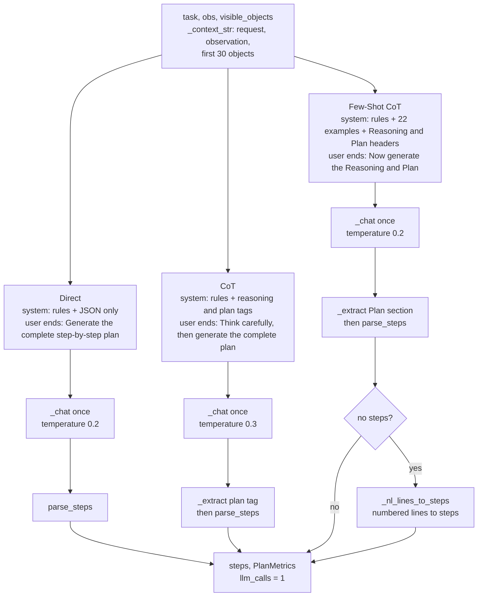

# Single-call (Direct, CoT, Few-Shot CoT)

A single-call planner asks the LLM once and turns the reply into a plan. It does not check the plan, it does not ask a second question, and it does not look at the world again. These three planners are the simplest in embodiplan. They differ only in what the prompt asks the model to write besides the plan.

!!! abstract "In this page"
    - Direct, CoT and Few-Shot CoT each make exactly **one** LLM call per `generate_plan` and per `replan`.
    - CoT asks for reasoning before the plan. Few-Shot CoT also shows 22 worked examples in the system prompt.
    - Only Few-Shot CoT can rescue a reply that is a numbered English list instead of JSON.
    - Direct drops the error text when the call fails. CoT and Few-Shot CoT keep it in `extra["reasoning"]`.

!!! code "Where in the code"
    - [`DirectPlanner`](https://github.com/mtbui2010/embodiplan/blob/a69064255c69/embodiplan/direct.py#L27-L87)
    - [`CoTPlanner` and `_extract`](https://github.com/mtbui2010/embodiplan/blob/a69064255c69/embodiplan/cot.py#L43-L131)
    - [`FewShotPlanner` and the NL fallback](https://github.com/mtbui2010/embodiplan/blob/a69064255c69/embodiplan/few_shot.py#L72-L251)
    - [`FEW_SHOT_EXAMPLES`](https://github.com/mtbui2010/embodiplan/blob/a69064255c69/embodiplan/few_shot_examples.py#L19-L521)

## At a glance

| | Direct | CoT | Few-Shot CoT |
|---|---|---|---|
| registry key | `"Direct"` | `"CoT"` | `"Few-Shot CoT"` |
| class | `DirectPlanner` | `CoTPlanner` | `FewShotPlanner` |
| LLM calls | 1 | 1 | 1 |
| temperature | 0.2 (default) | 0.3 | 0.2 |
| reply format asked | JSON only | `<reasoning>` + `<plan>` tags | `Reasoning:` + `Plan:` sections |
| system prompt size (chars, measured) | 3,109 | 3,300 | 22,028 |
| natural-language fallback | no | no | yes |
| `metrics.extra` | `{}` | `{"reasoning"}` | `{"reasoning", "fallback_used"}` |
| keeps error text on failure | no | yes | yes |

All three are built with `host, model, provider, api_key` and nothing else ([`BasePlanner.__init__`](https://github.com/mtbui2010/embodiplan/blob/76da520/embodiplan/base.py#L537-L548)). The shorthand functions `embodiplan.direct()`, `cot()` and `few_shot()` do the same ([`__init__.py`](https://github.com/mtbui2010/embodiplan/blob/a69064255c69/embodiplan/__init__.py#L152-L167)).

!!! warning "The default host is a remote server"
    A planner built without `host=` sends its prompts to `http://ollama.aistations.org` ([`base.py:23`](https://github.com/mtbui2010/embodiplan/blob/a69064255c69/embodiplan/base.py#L23)). For a local server pass `host="http://localhost:11434"`. The backends are `ollama`, `openai` and `gemini`; `provider="anthropic"` raises `ValueError`.

Two things are the same for all three planners:

- The user message starts with `_context_str`: the request, the observation text, and at most the first 30 visible objects ([`base.py:604`](https://github.com/mtbui2010/embodiplan/blob/76da520/embodiplan/base.py#L604-L610)). Objects after the 30th are not shown to the LLM.
- `replan` builds its user message with `_replan_context` (task, completed steps, failed step and reason, observation, visible objects) and ends with "Generate ONLY the remaining steps." ([`base.py:612`](https://github.com/mtbui2010/embodiplan/blob/76da520/embodiplan/base.py#L612-L625)). See [Replanning](../concepts/replanning.md).

The picture shows what is the same and what differs. The input is the same for the three. Each planner builds its own system prompt and its own closing sentence for the user message, makes one `_chat` call, and reads the reply its own way ([`direct.py`](https://github.com/mtbui2010/embodiplan/blob/76da520/embodiplan/direct.py#L27-L60), [`cot.py`](https://github.com/mtbui2010/embodiplan/blob/76da520/embodiplan/cot.py#L14-L97), [`few_shot.py`](https://github.com/mtbui2010/embodiplan/blob/76da520/embodiplan/few_shot.py#L28-L251)).



Caption: drawn from the code at 76da520, not from a recorded run. `self_refine.py` is a separate planner and is not on this page; it is not drawn.

Every example below was run offline. Only the LLM text is fixed; the planner code runs as written. All outputs are shown **with a scripted LLM reply**. The token counts (100 and 20) are typed into the fake, not measured. This helper is used by all three examples:

```python
from embodiplan import DirectPlanner, CoTPlanner, FewShotPlanner

def scripted(cls, reply):
    p = cls(host="http://127.0.0.1:1", model="fake")   # nothing is sent: _chat is replaced
    def _chat(messages, temperature=0.2):
        if isinstance(reply, Exception):
            raise reply
        print("temperature:", temperature)
        return reply, 100, 20                          # fake text, fake token counts
    p._chat = _chat
    return p

args = ("Make coffee", "Kitchen, a counter", ["Mug", "CoffeeMachine", "Kitchen"])
```

## Direct

Direct is the baseline: one prompt, one JSON plan, no reasoning text. Use it when you want the lowest cost and a reference point for the other planners.

### Inputs and options

| argument | meaning |
|---|---|
| `task` | the user request, a string |
| `obs` | text description of what the robot sees |
| `visible_objects` | list of CamelCase names, for example `["Mug", "Fridge"]` |

There are no planner-specific options. See [plan format](../concepts/plan-format.md) for the result.

### What the LLM is asked (prompt and temperature)

The system prompt is `SYSTEM_PROMPT`: the role, the action list, `STEP_SCHEMA`, and the sentence "Return ONLY valid JSON with no markdown and no explanation" followed by `JSON_EXAMPLE` ([`direct.py:14-24`](https://github.com/mtbui2010/embodiplan/blob/a69064255c69/embodiplan/direct.py#L14-L24)). The user message is the context text plus `Generate the complete step-by-step plan:`. Direct passes no temperature, so `_chat` uses its default 0.2. The scripted run printed `temperature: 0.2`.

### Parsing and fallbacks

The reply goes to `parse_steps` ([details](../concepts/plan-format.md)). There is no other fallback. `parse_ok` is `bool(steps)`: an empty plan means `parse_ok=False`.

### Output and `extra` keys

`steps` is the parsed list. `metrics` has `llm_calls=1`, the token counts from the backend, `num_steps`, and `parse_ok`. `extra` is `{}` and `notes` is `""`.

### replan

`replan` uses the same system prompt and `_replan_context` as the user message, with the same parsing and the same metrics ([`direct.py:62-87`](https://github.com/mtbui2010/embodiplan/blob/a69064255c69/embodiplan/direct.py#L62-L87)). It has no extra closing sentence.

### Example (scripted)

```python
reply = ('{"steps": [{"action": "MoveTo", "object": "Kitchen"},'
         ' {"action": "Find", "object": "Mug"}, {"action": "Pick", "object": "Mug"}]}')
steps, m = scripted(DirectPlanner, reply).generate_plan(*args)
print(steps)
print(m.to_dict())
print("--- failure")
steps, m = scripted(DirectPlanner, ConnectionRefusedError("connection refused")).generate_plan(*args)
print(steps, m.parse_ok, m.llm_calls, repr(m.notes), m.extra)
```

Output with a scripted LLM reply:

```text
temperature: 0.2
[Direct] 3 steps in 0.0s
[{'action': 'MoveTo', 'object': 'Kitchen'}, {'action': 'Find', 'object': 'Mug'}, {'action': 'Pick', 'object': 'Mug'}]
{'method': 'Direct', 'model': 'fake', 'backend': 'ollama', 'latency_s': 0.0, 'llm_calls': 1, 'input_tokens': 100, 'output_tokens': 20, 'total_tokens': 120, 'num_steps': 3, 'tokens_per_step': 40.0, 'parse_ok': True, 'notes': ''}
--- failure
[Direct] 0 steps in 0.0s
[] False 1 '' {}
```

The lines starting with `[Direct]` are printed by the planner itself.

### Failure modes

!!! warning "The error text is lost"
    If the LLM call raises (connection refused, timeout, bad key), Direct returns `[]` with `parse_ok=False`. The exception text is stored only in a local variable ([`direct.py:45-46`](https://github.com/mtbui2010/embodiplan/blob/a69064255c69/embodiplan/direct.py#L45-L46)). `notes` is `""` and `extra` is `{}`, and `llm_calls` still says 1. A failed call looks the same as a reply that held no plan. To find the cause, call `planner._chat(...)` yourself, or use CoT or Few-Shot CoT, which keep the text.

- A reply shaped as `{"plan": [...]}` gives `[]`, because `parse_steps` reads only the key `steps`.
- The plan is not checked against the action list or the world. Use the [action model](../reference/action-model.md) for that.

### Tests

None. No test file in `tests/` refers to `DirectPlanner`.

## CoT

CoT (chain of thought) asks the model to write its reasoning first, then the plan, all in one reply. You get the reasoning as text in `metrics.extra`.

### Inputs and options

Same as Direct: `task`, `obs`, `visible_objects`. No planner-specific options.

### What the LLM is asked (prompt and temperature)

The system prompt asks for two parts: a `<reasoning>` block that answers four questions (goal, objects needed, order, what could go wrong) and a `<plan>` block with `JSON_EXAMPLE`. It ends with "Do not output anything outside these two XML tags." ([`cot.py:18-40`](https://github.com/mtbui2010/embodiplan/blob/a69064255c69/embodiplan/cot.py#L18-L40)). The user message ends with `Think carefully, then generate the complete plan:`. Temperature is 0.3 ([`cot.py:77`](https://github.com/mtbui2010/embodiplan/blob/a69064255c69/embodiplan/cot.py#L77)).

!!! note "One call, not two"
    The header comment of `cot.py` says "SINGLE LLM call", and the code sets `llm_calls=1`. `docs/usage.md` says "2 calls". The code is right; trust `llm_calls=1`. The class description also says "~2x tokens"; no token count was measured for this page.

### Parsing and fallbacks

`_extract` ([`cot.py:43-56`](https://github.com/mtbui2010/embodiplan/blob/a69064255c69/embodiplan/cot.py#L43-L56)) runs two regular expressions:

1. `<reasoning>(.*?)</reasoning>` gives the reasoning text, or `""` if the tag is missing.
2. `<plan>(.*?)</plan>` gives the text for `parse_steps`. If there is no `<plan>` tag, the **whole reply** is parsed instead.

So a reply with plain JSON and no tags still works: it returns the steps and `reasoning` is `""`. I ran this with the reply `{"steps": [{"action": "Find", "object": "Mug"}]}` and got one step and `{'reasoning': ''}`.

### Output and `extra` keys

| key | value |
|---|---|
| `extra["reasoning"]` | the text inside `<reasoning>`, or `""`, or the error text on failure |

`llm_calls=1`. `parse_ok` is `bool(steps)`. The planner prints the reasoning length in characters.

### replan

Same prompt and temperature (0.3). The user message is `_replan_context` plus `Think carefully about the failure, then generate the remaining steps:` ([`cot.py:100-131`](https://github.com/mtbui2010/embodiplan/blob/a69064255c69/embodiplan/cot.py#L100-L131)). `extra` holds the new reasoning. A scripted reply of `<plan>{"steps": []}</plan>` gave `[]`, `parse_ok=False`, `extra={'reasoning': ''}`.

### Example (scripted)

```python
reply = ('<reasoning>Mug on shelf; get it.</reasoning>\n'
         '<plan>{"steps": [{"action": "Find", "object": "Mug"}, {"action": "Pick", "object": "Mug"}]}</plan>')
steps, m = scripted(CoTPlanner, reply).generate_plan(*args)
print(steps)
print(m.extra)
steps, m = scripted(CoTPlanner, ConnectionRefusedError("connection refused")).generate_plan(*args)
print(steps, m.parse_ok, m.extra)
```

Output with a scripted LLM reply:

```text
temperature: 0.3
[CoT] 2 steps in 0.0s | reasoning: 21 chars
[{'action': 'Find', 'object': 'Mug'}, {'action': 'Pick', 'object': 'Mug'}]
{'reasoning': 'Mug on shelf; get it.'}
[CoT] 0 steps in 0.0s | reasoning: 18 chars
[] False {'reasoning': 'connection refused'}
```

### Failure modes

- **The error text is stored in the wrong field.** On an exception, `extra["reasoning"]` holds the error message ([`cot.py:82`](https://github.com/mtbui2010/embodiplan/blob/a69064255c69/embodiplan/cot.py#L82)). Check `parse_ok` first. If it is `False` and `steps` is empty, `reasoning` may be an error, not thought.
- If the model puts the plan outside `<plan>` and also writes braces in its reasoning, the whole reply is given to `parse_steps`, which may pick up the wrong JSON.
- `metrics.extra` is not in `to_dict()`, so the reasoning is lost if you save only `to_dict()`.
- As in Direct, `{"plan": [...]}` gives `[]` and nothing is checked against the action model.

### Tests

None. No test file in `tests/` refers to `CoTPlanner`.

## Few-Shot CoT

Few-Shot CoT is CoT with worked examples in the system prompt. The model sees many finished tasks (task, intent, reasoning, plan) and is asked to copy the pattern. It is also the only single-call planner with a parser for plain English plans.

### Inputs and options

Same as Direct: `task`, `obs`, `visible_objects`. No planner-specific options. The examples are fixed in code; you cannot pass your own.

### What the LLM is asked (prompt and temperature)

The system prompt has the role, the action list, `STEP_SCHEMA`, the examples block `FEW_SHOT_EXAMPLES`, and a strict output format: `Reasoning:` then `Plan:` with `{"steps": [...]}`, no bold headers, no numbered sentences, no code fences, no text after the JSON ([`few_shot.py:25-55`](https://github.com/mtbui2010/embodiplan/blob/a69064255c69/embodiplan/few_shot.py#L25-L55)). The user message ends with `Now generate the Reasoning and Plan for this task:`. Temperature is 0.2.

**The examples.** `few_shot_examples.py` holds **22** examples, headed `=== EXAMPLE 1 ===` to `=== EXAMPLE 22 ===` (counted by reading the file and by counting the headers in the string; both give 22). The comment in `few_shot.py` and the class description say "3 examples"; that text is out of date. The whole system prompt is 22,028 characters when measured, so every call sends it in full. That is the main cost of this planner.

Each example has the same layout: `Task:`, `Intent objects & locations:`, `Reasoning:` (short bullet points that end with a self-check), and `Plan:` with a JSON `steps` list. For example, example 1 is "Place apple in to dish in dining table" and its plan is `Find Apple`, `Pick Apple`, `MoveTo DiningTable`, `Place DiningTable`. The file header says the examples encode the rules of `STEP_SCHEMA`:

- `MoveTo` a room before a `Find` in that room.
- `Find` before `Pick`, `Open`, `Close`, `TurnOn` or `TurnOff`.
- `Place` only after the robot holds something and has moved to the target.
- For an object inside a container: `Find` container, `Open`, `Find` object, `Pick`, `Find` container, `Close`.

So the examples are used for one thing: they are text in the prompt that shows the model the output format, the action names and these ordering rules. They are not used to train anything and are not searched or selected per task. All 22 go into every call. (`my_planner.py` also imports them; that planner is covered on another page.)

### Parsing and fallbacks

Parsing has three layers:

1. `_strip_markdown` turns `**Plan:**` into `Plan:` ([`few_shot.py:67-69`](https://github.com/mtbui2010/embodiplan/blob/a69064255c69/embodiplan/few_shot.py#L67-L69)).
2. `_extract` ([`few_shot.py:72-83`](https://github.com/mtbui2010/embodiplan/blob/a69064255c69/embodiplan/few_shot.py#L72-L83)) takes the text after `Reasoning:` up to `Plan:` as reasoning, and everything after `Plan:` as the plan text. If there is no `Plan:`, the whole reply is the plan text.
3. `parse_steps` reads the plan text. If it returns nothing, `_nl_lines_to_steps` ([`few_shot.py:105-154`](https://github.com/mtbui2010/embodiplan/blob/a69064255c69/embodiplan/few_shot.py#L105-L154)) reads numbered or bulleted lines (`1.`, `-`, `*`).

For each line, the NL fallback does this:

- **Action.** It tests the verb hints in a fixed order ([`_VERB_HINTS`](https://github.com/mtbui2010/embodiplan/blob/a69064255c69/embodiplan/few_shot.py#L87-L102)) and takes the first that matches: `go`, `move`, `walk` give `MoveTo`; `find` gives `Find`; `pick`, `grab`, `take` give `Pick`; `turn on`, `start` give `TurnOn`; `turn off`, `stop` give `TurnOff`; and so on. A line with no hint is dropped.
- **Object.** It first looks for a visible object whose name (lower case) is in the line, also with spaces removed, so "coffee machine" finds `CoffeeMachine`. Then it looks for a CamelCase word. Then it takes the first capitalised word that is not a verb hint. A line with no object is dropped, except `Pick`, which is kept with `object: ""`.

### Output and `extra` keys

| key | value |
|---|---|
| `extra["reasoning"]` | text after `Reasoning:`, or `""`, or the error text on failure |
| `extra["fallback_used"]` | `True` only when `parse_steps` found nothing and the NL parser found at least one step |

`llm_calls=1`. `parse_ok` is `bool(steps)`.

### replan

Same prompt, same temperature and same fallback. The user message is `_replan_context` plus `Now generate the Reasoning and remaining Plan:` ([`few_shot.py:215-251`](https://github.com/mtbui2010/embodiplan/blob/a69064255c69/embodiplan/few_shot.py#L215-L251)).

### Example (scripted)

The reply is a numbered English list, with one line that has no verb:

```python
reply = ("Reasoning:\nNeed the mug.\n\nPlan:\n1. Go to the kitchen\n2. Find the coffee machine\n"
         "3. Pick up the Mug\n4. Think about lunch\n5. Turn on the coffee machine")
steps, m = scripted(FewShotPlanner, reply).generate_plan(*args)
for s in steps: print(s)
print(m.extra, m.parse_ok, m.num_steps)
```

Output with a scripted LLM reply:

```text
temperature: 0.2
[Few-Shot CoT] (NL-fallback) 4 steps in 0.0s
{'action': 'MoveTo', 'object': 'Kitchen'}
{'action': 'Find', 'object': 'CoffeeMachine'}
{'action': 'Pick', 'object': 'Mug'}
{'action': 'TurnOn', 'object': 'CoffeeMachine'}
{'reasoning': 'Need the mug.', 'fallback_used': True}
True 4
```

Five lines went in and four steps came out: "Think about lunch" has no verb hint, so it was dropped without a message. "Kitchen" was found because it is in `visible_objects`. When I ran the same reply with `"Kitchen"` left out of the visible list, the line "Go to the kitchen" was also dropped, because the word is lower case and no object matched.

### Failure modes

- **Verb order decides.** The first matching hint wins, so a line with "stop" becomes `TurnOff` and a line with "start" becomes `TurnOn`, even where the sentence means something else ([`few_shot.py:95-96`](https://github.com/mtbui2010/embodiplan/blob/a69064255c69/embodiplan/few_shot.py#L95-L96)). I ran `Stop the coffee machine` and `Start the coffee machine` and got `TurnOff` and `TurnOn`.
- **Lines are dropped silently.** A line with no verb hint, or with no object, leaves no trace. Compare `num_steps` with the number of lines in the reply if this matters.
- **The fallback can invent objects.** An object can come from the first capitalised word of the line, which need not be an object at all. Check the plan with the [action model](../reference/action-model.md).
- **A fallback plan is a guess.** `parse_ok=True` also holds for a fallback plan. Read `extra["fallback_used"]` to tell the two apart.
- **Error text sits in `extra["reasoning"]`**, as in CoT ([`few_shot.py:195`](https://github.com/mtbui2010/embodiplan/blob/a69064255c69/embodiplan/few_shot.py#L194-L197)). With a scripted connection error I got `[]`, `parse_ok=False`, `{'reasoning': 'connection refused', 'fallback_used': False}`.
- **A large prompt.** 22,028 characters per call. A small local model with a short context window may cut the prompt. I did not test this.

### Tests

None. No test file in `tests/` refers to `FewShotPlanner`.

## Next

- [Planner overview](index.md): all planners side by side.
- [Critique planners](critique.md): planners that check and rewrite their own plan.
- [LLM calls and cost](../concepts/llm-calls.md): how tokens and calls are counted.
