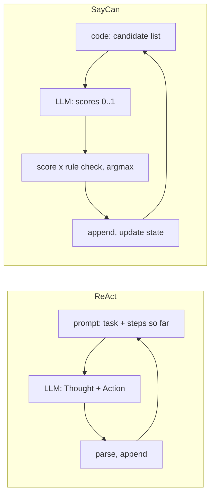

# Step-by-step (ReAct, SayCan)

Most planners ask the LLM for the whole plan in one call. The two planners on this page build the plan **one step per LLM call**. After each call the planner adds one step to the plan and then asks again. You get plans that can react to what was chosen before. You pay one call per step.

!!! abstract "In this page"
    - **ReAct** asks the LLM for `Thought:` and `Action:` text, one action per call. It stops when the reply contains the word "Done". That check is loose; see [Failure modes](#failure-modes).
    - **SayCan** lists candidate steps in code, asks the LLM to score them all in one call, and multiplies each score by a rule check. It picks the best one.
    - Both start from the task, the observation and the visible objects. Neither reads a database of examples.
    - Every output below was run offline with a scripted LLM reply: the planner code runs, only the LLM text is fixed.

!!! warning "Default host"
    A planner built without `host=` sends its prompts to `http://ollama.aistations.org` ([`base.py:23`](https://github.com/mtbui2010/embodiplan/blob/a69064255c69/embodiplan/base.py#L23)). For a local server pass `host="http://localhost:11434"`. The backends are `ollama`, `openai` and `gemini`; `provider="anthropic"` raises `ValueError`.

## Comparison

| | ReAct | SayCan |
|---|---|---|
| Registry key | `"ReAct"` | `"SayCan"` |
| Class | `ReActPlanner` | `SayCanPlanner` |
| Who proposes a step | the LLM, as free text | the code lists candidates; the LLM scores them |
| LLM calls | one per step, plus the final `Done` call | one per step, plus the final `done` call |
| Temperature | 0.2 | 0.0 |
| Step cap (`max_steps`) | 15 | 18 |
| Rule check during planning | none | yes, every candidate (one hand) |
| Reads `obs` | yes, the same text on every call | no |
| Keys in a step | `action`, `object`, `target`, `reason` | `action`, `object` |
| `metrics.extra` | `{"thoughts": [...]}` | `{"saycan_steps", "saycan_calls"}` |
| `replan` returns | only the new steps | only the new steps |



!!! code "Where in the code"
    - [`react.py`](https://github.com/mtbui2010/embodiplan/blob/a69064255c69/embodiplan/react.py): prompt [`L21-L42`](https://github.com/mtbui2010/embodiplan/blob/a69064255c69/embodiplan/react.py#L21-L42), parser [`L44-L63`](https://github.com/mtbui2010/embodiplan/blob/a69064255c69/embodiplan/react.py#L44-L63), loop [`L77-L150`](https://github.com/mtbui2010/embodiplan/blob/a69064255c69/embodiplan/react.py#L77-L150), replan [`L157-L167`](https://github.com/mtbui2010/embodiplan/blob/a69064255c69/embodiplan/react.py#L157-L167)
    - [`saycan.py`](https://github.com/mtbui2010/embodiplan/blob/a69064255c69/embodiplan/saycan.py): candidates [`L142-L185`](https://github.com/mtbui2010/embodiplan/blob/a69064255c69/embodiplan/saycan.py#L142-L185), scoring [`L193-L217`](https://github.com/mtbui2010/embodiplan/blob/a69064255c69/embodiplan/saycan.py#L193-L217), loop [`L219-L286`](https://github.com/mtbui2010/embodiplan/blob/a69064255c69/embodiplan/saycan.py#L219-L286), replan [`L288-L355`](https://github.com/mtbui2010/embodiplan/blob/a69064255c69/embodiplan/saycan.py#L288-L355)

The fake `_chat` used in every example is the same idea as in [Getting started](../getting-started.md): subclass the planner and override `_chat(messages, temperature)` so that it returns `(text, in_tokens, out_tokens)`. Token counts are `0` in these examples because nothing was measured.

---

## ReAct

ReAct asks for one `Thought` and one `Action` per call. The planner puts the steps chosen so far into the next prompt. The loop ends when the model says `Done`, when `max_steps` is reached, when a reply cannot be parsed, or when a call raises an error.

### Inputs and options

| name | type | default | meaning |
|---|---|---|---|
| `host` | str | none (required) | LLM server URL |
| `model` | str | none (required) | model name |
| `provider` | str | `"ollama"` | `ollama`, `openai` or `gemini` |
| `api_key` | str | `""` | key for `openai` / `gemini` (use a placeholder such as `"sk-..."` in examples) |
| `max_steps` | int | `15` | cap on loop turns; a `replan` subtracts the seed length |
| `**kwargs` | | | swallowed and ignored (for example `capabilities=` has no effect) |

`generate_plan(task, obs, visible_objects)` uses only the first 30 visible objects in the prompt ([`react.py:91`](https://github.com/mtbui2010/embodiplan/blob/a69064255c69/embodiplan/react.py#L91)). `embodiplan.get("ReAct", host=..., model=...)` supplies `host` and `model`. Because the constructor has no defaults for them, `ReActPlanner()` alone raises `TypeError`.

### What the LLM is asked (prompt and temperature)

Temperature is `0.2` on every call. The system prompt (`SYSTEM_PROMPT`) lists the actions and demands exactly one of two shapes:

```text
Thought: <one sentence reasoning about what to do next>
Action: <action_name> | <object> | <target_or_empty> | <reason>
```

or, when finished, `Thought: The task is complete.` followed by `Done`. The user message is built from four parts. This is the real second prompt of the example below (the first step was already chosen):

```text
Task: bring a mug

Completed steps so far:
  1. MoveTo Kitchen

Current scene observation:
Living room.

Visible objects: Mug, Sink

What is your next Thought and Action? (or Done if finished)
```

The "Current scene observation" is the `obs` you passed. It is the same text on every call, so the model learns what happened only from the "Completed steps" list ([`react.py:101-107`](https://github.com/mtbui2010/embodiplan/blob/a69064255c69/embodiplan/react.py#L101-L107)). The prompt says "Always Navigate or Find before interacting", but the action vocabulary has no `Navigate`; the move action is `MoveTo` (see [Plan format](../concepts/plan-format.md)).

### Parsing and fallbacks

Two regular expressions read the reply, in this order ([`react.py:113-136`](https://github.com/mtbui2010/embodiplan/blob/a69064255c69/embodiplan/react.py#L113-L136)):

```python
            try:
                raw, in_tok, out_tok = self._chat(messages, temperature=0.2)
                llm_calls += 1
                total_in  += in_tok
                total_out += out_tok
            except Exception as e:
                thoughts.append(f"[Error] {e}")
                break

            # Extract thought
            tm = re.search(r"Thought:\s*(.+)", raw, re.IGNORECASE)
            if tm:
                thoughts.append(tm.group(1).strip())

            if _is_done(raw):
                break

            step = _parse_action(raw)
            if step:
                steps.append(step)
            else:
                # Couldn't parse — try to continue
                thoughts.append(f"[parse fail] {raw[:80]}")
                break
```

1. `Thought:\s*(.+)` stores the first thought line in `extra["thoughts"]`.
2. `_is_done(raw)` is checked **before** the action is parsed. If it is true, the loop ends and any `Action:` in the same reply is dropped.
3. `_parse_action` uses `Action:\s*(\w+)\s*\|\s*([^\|]+)\s*\|\s*([^\|]*)\s*\|\s*(.+)` (case-insensitive) and returns `action`, `object`, `target`, `reason`.
4. If there is no match, the code appends `[parse fail] <first 80 characters>` to the thoughts and **breaks**. The comment says "try to continue", but the code stops.

An error in `_chat` is caught: the text `[Error] ...` goes into the thoughts and the loop ends. It is not raised and not written to `notes`.

#### The stop rule: `_is_done`

The whole function ([`react.py:62-63`](https://github.com/mtbui2010/embodiplan/blob/a69064255c69/embodiplan/react.py#L62-L63)):

```python
def _is_done(raw: str) -> bool:
    return bool(re.search(r"\bDone\b", raw, re.IGNORECASE))
```

It looks for the **word** `done`, in any letter case, **anywhere in the reply**. It does not look for a line that says only `Done`. So these all count as "finished":

| reply text | `_is_done` (run) |
|---|---|
| `Thought: Done soon.` | `True` |
| `Thought: The task is complete.` + a line `Done` | `True` |
| `Thought: When that is done, find the mug.` + an `Action:` | `True` |
| `Thought: undone` | `False` (no word boundary) |
| `Thought: Abandoned.` | `False` |
| `Thought: finished` + an `Action:` | `False` |

This is current behaviour. A model that writes "when that is done" in a Thought ends the plan and loses the action in the same reply. The example below shows it. How to avoid it:

- Keep ReAct for models that follow the format closely, and check `metrics.llm_calls` and `extra["thoughts"]` for an early stop.
- Replace the check. `react.py` is imported as a module, so patch it by name. Do not write `import embodiplan.react as m`: `embodiplan.react` is the factory function, not the module ([Planner interface](../reference/interface.md)). Use `sys.modules` or `importlib`:

```python
import re, sys, embodiplan
react = sys.modules["embodiplan.react"]
react._is_done = lambda raw: bool(re.search(r"^\s*Done\s*$", raw, re.IGNORECASE | re.MULTILINE))
```

With this patch and the same reply as in the failure example below, the Find step is kept (run offline, scripted: `1 steps, 2 LLM calls`, the step is `Find Mug`). The patch is global for the process.

### Output and `extra` keys

`generate_plan` returns `(steps, metrics)`. It also prints one line, `[ReAct] N steps, M LLM calls, T s`.

| item | value |
|---|---|
| step keys | `action`, `object`, `target` (may be `""`), `reason` |
| `metrics.method` | `"ReAct"` |
| `metrics.llm_calls` | number of successful `_chat` calls, including the `Done` call |
| `metrics.num_steps` | `len(steps)` |
| `metrics.parse_ok` | `bool(steps)`: `False` when the plan is empty |
| `metrics.notes` | not set (`""`) |
| `metrics.extra["thoughts"]` | list of thought texts, plus `[parse fail] ...` or `[Error] ...` entries |

Steps are not checked against the [action model](../reference/action-model.md). A step such as `Pick Mug` with no `Find` is returned as it is.

### replan

`replan(task, completed, failed_step, failure_reason, obs, visible_objects)` ([`react.py:157-167`](https://github.com/mtbui2010/embodiplan/blob/a69064255c69/embodiplan/react.py#L157-L167)) runs the same loop with `completed` as the first steps. It appends this to `obs`:

```text
[FAILURE] Step 'Find Mug' failed: Mug not visible. Adjust your plan accordingly.
```

The loop runs at most `max_steps - len(completed)` turns. The result is only the new steps (`steps[len(completed):]`), and `metrics.num_steps` is set to that count. Other planners' `replan` is described in [Replanning](../concepts/replanning.md).

### Example (scripted)

Offline, with a scripted LLM reply. The planner code is real; `_chat` returns the next text from a list.

```python
from embodiplan.react import ReActPlanner

class Scripted(ReActPlanner):
    def __init__(self, replies, **kw):
        super().__init__(host="http://127.0.0.1:1", model="scripted", **kw)
        self.replies, self.prompts = list(replies), []
    def _chat(self, messages, temperature=0.2):
        self.prompts.append(messages[-1]["content"])
        return self.replies.pop(0), 0, 0

p = Scripted([
    "Thought: Go to the kitchen first.\nAction: MoveTo | Kitchen | | the mug is in the kitchen",
    "Thought: Now look for the mug.\nAction: Find | Mug | | need the mug in view",
    "Thought: The task is complete.\nDone",
])
steps, m = p.generate_plan("bring a mug", "Living room.", ["Mug", "Sink"])
print(steps)
print(m.llm_calls, m.num_steps, m.extra)
```

Output, with a scripted LLM reply:

```text
[ReAct] 2 steps, 3 LLM calls, 0.0s
[{'action': 'MoveTo', 'object': 'Kitchen', 'target': '', 'reason': 'the mug is in the kitchen'}, {'action': 'Find', 'object': 'Mug', 'target': '', 'reason': 'need the mug in view'}]
3 2 {'thoughts': ['Go to the kitchen first.', 'Now look for the mug.', 'The task is complete.']}
```

Three replies, two steps, three calls. The time `0.0s` is the fake call, not a model.

A replan with a scripted LLM reply, after `MoveTo Kitchen` was completed and `Find Mug` failed:

```python
p = Scripted(["Thought: look again.\nAction: Find | Mug | | retry", "Thought: ok\nDone"])
new, m = p.replan("bring a mug", [{"action": "MoveTo", "object": "Kitchen", "target": "", "reason": ""}],
                  {"action": "Find", "object": "Mug"}, "Mug not visible", "Kitchen.", ["Mug"])
print(new, m.num_steps, m.llm_calls)
```

```text
[{'action': 'Find', 'object': 'Mug', 'target': '', 'reason': 'retry'}] 1 2
```

### Failure modes

All four were run with a scripted LLM reply on the real code.

1. **"Done" anywhere ends the plan.** Replies: `MoveTo Kitchen`, then `Thought: When that is done, find the mug.` with `Action: Find | Mug | | need the mug`. Result: `1 steps, 2 LLM calls`, steps `[MoveTo Kitchen]`, thoughts `['Go to the kitchen first.', 'When that is done, find the mug.']`. The `Find` is lost and there is no error. See the workaround above.
2. **One unparseable reply ends the loop.** Reply `Let me think about it.` gives `[]`, `llm_calls=1`, `parse_ok=False`, thoughts `['[parse fail] Let me think about it.']`. A reply with `Action:` but only three pipe fields also fails, because the regex needs a fourth field (`reason`).
3. **The observation never changes.** `obs` is copied into every prompt. The model cannot see that a step worked or failed; it only sees its own list. Use `replan` to tell it about a failure.
4. **No rule check.** Nothing stops `Pick` before `Find`, or a second `Pick`. If you need that, run `simulate` from [Action model](../reference/action-model.md) on the result, or use [SayCan](#saycan) or [SAGE](sage.md).

### Tests

No test file covers `react.py`. Everything above comes from reading the code and from the offline runs shown.

---

## SayCan

SayCan follows the idea of "Do As I Can, Not As I Say" (Ahn et al., 2022): the model says what is useful, and an affordance term says what is possible now. In embodiplan the code builds a list of candidate steps. One LLM call gives each a usefulness score. The rule checker gives each a feasibility of `1.0` or `0.001`. The planner takes the largest product.

The module header says what is not the same as the paper ([`saycan.py:18-25`](https://github.com/mtbui2010/embodiplan/blob/a69064255c69/embodiplan/saycan.py#L18-L25)): the paper uses learned models for both terms. Here the "value" is a score written by an LLM, and the "affordance" is the rule check from the [action model](../reference/action-model.md). It has the same structure, not the same models.

### Inputs and options

| name | type | default | meaning |
|---|---|---|---|
| `host`, `model`, `provider`, `api_key` | | base defaults | passed to `BasePlanner` (default host `http://ollama.aistations.org`) |
| `max_steps` | int | `18` | cap on decoding turns |
| `containers` | set[str] or None | `DEFAULT_CONTAINERS` | names that must be open for `PutIn` |

`generate_plan(task, obs, visible_objects)` starts from an empty `SymbolicState` and marks `visible_objects` as visible ([`saycan.py:221-223`](https://github.com/mtbui2010/embodiplan/blob/a69064255c69/embodiplan/saycan.py#L221-L223)). The `obs` argument is accepted and handed to the scoring function, but that function never writes it into the prompt. There is no `capabilities` option: `verify_step` is called without it, so the check always assumes one hand.

How the candidates are built (`_candidates`, [`L142-L185`](https://github.com/mtbui2010/embodiplan/blob/a69064255c69/embodiplan/saycan.py#L142-L185)):

| candidate | built from |
|---|---|
| `MoveTo X` | every visible object plus the nine fixed places `Kitchen, LivingRoom, Bedroom, Bathroom, DiningTable, CounterTop, Sofa, Sink, CoffeeTable` |
| `Find X` | every visible object |
| `Pick` | one candidate, object = the last found item (or `""`) |
| `Open, Close, TurnOn, TurnOff X` | every visible object and the found item |
| `Place`, `PutIn` | only when the hand is full: `Place` on the arrived place, `PutIn` on each interact target |

Duplicates are removed, and the list is cut to 60. The candidates are not filtered by the rule check; feasibility is applied later. Run offline: for `visible_objects=["Mug"]` and an empty state there are 16 candidates, and the first three are `MoveTo Mug`, `MoveTo Kitchen`, `MoveTo LivingRoom`.

### What the LLM is asked (prompt and temperature)

Temperature is `0.0`. One call scores all candidates. The system prompt (`_SCORE_SYSTEM`) says "You are the value head of a SayCan household robot", lists the actions and the step schema, and asks for only this JSON shape:

```text
{"scores": {"0": 0.9, "1": 0.1, "2": 0.4}, "done": false}
```

The user message has the task, the symbolic state as text, the steps so far and the numbered candidates. This is the real second prompt of the example below, with a scripted LLM reply for the first call:

```text
Task: pick up the mug

Robot symbolic state:
  arrived: ∅ | found: Mug | holding: ∅ | opened: ∅ | on: ∅

Actions taken so far:
  1. Find Mug

Candidate next actions:
  0: MoveTo Mug
  1: MoveTo Kitchen
  2: MoveTo LivingRoom
  3: MoveTo Bedroom
  4: MoveTo Bathroom
  5: MoveTo DiningTable
  6: MoveTo CounterTop
  7: MoveTo Sofa
  8: MoveTo Sink
  9: MoveTo CoffeeTable
  10: Find Mug
  11: Pick Mug
  12: Open Mug
  13: Close Mug
  14: TurnOn Mug
  15: TurnOff Mug

Score each candidate's usefulness now and set done appropriately.
```

The task text is the only description of the goal. The symbolic state line comes from the code's own simulation of the steps chosen so far.

### Parsing and fallbacks

`_parse_scores(raw, n)` ([`L85-L123`](https://github.com/mtbui2010/embodiplan/blob/a69064255c69/embodiplan/saycan.py#L85-L123)) never raises:

1. Remove code fences and try `json.loads`; if that fails, try the first `{...}` span.
2. Read `done` (default false) and `scores`. If there is no `scores` key, the dict itself is read as scores. Each value is clamped to `[0, 1]`; bad keys or values are skipped.
3. If no score was found, scrape `idx: value` pairs with a regex.
4. Every candidate without a score gets `0.3`.

Run offline: `'{"scores": {"0": 0.9, "2": 1.7}, "done": false}'` with `n=4` gives `({0: 0.9, 2: 1.0, 1: 0.3, 3: 0.3}, False)`. The text `garbage` with `n=3` gives `({0: 0.3, 1: 0.3, 2: 0.3}, False)`.

Choosing the step, from [`saycan.py:245-268`](https://github.com/mtbui2010/embodiplan/blob/a69064255c69/embodiplan/saycan.py#L245-L268):

```python
            # The classic SayCan product: value(LLM) × affordance(verifier),
            # argmax. Feasible candidates have affordance 1.0; precondition-
            # violating candidates have affordance ~0, so they are effectively
            # gated out unless every candidate is infeasible.
            best_i, best_val = -1, -1.0
            for i, c in enumerate(cands):
                aff = self._affordance(c, state)
                val = scores.get(i, 0.3)
                combined = val * aff
                if combined > best_val:
                    best_val, best_i = combined, i

            if best_i < 0:
                break
            chosen = cands[best_i]

            # Safety: never append a hard-infeasible step (affordance ~0); if
            # the best candidate is still infeasible, decoding is stuck → stop.
            if self._affordance(chosen, state) <= _INFEASIBLE_VALUE:
                notes = notes or "stuck_all_infeasible"
                break

            plan.append({"action": chosen["action"], "object": chosen.get("object", "")})
            _apply(chosen, state)
```

The affordance is `1.0` when `verify_step` finds no error and `0.001` otherwise ([`L188-L190`](https://github.com/mtbui2010/embodiplan/blob/a69064255c69/embodiplan/saycan.py#L188-L190)); warnings such as `already_there` do not count as errors. Ties go to the earlier candidate (`>` is strict). After a step is chosen, `_apply` updates the symbolic state, so the next candidate list and prompt use the new state. See [Symbolic state](../concepts/symbolic-state.md).

### Output and `extra` keys

| item | value |
|---|---|
| step keys | `action`, `object` only |
| `metrics.llm_calls` | number of scoring calls that returned, including the final `done` call |
| `metrics.num_steps` | `len(plan)` |
| `metrics.parse_ok` | `bool(plan)` |
| `metrics.notes` | `""`, or `score_error:<ExceptionName>` if a call raised, or `stuck_all_infeasible` |
| `metrics.extra` | `{"saycan_steps": len(plan), "saycan_calls": llm_calls}` |

A call that raises is caught: decoding stops and the exception name goes to `notes`. `generate_plan` prints `[SayCan] N steps, M calls in T s` and adds `(notes)` when notes are set. `Pick` carries the last found object as its `object` field.

### replan

`replan` ([`L288-L355`](https://github.com/mtbui2010/embodiplan/blob/a69064255c69/embodiplan/saycan.py#L288-L355)) replays `completed` into a fresh `SymbolicState` with `_apply` (no check, because those steps ran in the world), then decodes again with the same loop. The history in the prompt starts with the completed steps. Only the new steps are returned. `notes` is `replan_after:<failed action>`. `failure_reason` and `obs` are not used in the prompt, so the LLM is not told why the step failed. `extra` is empty, and "stuck" is not reported in `notes` here.

### Example (scripted)

Offline, with a scripted LLM reply. The fake `_chat` reads the numbered candidates out of the prompt and scores the wanted one `1.0` and the others `0.1`. A `None` means reply `done: true`.

```python
import json, re
from embodiplan.saycan import SayCanPlanner

class Scripted(SayCanPlanner):
    def __init__(self, wants, **kw):
        super().__init__(host="http://127.0.0.1:1", model="scripted", **kw)
        self.wants, self.prompts = list(wants), []
    def _chat(self, messages, temperature=0.2):
        user = messages[-1]["content"]
        want = self.wants.pop(0)
        if want is None:
            return json.dumps({"scores": {}, "done": True}), 0, 0
        cands = re.findall(r"^  (\d+): (.*)$", user.split("Candidate next actions:")[1], re.M)
        return json.dumps({"scores": {i: (1.0 if t == want else 0.1) for i, t in cands}, "done": False}), 0, 0

p = Scripted(["Find Mug", "Pick Mug", None])
steps, m = p.generate_plan("pick up the mug", "Kitchen.", ["Mug"])
print(steps)
print(m.llm_calls, m.num_steps, repr(m.notes), m.extra)
```

Output, with a scripted LLM reply:

```text
[SayCan] 2 steps, 3 calls in 0.0s
[{'action': 'Find', 'object': 'Mug'}, {'action': 'Pick', 'object': 'Mug'}]
3 2 '' {'saycan_steps': 2, 'saycan_calls': 3}
```

The rule check at work: in a second run the scripted scores favour `"Pick"` first (candidate `Pick`, with nothing found yet), then `"Find Mug"`, then `done`. Result, with a scripted LLM reply:

```text
[SayCan] 2 steps, 3 calls in 0.0s
[{'action': 'MoveTo', 'object': 'Mug'}, {'action': 'Find', 'object': 'Mug'}] 3
```

`Pick` had the top score but its affordance was `0.001` (no `Find` yet), so it lost. All other candidates scored `0.1`, so the first feasible one, `MoveTo Mug`, won. The plan is valid, but it is not what the scores asked for.

A replan with a scripted LLM reply, with `Find Mug` completed and `Pick Mug` failed:

```python
p = Scripted(["Pick Mug", None])
new, m = p.replan("pick up the mug", [{"action": "Find", "object": "Mug"}],
                  {"action": "Pick", "object": "Mug"}, "slipped", "Kitchen.", ["Mug"])
print(new, m.llm_calls, m.notes, m.extra)
```

```text
[{'action': 'Pick', 'object': 'Mug'}] 2 replan_after:Pick {}
```

### Failure modes

Runs below used a scripted LLM reply on the real code.

1. **A bad scoring reply does not stop decoding, and it can loop.** With the reply `no idea` and `max_steps=3`, every score is `0.3`, the first feasible candidate wins each turn, and the result is `MoveTo Mug` three times (`3 calls`, empty `notes`). `already_there` is a warning, so it is not blocked. With the default `max_steps=18` the loop is capped at 18 turns, so such a run would make 18 calls (read from the code, not run; the run above used `max_steps=3`). Check `llm_calls` against `num_steps` and look for repeated steps.
2. **Candidate order matters.** Under uniform or tied scores the first feasible candidate is `MoveTo <first visible object>`, so plans can drift toward it.
3. **`obs` is ignored.** The start state is always empty. Facts like "the robot already holds a cup" never reach the planner, unless you pass a `replan` with the completed steps.
4. **One hand only.** `capabilities` are not passed to the check, so a two-handed robot is still planned as one-handed.
5. **Scores are LLM text, not a trained value function.** The module says so in its header. Do not read the scores as probabilities.
6. **Fixed places.** `Kitchen`, `Sofa` and the others are always candidates, even if the scene has no such place.
7. **Errors are swallowed into `notes`.** A connection error gives `[]`, `parse_ok=False` and `notes="score_error:ConnectionError"` (run with a `_chat` that raises). Read `notes`.

### Tests

No test file covers `saycan.py`. The rule check it relies on, `verify_step` and `_apply`, is covered through [`tests/test_action_model.py`](https://github.com/mtbui2010/embodiplan/blob/a69064255c69/tests/test_action_model.py); see [Action model](../reference/action-model.md).

## Next

- [Planner overview](index.md): all planners in one table.
- [Replanning](../concepts/replanning.md): what each `replan` does and what it costs.
- [LLM calls and cost](../concepts/llm-calls.md): how calls and tokens are counted.
