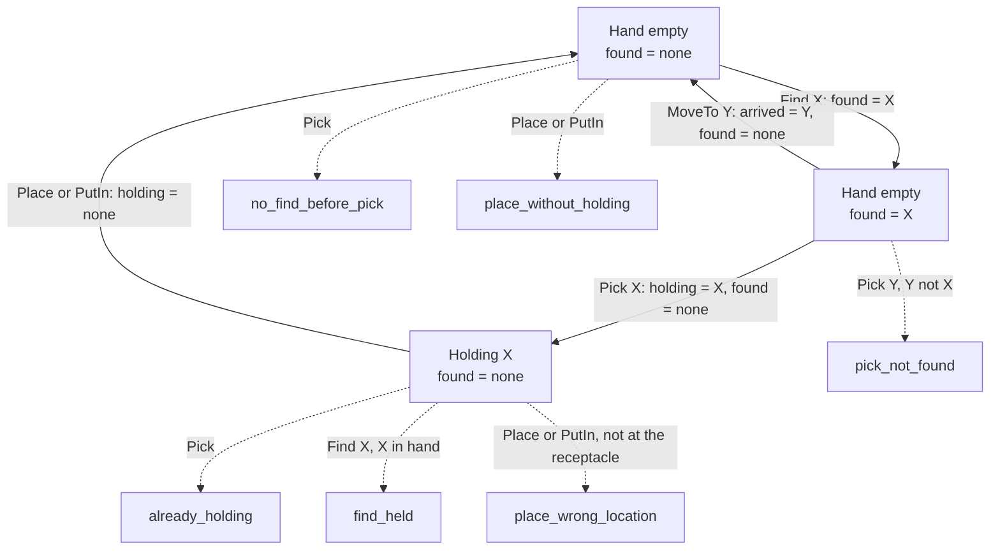
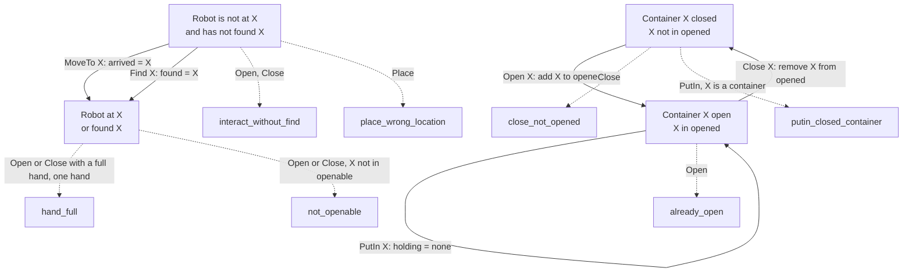

# Action model and verifier

This page documents the rules that say whether a plan step is allowed, and what a step changes. The rules run in plain Python. They need no LLM and no network. You get three functions (`check`, `apply`, `simulate`), a list of violation codes, a switch for the robot body (`capabilities`, which can also name actions that release the held object), and a small facade (`verifier.py`) that keeps the 0.1 names and builds the feedback text that SAGE sends back to the LLM.

!!! abstract "In this page"
    - `action_model.py` is the one versioned source of preconditions and effects for 14 actions. `ACTION_MODEL_VERSION = "1.0"`.
    - `check` lists rule findings for one step, `apply` returns the next world, `simulate` replays a whole plan.
    - The default body has **one hand**. The container example that the prompts teach fails this default with `hand_full`. Pass `capabilities={"hands": 2}` to allow it.
    - `verifier.py` adds no rules. It re-exports the model, keeps `verify_step` and `_apply`, and has `format_violations_for_llm`.

!!! code "Where in the code"
    - [`embodiplan/action_model.py`](https://github.com/mtbui2010/embodiplan/blob/76da520/embodiplan/action_model.py): `check` [L266-L373](https://github.com/mtbui2010/embodiplan/blob/76da520/embodiplan/action_model.py#L266-L373), `apply` [L384-L427](https://github.com/mtbui2010/embodiplan/blob/76da520/embodiplan/action_model.py#L384-L427), `simulate` [L433-L492](https://github.com/mtbui2010/embodiplan/blob/76da520/embodiplan/action_model.py#L433-L492).
    - [`embodiplan/verifier.py`](https://github.com/mtbui2010/embodiplan/blob/76da520/embodiplan/verifier.py): `verify_step` [L47-L64](https://github.com/mtbui2010/embodiplan/blob/76da520/embodiplan/verifier.py#L47-L64), `format_violations_for_llm` [L70-L104](https://github.com/mtbui2010/embodiplan/blob/76da520/embodiplan/verifier.py#L70-L104).
    - Action list: `ROBOT_ACTIONS` in [`embodiplan/base.py`](https://github.com/mtbui2010/embodiplan/blob/76da520/embodiplan/base.py#L53-L57).

## The world and the step

A step is a dict `{"action": ..., "object": ...}`. The world is **duck-typed**: any object with the fields `arrived`, `found`, `holding` (a string or `None`) and `opened`, `on` (sets). The class `SymbolicState` in this module has them (plus a `visible` set). See [Symbolic state](../concepts/symbolic-state.md) for the idea behind the fields.

Before any rule runs, the action name is normalised: spaces and underscores are removed, the text is lower-cased, and it is looked up in `_ALIAS_MAP` ([L187-L209](https://github.com/mtbui2010/embodiplan/blob/76da520/embodiplan/action_model.py#L187-L209)). `Navigate` and `goto` become `MoveTo`; `grab` and `pickup` become `Pick`; `put` becomes `Place`; `search` and `locate` become `Find`. A name that is not in the map is kept as written. A non-text action or object (a number a model wrote, such as `{"action": "Wait", "object": 5}`) is turned into text first (`normalize_action` and `_target`, added in 0.2.6). Real result (run): `Navigate Mug, grab Mug, "Turn On" Lamp` becomes `MoveTo Mug, Pick Mug, TurnOn Lamp`.

## Action table

`ROBOT_ACTIONS` has 14 names. A robot with its own action list passes `actions=`; a name in `capabilities["release_actions"]` (see [Capabilities](#capabilities)) empties the hand instead of following this table. Three more (`Heat`, `Cool`, `Clean`) are added only when the environment variable `EMBODIPLAN_EXTRA_ACTIONS` lists them before import (not run here). "Reach" means `world.arrived == object`, or `world.found == object` when `find_reaches` is true.

| Action | Preconditions (violation code) | Effect on the world | Warning |
|---|---|---|---|
| `MoveTo` | object not empty (`empty_object`) | `arrived = object`; `found` reset to `None` unless it equals the object | `already_there` if already at the object |
| `Find` | object not empty (`empty_object`); not the held object (`find_held`); if `object_places` gives a place and `arrived` differs (`find_wrong_place`) | `found = object` | none |
| `Pick` | hand free (`already_holding`); `found` is set (`no_find_before_pick`); if an object is given it equals `found` (`pick_not_found`) | `holding = object or found`; `found = None` | none |
| `Place` | holding something (`place_without_holding`); object not empty (`empty_object`); `arrived == object` (`place_wrong_location`) | `holding = None` | none |
| `PutIn` | as `Place`, but `found == object` also counts as at it when `find_reaches`; if the object is a container it must be in `opened` (`putin_closed_container`) | `holding = None` | none |
| `Open` | object not empty; in `openable` when given (`not_openable`); reach (`interact_without_find`); not already open (`already_open`); free hand if `hands < 2` (`hand_full`) | object added to `opened` | none |
| `Close` | as `Open`, but the object must be open (`close_not_opened`) | object removed from `opened` | none |
| `TurnOn` | object not empty; reach; not already on (`already_on`) | object added to `on` | none |
| `TurnOff` | object not empty; reach; must be on (`turnoff_not_on`) | object removed from `on` | none |
| `Wash` | reach, or holding the object (`interact_without_find`); the object may be empty | none tracked | none |
| `Sit`, `LieOn`, `Wait` | none | none tracked | none |
| `Serve` | none (error-free) | none tracked | `serve_without_holding` if the hand is empty |
| `Heat`, `Cool`, `Clean` (opt-in) | holding something (`treat_without_holding`) | none; the object stays in hand | none |

Notes read from the code:

- `Place` puts the object **on** the receptacle, so it never needs the receptacle open. Only `PutIn` checks `opened` ([L337-L340](https://github.com/mtbui2010/embodiplan/blob/76da520/embodiplan/action_model.py#L337-L340)).
- `Pick` and `Place`/`PutIn` can report several errors for one step. `simulate` records only the first one per step.
- An unknown action returns `unknown_action` at once and no other rule runs.
- There is no model of what is inside a container. A plan that does `Find Apple` before `Open Fridge` is not rejected for that reason.

## The rules as a state machine

The first picture follows the hand and `found`. A box is a state of the world (`holding`, `found`). A solid arrow is the effect that `apply` gives for a step that `check` allowed. A dotted arrow ends in the violation code that `check` raises for that step in that state ([`check`](https://github.com/mtbui2010/embodiplan/blob/76da520/embodiplan/action_model.py#L296-L370)).



The second picture follows the opened containers and the robot's place. `arrived` is set by `MoveTo`. A target is within reach when `arrived` equals it, or when `found` equals it and `find_reaches` is true. `Place` is stricter: it needs `arrived` itself, while `PutIn` also accepts `found`.



Not drawn, to keep the pictures small: `unknown_action` (first test in `check`, nothing else runs, L299-L301), `empty_object` (a step with no object, L305, L311, L331, L344), `find_wrong_place` (L317, only with `object_places`), `already_on` and `turnoff_not_on` (L356, L358, the same idea as `already_open` for the `on` set), `treat_without_holding` (L365), and the two warnings `already_there` (L307) and `serve_without_holding` (L369). `PutIn X` also counts as at the receptacle after `Find X` (the `found == X` branch of L334). In the first picture `MoveTo X` where `X` is the found object keeps `found`. `check` returns every error that applies (for `Pick` with a full hand and nothing found, both `already_holding` and `no_find_before_pick`); `simulate` records only the first.

Caption: drawn from the code at 76da520, not from a recorded run, apart from these transitions, which I ran with the real `check` and `apply` on a `SymbolicState`: `Pick Mug` in the empty state gives `no_find_before_pick`; after `Find Mug`, `Pick Cup` gives `pick_not_found` and `apply` of `Pick Mug` gives `holding: Mug | found: ∅`; with `Mug` in hand `Pick Mug` gives `already_holding` and `Find Mug` gives `find_held`; `PutIn Fridge` at the closed `Fridge` gives `putin_closed_container`; `Open Fridge` twice gives `already_open`; `Close Fridge` on a closed one gives `close_not_opened`; `Place Table` while at `Fridge` gives `place_wrong_location`. Not run: `not_openable` (needs `openable=`).

## Public functions

### `check(step, world, *, capabilities=None, containers=None, openable=None, object_places=None, actions=None) -> list[Violation]`

| Argument | Type | Meaning | Default |
|---|---|---|---|
| `step` | dict | `{"action", "object"}`; the action is normalised | required |
| `world` | duck-typed | the belief; **not changed** | required |
| `capabilities` | `Capabilities`, dict or `None` | robot body | one hand, Find reaches |
| `containers` | names or predicate | what must be open for `PutIn` | `DEFAULT_CONTAINERS` |
| `openable` | names or predicate | what `Open`/`Close` may target | `None` = not checked |
| `object_places` | `{object: place}` | `Find X` elsewhere is an error | `None` |
| `actions` | iterable of str | the action vocabulary | `ROBOT_ACTIONS` |

Returns a list of `Violation(code, reason, severity)`. Errors come first, then warnings (a stable sort on severity). An empty list means the step is allowed. `check` never raises for a bad step; it returns `unknown_action`. Name matching for `containers` and `openable` accepts an exact name, a case-insensitive name, or the head word of a place key such as `drawer@bedroom`.

`DEFAULT_CONTAINERS` is `Fridge, Cabinet, Drawer, Microwave, Oven, Safe, Box, GarbageCan`. `errors(step, world, **kw)` is `check` without the warnings.

### `apply(step, world, *, inplace=False, capabilities=None)`

Returns the world after the step **as if it had succeeded**. It does not check anything. It copies the world (`world.copy()` if present, else `copy.deepcopy`) unless `inplace=True`. It touches only the five symbolic fields. With `capabilities` (a `Capabilities`, a dict or `None`), a step whose normalised action is in `release_actions` sets `holding = None` and returns at once: the effect table above is not used for it. With `capabilities=None` (the default) nothing changes. The argument and `release_actions` were added in 0.2.6. `simulate` passes its own `capabilities` to `apply`, so a release action empties the hand inside a replay too.

Real result (run, 0.2.7): holding `toy car` at `kid`, `Handover kid` with `capabilities={"release_actions": ["Handover"]}` gives `holding = None`; the same call without `capabilities` leaves `toy car` in hand. A replay `Find Mug, Pick Mug, Handover kid, Find Cup, Pick Cup` with `actions=["MoveTo","Find","Pick","Handover"]` and one hand fails at step 5 `already_holding` without `release_actions`, and passes (final `holding` = `Cup`) with it.

### `simulate(plan, world=None, visible_objects=None, containers=None, stop_on_error=True, *, initial_state=None, capabilities=None, openable=None, object_places=None, actions=None, apply_on_error=False) -> VerifierReport`

For each step it runs `check`, records warnings, records the first error, then applies the step. The start state is `world`, else `initial_state` (the legacy name), else an empty `SymbolicState`. The input state is copied.

| `stop_on_error` | `apply_on_error` | On an error |
|---|---|---|
| `True` (default) | any | stop at the first error |
| `False` | `False` (default) | record it, skip that step's effects, go on |
| `False` | `True` | record it, apply the step anyway (fewer cascading findings) |

`VerifierReport` fields: `ok` (no errors), `violations` (errors only, as `StepViolation(index, step, code, reason, severity)`, index is 0-based), `warnings`, `final_state`, `num_steps` (plan length, also when stopped early). Methods: `first_error_index()` and `summary(limit=5)`. The summary text uses 1-based step numbers.

## Violation codes

| Code | Meaning |
|---|---|
| `unknown_action` | the action is not in the vocabulary |
| `empty_object` | the step needs an object and has none |
| `find_held` | `Find` of the object already in hand |
| `find_wrong_place` | `object_places` says the object is elsewhere than `arrived` |
| `already_holding` | `Pick` with a full hand |
| `no_find_before_pick` | `Pick` while `found` is `None` |
| `pick_not_found` | `Pick X` but the last `Find` was another object |
| `place_without_holding` | `Place`/`PutIn` with an empty hand |
| `place_wrong_location` | `Place`/`PutIn` when not at the receptacle |
| `putin_closed_container` | `PutIn` into a container not in `opened` |
| `not_openable` | `Open`/`Close` target is outside `openable` |
| `interact_without_find` | `Open`/`Close`/`TurnOn`/`TurnOff`/`Wash` target is not reachable |
| `already_open`, `close_not_opened` | `Open` of an open container; `Close` of a closed one |
| `already_on`, `turnoff_not_on` | `TurnOn` of an appliance that is on; `TurnOff` of one that is off |
| `hand_full` | `Open`/`Close` while holding an object and `hands < 2` |
| `treat_without_holding` | `Heat`/`Cool`/`Clean` with an empty hand |

Warnings (never make `ok` false): `already_there`, `serve_without_holding`.

## Capabilities

`Capabilities(hands=1, find_reaches=True, release_actions=frozenset())` is a frozen dataclass. `DEFAULT_CAPABILITIES` is that default. `Capabilities.from_any` accepts a `Capabilities`, `None`, or a dict:

- `hands` may be an int or a list/tuple/set (its length is used). If `hands` is missing, `arms` is read. Then 1.
- `find_reaches` (default true): when false, `Find` only looks, so reach rules need `MoveTo`.
- `release_actions` (default empty): names of robot actions that release the held object, for example a manifest action whose effects include `hand_empty()` such as `Handover`. The dict value is any iterable of names; it is stored as a `frozenset`. Only `apply` (and so `simulate`) reads it. `check` does not: the action must still be in the `actions` vocabulary, or `check` returns `unknown_action` (run: `Handover` without `actions=` gives `unknown_action` at step 3).

Run: `from_any({"hands": ["left", "right"]})` gives `Capabilities(hands=2, find_reaches=True, release_actions=frozenset())`; `from_any(None)` gives `Capabilities(hands=1, find_reaches=True, release_actions=frozenset())`; `from_any({"hands": 1, "release_actions": ["Handover"]})` gives `release_actions=frozenset({'Handover'})`. Only `hands < 2` triggers `hand_full`.

## Version

`ACTION_MODEL_VERSION = "1.0"` ([L29](https://github.com/mtbui2010/embodiplan/blob/76da520/embodiplan/action_model.py#L29)). The file header says a rule change bumps it and lists the change in `CHANGELOG.md`. The version has been `1.0` in every release the file lists (0.2.1 to 0.2.5 and 0.2.7; it has no 0.2.6 entry, although 0.2.6 added `release_actions`, the rule version stayed `1.0`). Codes are described as "stable across versions" in the `Violation` comment.

## Main entry point: the Pick and Place rules

Verbatim from `check` ([L319-L340](https://github.com/mtbui2010/embodiplan/blob/76da520/embodiplan/action_model.py#L319-L340)):

```python
    elif a == "Pick":
        if world.holding:
            err("already_holding", f"cannot Pick while already holding '{world.holding}'")
        if world.found is None:
            err("no_find_before_pick", "Pick requires a preceding Find of the target object")
        elif o and world.found != o:
            err("pick_not_found", f"Pick '{o}' but the last Find was '{world.found}'")

    elif a in _PLACE_ACTIONS:
        if not world.holding:
            err("place_without_holding", f"{a} requires holding an object")
        if not o:
            err("empty_object", f"{a} requires a receptacle/container")
            return out
        at_it = world.arrived == o or (a == "PutIn" and caps.find_reaches and world.found == o)
        if not at_it:
            err("place_wrong_location",
                f"{a} requires MoveTo '{o}' first (currently at '{world.arrived}')")
        # Place puts the object ON the receptacle (the top of a closed chest of
        # drawers is a surface); only PutIn goes inside and needs it open.
        if a == "PutIn" and is_container(o, containers) and o not in world.opened:
            err("putin_closed_container", f"PutIn requires container '{o}' to be Open")
```

## Example (run offline, no LLM)

The container example from `JSON_EXAMPLE` in `base.py`, replayed with one hand and with two:

```python
import json
from embodiplan import action_model as am
from embodiplan.base import JSON_EXAMPLE

plan = json.loads(JSON_EXAMPLE.split("Example with container:\n")[1])["steps"]
for caps in (None, {"hands": 2}):
    r = am.simulate(plan, capabilities=caps)
    print(caps, r.ok, r.num_steps, [(v.index + 1, v.code) for v in r.violations])
    print(r.summary())
```

Output:

```text
None False 9 [(7, 'hand_full')]
FAIL (1 violation(s)):
  step 7: [hand_full] cannot Close 'Fridge' while holding 'Apple' (one hand) (Close Fridge)
{'hands': 2} True 9 []
OK (9 steps verified)
```

Other real results from the same run:

| Call | Result |
|---|---|
| `check(Pick Mug, SymbolicState())` | `[('no_find_before_pick', 'error')]` |
| `check(MoveTo Kitchen, SymbolicState(arrived="Kitchen"))` | `[('already_there', 'warning')]` |
| `apply(Find Mug, SymbolicState(arrived="CounterTop")).as_text()` | `arrived: CounterTop \| found: Mug \| holding: ∅ \| opened: ∅ \| on: ∅` |

## The verifier facade

`verifier.py` holds no rules. Its header calls it "the 0.1-compatible facade". It does three things.

1. **Re-exports** `ACTION_MODEL_VERSION`, `Capabilities`, `DEFAULT_CAPABILITIES`, `DEFAULT_CONTAINERS`, `StepViolation`, `SymbolicState`, `VerifierReport`, `Violation`, `check`, `normalize_*` and `simulate` from `action_model` (the same objects; a test checks `verifier.simulate is action_model.simulate`).
2. **Legacy wrappers.** `verify_step(step, state, containers=None, *, capabilities=None) -> (ok, code, reason)` calls `check` and returns the first error, or `(True, None, None)`; warnings are ignored. `_apply(step, state)` is `apply(..., inplace=True)`. Real result: `verify_step(Place Sofa, arrived=Desk, holding=Cup)` gives `(False, 'place_wrong_location', "Place requires MoveTo 'Sofa' first (currently at 'Desk')")`.
3. **`format_violations_for_llm(report, plan, limit=6) -> str`.** If `report.ok` it returns `"All preconditions satisfied."`. Otherwise it lists up to `limit` violations as `step N (Action Object): reason`, adds `... and K more.` past the limit, then a fixed block of "Common fixes". Two lines are conditional: one for the codes `already_open`, `close_not_opened`, `already_on`, `turnoff_not_on`, and one for `hand_full` ("The robot has one hand: Open / Close containers before the Pick."). SAGE puts this text in its refine prompts ([SAGE](../planners/sage.md)); SayCan uses `verify_step` and `_apply` ([Step-by-step](../planners/stepwise.md)).

Real output for `MoveTo Desk, Pick Cup, MoveTo Sofa, Place Sofa` with `stop_on_error=False`:

```text
The previous plan violates these preconditions:
  step 2 (Pick Cup): Pick requires a preceding Find of the target object
  step 4 (Place Sofa): Place requires holding an object

Fix the plan so each step satisfies its preconditions. Common fixes:
  - Insert MoveTo <container> + Open before Find for items inside containers.
  - Insert Find <object> before Pick / Open / Close / TurnOn / TurnOff.
  - Insert MoveTo <receptacle> before Place; the receptacle must match.
  - Do not Pick while already holding something — Place the held item first.
```

## Failure modes

!!! warning "The prompts teach a pattern the default model rejects"
    The container example in `JSON_EXAMPLE` ([`base.py` L127-L138](https://github.com/mtbui2010/embodiplan/blob/76da520/embodiplan/base.py#L127-L138)) fails at step 7 with `hand_full` under the default one hand (run above). The "typical" container sequence in `STEP_SCHEMA` (`base.py` L101-L102) closes the container while holding the object too; I replayed it (run) and it fails at step 6 `hand_full`. Both pass with `hands=2`. CHANGELOG 0.2.1 says to pass `capabilities={"hands": 2}` to model AI2-THOR's agent. The SAGE gate also reads `capabilities` (`SAGEPlanner(capabilities=...)`).

- **Pick's object field.** `STEP_SCHEMA` says the Pick object field is "ignored" (`base.py` L86). `check` does not ignore it: a given object that differs from the last `Find` gives `pick_not_found`. An empty object is accepted.
- **No containment model.** The model does not know which object is in which container. `Find Apple` right after `MoveTo Fridge`, with the door closed, passes.
- **`MoveTo` clears `found`.** After `Find Fridge`, a `MoveTo Kitchen` resets `found`, so a later `Pick` gives `no_find_before_pick`. `MoveTo Fridge` keeps it.
- **Default container list is AI2-THOR style.** An unlisted container name (for example `Basket`) is not checked for `putin_closed_container`. Pass `containers=` to change this.
- **Rejected step, no effect.** In `simulate` with `stop_on_error=False` and the default `apply_on_error=False`, a later step can report a second error that follows from the skipped one.

## Tests

[`tests/test_action_model.py`](https://github.com/mtbui2010/embodiplan/blob/76da520/tests/test_action_model.py) covers this page. By reading the file: a table of parametrised edge cases per rule (`test_edge_case`), `check` does not change the world, two hands allow `Open`/`Close` while holding, `capabilities` from a manifest dict, `find_reaches=False`, `object_places`, `openable`, the `actions` vocabulary, container name matching, alias normalisation, `apply` (including a duck-typed world), `simulate` (ok plan, warnings, `apply_on_error`, legacy signature), version and public names, facade parity (`verifier.simulate is am.simulate`, `verifier._apply`), and that the bundled reference plans keep their pass counts (8, 21, 12, 8 and 12 for the five `eval_dataset*.json` files). Run it with `PYTHONPATH=$PWD python -m pytest -q tests`. No pytest result is claimed here. The release action (`apply` and `simulate` with `release_actions`) is covered by `test_release_action_clears_hand` in [`tests/test_sage_v2_hooks.py`](https://github.com/mtbui2010/embodiplan/blob/76da520/tests/test_sage_v2_hooks.py#L99-L107).
