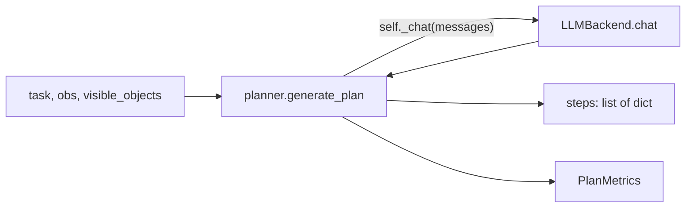

# Planner interface and registry

This page describes the contract that every planner in embodiplan follows, and the table that lets you build a planner from its name. After reading it you can call any planner the same way, read its metrics, write your own planner, and avoid the traps in the public API.

!!! abstract "In this page"
    - Every planner extends `BasePlanner` and offers two methods: `generate_plan` and `replan`. Both return `(steps, PlanMetrics)`.
    - `REGISTRY` maps 11 names to planner classes. `embodiplan.get(name, host=..., model=...)` builds one.
    - `from embodiplan import cot` gives a **function**, not the module `embodiplan/cot.py`.
    - Providers are `ollama`, `openai` and `gemini`. `provider="anthropic"` is not supported: `LLMBackend.chat` raises `ValueError`, but a planner catches it and returns an empty plan (see [Known pitfalls](../pitfalls.md)).

!!! code "Where in the code"
    - [`embodiplan/base.py`](https://github.com/mtbui2010/embodiplan/blob/76da520/embodiplan/base.py#L526-L625): `BasePlanner`
    - [`embodiplan/base.py`](https://github.com/mtbui2010/embodiplan/blob/76da520/embodiplan/base.py#L144-L181): `PlanMetrics`
    - [`embodiplan/base.py`](https://github.com/mtbui2010/embodiplan/blob/76da520/embodiplan/base.py#L475-L520): `parse_steps`, `_text_fields`
    - [`embodiplan/base.py`](https://github.com/mtbui2010/embodiplan/blob/76da520/embodiplan/base.py#L187-L270): `LLMBackend`
    - [`embodiplan/__init__.py`](https://github.com/mtbui2010/embodiplan/blob/76da520/embodiplan/__init__.py#L98-L140): `REGISTRY` and `get`

!!! warning "The default host is a remote server"
    `DEFAULT_HOST` is `http://ollama.aistations.org` ([`base.py:23`](https://github.com/mtbui2010/embodiplan/blob/76da520/embodiplan/base.py#L23)). A planner built **without** `host=` sends its prompts to that server. For a local Ollama server, pass `host="http://localhost:11434"`. All examples on this page use a placeholder host (`http://127.0.0.1:1`) and replace `_chat` with a fake, so nothing leaves your machine.

## The contract

A planner receives a task in words, a short text of what the robot sees, and a list of object names. It returns a list of steps and a record of what the call cost.



### `generate_plan`

Signature: [`base.py:582-589`](https://github.com/mtbui2010/embodiplan/blob/76da520/embodiplan/base.py#L582-L589). `SAGEPlanner` adds keyword-only parameters, see [SAGE's extra parameters](#sages-extra-parameters).

| name | type | meaning | example |
|---|---|---|---|
| `task` | `str` | the user request | `"make coffee"` |
| `obs` | `str` | free-text observation. SAGE also reads a `Robot state:` line from it | `"Kitchen."` |
| `visible_objects` | `list[str]` | object names. Only the **first 30** go into the prompt (`_context_str`, `base.py:605`) | `["Mug", "CoffeeMachine"]` |

Returns `(steps, metrics)`. `steps` is a list of dicts, each with at least `action` and `object`. Some planners add `target` and `reason` keys. See [Plan format and metrics](../concepts/plan-format.md).

### `replan`

Signature: [`base.py:592-601`](https://github.com/mtbui2010/embodiplan/blob/76da520/embodiplan/base.py#L592-L601). Inputs: `task, completed, failed_step, failure_reason, obs, visible_objects`. It returns the **remaining** steps only, again as `(steps, PlanMetrics)`. How each planner does this is in [Replanning](../concepts/replanning.md).

### Constructor

`BasePlanner.__init__(host=DEFAULT_HOST, model=DEFAULT_MODEL, provider="ollama", api_key="", **kwargs)` ([`base.py:537-548`](https://github.com/mtbui2010/embodiplan/blob/76da520/embodiplan/base.py#L537-L548)). The default model is `"llama3.3:70b"`. Extra keyword arguments are accepted and ignored by the base class. It builds one `LLMBackend`. It does not pass a `seed`, so the seed option of `LLMBackend` is not reachable through a planner constructor.

### SAGE's extra parameters

`SAGEPlanner` is the one planner whose methods take more than the base signature ([`sage.py:597-606`](https://github.com/mtbui2010/embodiplan/blob/76da520/embodiplan/sage.py#L597-L606) and [`sage.py:807-818`](https://github.com/mtbui2010/embodiplan/blob/76da520/embodiplan/sage.py#L807-L818)). All are keyword-only and default to `None`, so a call written for 0.2.5 behaves as before.

| method | parameter | meaning |
|---|---|---|
| `generate_plan`, `replan` | `state` | the starting belief (a `SymbolicState` or a duck-typed world); else the `Robot state:` line of `obs`, else empty |
| `generate_plan` | `subgoals` (0.2.6) | the caller's sub-goals. No decompose call; one expand per sub-goal, and each expand prompt says the earlier sub-goals are done. A sub-goal is a string, a `(text, steps)` tuple or `{"name": text, "steps": steps}`; with steps (0.2.7) the block is **fixed**: no expand, no refine, and `edit_block` returns its steps unchanged |
| `generate_plan`, `replan` | `budget` (0.2.6) | any object with a `take()` method. `SAGEPlanner._chat` calls `budget.take(what="planner")` before every LLM call; if it raises, SAGE stops between two calls and re-raises **that** exception to the caller (it is not swallowed like an LLM error) |

`SAGEPlanner.fixed_subgoals` is `True` ([`sage.py:356`](https://github.com/mtbui2010/embodiplan/blob/76da520/embodiplan/sage.py#L356)); a caller can test it to know the planner accepts steps inside `subgoals`. The budget is kept on the planner only during the call and is reset to `None` afterwards. The behaviour is described in [SAGE, planning](../planners/sage.md). These parameters are not in the `embodiplan.sage()` factory (it has the 10 parameters listed under Failure modes). What the repository's test asserts (`test_fixed_subgoal_keeps_the_callers_steps_and_costs_no_call`, [`tests/test_sage_v2_hooks.py:116-128`](https://github.com/mtbui2010/embodiplan/blob/76da520/tests/test_sage_v2_hooks.py#L116-L128)): with `subgoals=[(A, own_steps), B, {...}]` only `B` costs an LLM call. I did not run it; no pytest result is claimed.

## `PlanMetrics`

A dataclass filled for every `generate_plan` and `replan` call ([`base.py:144-181`](https://github.com/mtbui2010/embodiplan/blob/76da520/embodiplan/base.py#L144-L181)).

| field | type | unit and meaning |
|---|---|---|
| `method` | `str` | the planner's `name` |
| `model` | `str` | model name |
| `backend` | `str` | provider (`ollama`, `openai`, `gemini`) |
| `latency_s` | `float` | seconds, from `time.perf_counter` |
| `llm_calls` | `int` | number of LLM calls this planner counted |
| `input_tokens`, `output_tokens` | `int` | tokens, summed over the calls |
| `num_steps` | `int` | length of the returned plan |
| `parse_ok` | `bool` | `True` when a plan was parsed (most planners: `bool(steps)`) |
| `notes` | `str` | short free text, for example a fallback reason |
| `extra` | `dict` | planner-specific keys. **Not** included in `to_dict()` |

Two properties: `total_tokens` (input plus output) and `tokens_per_step` (total divided by steps, `0.0` when there are no steps). `to_dict()` rounds `latency_s` to 3 decimals and `tokens_per_step` to 1 decimal. How the counts are collected is explained in [LLM calls and cost](../concepts/llm-calls.md).

## `parse_steps`

LLM text is not always clean JSON. `parse_steps(raw)` is the tolerant parser that all planners use ([`base.py:491-520`](https://github.com/mtbui2010/embodiplan/blob/76da520/embodiplan/base.py#L491-L520)). It tries, in this order:

1. remove code fences, then `json.loads`. A dict gives its `steps` key; a list is returned as is;
2. the first `[ ... ]` span in the text;
3. every `{ ... }` object that has an `action` key.

If nothing works it returns `[]`. It never raises. Since 0.2.6 the result then goes through `_text_fields` ([`base.py:475-489`](https://github.com/mtbui2010/embodiplan/blob/76da520/embodiplan/base.py#L475-L489)): items that are not dicts are dropped, and a non-text `action`, `object` or `target` (a number a model wrote, such as `{"action": "Wait", "object": 5}`) becomes text; `None` stays `None`. Real result (run): `parse_steps('[{"action":"Wait","object":5}, 3, {"action":"Find","object":null}]')` gives `[{'action': 'Wait', 'object': '5'}, {'action': 'Find', 'object': None}]`. Input that is not text is read as an empty string.

## `LLMBackend` and `_chat`

`LLMBackend` sends the messages to the chosen provider ([`base.py:187-270`](https://github.com/mtbui2010/embodiplan/blob/76da520/embodiplan/base.py#L187-L270)). `BasePlanner._chat(messages, temperature=0.2)` is the only method planners call. It returns `(content, input_tokens, output_tokens)` ([`base.py:550-571`](https://github.com/mtbui2010/embodiplan/blob/76da520/embodiplan/base.py#L550-L571)). `SAGEPlanner` overrides `_chat` to take a caller's budget first (see [SAGE's extra parameters](#sages-extra-parameters)).

| provider | API key | host used |
|---|---|---|
| `ollama` (default) | none | `host`, at `/api/chat` |
| `openai` | `api_key=`, else env `OPENAI_API_KEY` | fixed OpenAI URL |
| `gemini` | `api_key=`, else env `GEMINI_API_KEY` | fixed Gemini URL |

`provider="anthropic"` is **not supported**. `LLMBackend.chat` raises `ValueError` ([`base.py:270`](https://github.com/mtbui2010/embodiplan/blob/76da520/embodiplan/base.py#L270)), but the planners catch the exception, so `generate_plan` returns an empty plan with `parse_ok=False` and no exception (see [Known pitfalls](../pitfalls.md)). Some docstrings in `base.py` and the README say otherwise; they are wrong. The details (host rules, timeouts, token counting) are in [LLM calls and cost](../concepts/llm-calls.md).

!!! warning "`_chat` never swallows errors"
    `_chat` re-raises every exception. It has a list of "fatal" keywords, but both branches execute `raise`, so the list has no effect ([`base.py:556-571`](https://github.com/mtbui2010/embodiplan/blob/76da520/embodiplan/base.py#L556-L571)). Each planner decides what to do with the error. Some return `[]` and drop the message. See each planner page.

## Write a planner of your own

Extend `BasePlanner`, implement the two abstract methods, call `self._chat`, and use `self._make_metrics(...)` to get a `PlanMetrics` already filled with `method`, `model` and `backend`.

```python
import time
from embodiplan import BasePlanner, parse_steps

class OneShot(BasePlanner):
    name = "OneShot"
    def generate_plan(self, task, obs, visible_objects):
        t0 = time.perf_counter()
        raw, i, o = self._chat([{"role": "user", "content": self._context_str(task, obs, visible_objects)}])
        steps = parse_steps(raw)
        return steps, self._make_metrics(latency_s=time.perf_counter() - t0, llm_calls=1,
                                         input_tokens=i, output_tokens=o, num_steps=len(steps))
    def replan(self, task, completed, failed_step, failure_reason, obs, visible_objects):
        raw, i, o = self._chat([{"role": "user", "content": self._replan_context(
            task, completed, failed_step, failure_reason, obs, visible_objects)}])
        steps = parse_steps(raw)
        return steps, self._make_metrics(llm_calls=1, input_tokens=i, output_tokens=o, num_steps=len(steps))

p = OneShot(host="http://127.0.0.1:1", model="fake")
p._chat = lambda messages, temperature=0.2: ('Sure: {"action": "Find", "object": "Mug"} then {"action": "Pick", "object": "Mug"}', 10, 5)
steps, m = p.generate_plan("get the mug", "Kitchen.", ["Mug"])
print(steps)
print(m.method, m.backend, m.llm_calls, m.total_tokens, m.tokens_per_step)
```

Output, with a scripted LLM reply (the planner code is real; the text and the token numbers come from the fake `_chat`):

```text
[{'action': 'Find', 'object': 'Mug'}, {'action': 'Pick', 'object': 'Mug'}]
OneShot ollama 1 15 7.5
```

The reply was prose with two bare objects, so step 3 of `parse_steps` rescued both steps.

## The registry

`REGISTRY` is a dict from name to class ([`__init__.py:98-110`](https://github.com/mtbui2010/embodiplan/blob/76da520/embodiplan/__init__.py#L98-L110)). It has 11 keys:

| key | class | `.name` of the class |
|---|---|---|
| `"Direct"` | `DirectPlanner` | as key |
| `"CoT"` | `CoTPlanner` | as key |
| `"Few-Shot CoT"` | `FewShotPlanner` | as key |
| `"Self-Refine"` | `SelfRefinePlanner` | as key |
| `"ReAct"` | `ReActPlanner` | as key |
| `"Hierarchical"` | `HierarchicalPlanner` | as key |
| `"LLM Router"` | `LLMRouterPlanner` | as key |
| `"Hierarchical Few-Shot"` | `HierarchicalFewShotPlanner` | `"HierarchicalFewShot"` |
| `"SAGE"` | `SAGEPlanner` | as key |
| `"LLM+P"` | `LLMPPlanner` | as key |
| `"SayCan"` | `SayCanPlanner` | as key |

The last column was checked by running `cls.name` for every key. Only one differs, and it is set at [`my_planner.py:142`](https://github.com/mtbui2010/embodiplan/blob/76da520/embodiplan/my_planner.py#L142). So `metrics.method` for that planner differs from its registry key.

A deprecated alias of `"SAGE"` (its name before the rename) is kept. It resolves on lookup but is not listed when you iterate.

`get(name, host=DEFAULT_HOST, model=DEFAULT_MODEL, **kwargs)` ([`__init__.py:113-140`](https://github.com/mtbui2010/embodiplan/blob/76da520/embodiplan/__init__.py#L113-L140)) looks up the class and calls it with `host`, `model` and your keyword arguments. `list_methods()` returns name, class name and description for each key.

Real output, run offline:

```python
import embodiplan
from embodiplan import REGISTRY, get
print(len(REGISTRY), list(REGISTRY))
print(embodiplan.get("Direct").host)
try: get("Foo")
except ValueError as e: print(e)
```

```text
11 ['Direct', 'CoT', 'Few-Shot CoT', 'Self-Refine', 'ReAct', 'Hierarchical', 'LLM Router', 'Hierarchical Few-Shot', 'SAGE', 'LLM+P', 'SayCan']
http://ollama.aistations.org
Unknown method 'Foo'. Available: "Direct", "CoT", "Few-Shot CoT", "Self-Refine", "ReAct", "Hierarchical", "LLM Router", "Hierarchical Few-Shot", "SAGE", "LLM+P", "SayCan"
```

The third line shows the default host in action: a planner built without `host=` points at the remote server. No request was sent, because nothing was generated.

### Shorthand factories

For 10 names the package also exports a lowercase function: `direct`, `cot`, `few_shot`, `self_refine`, `react`, `hierarchical`, `hierarchical_few_shot`, `llm_router`, `sage`, and a deprecated alias of `sage` ([`__init__.py:152-252`](https://github.com/mtbui2010/embodiplan/blob/76da520/embodiplan/__init__.py#L152-L252)). `LLM+P` and `SayCan` have no factory; use `get("LLM+P")` or the class.

## Failure modes

- **Name shadowing.** `from embodiplan import cot` gives the factory *function* (checked: `type(embodiplan.cot)` is `function`, defined in module `embodiplan`). The same holds for `direct, few_shot, self_refine, react, hierarchical, llm_router, sage`. To reach the module use `from embodiplan.cot import CoTPlanner` or `importlib.import_module("embodiplan.cot")`.
- **`llm_router(anthropic_api_key=...)`.** The factory passes this keyword on, but `LLMRouterPlanner.__init__` swallows it in `**kwargs` ([`llm_router.py:129-139`](https://github.com/mtbui2010/embodiplan/blob/76da520/embodiplan/llm_router.py#L129-L139)). Any `verifier_backend` other than `"gemini"`, including `"anthropic"`, takes the OpenAI branch ([`llm_router.py:148-162`](https://github.com/mtbui2010/embodiplan/blob/76da520/embodiplan/llm_router.py#L148-L162)).
- **`embodiplan.sage()` has 10 parameters** (`host, model, provider, api_key, top_k, max_refines, gt_path, live_path, use_chroma, chroma_path`). For `capabilities`, `actions`, `robot_description`, `leave_one_out` or the `enable_*` switches, build `SAGEPlanner(...)` directly ([`sage.py:363-435`](https://github.com/mtbui2010/embodiplan/blob/76da520/embodiplan/sage.py#L363-L435)).
- **The `get` docstring lists only 7 names** ([`__init__.py:122-124`](https://github.com/mtbui2010/embodiplan/blob/76da520/embodiplan/__init__.py#L122-L124)). The registry has 11.
- **Wrong docstrings about Anthropic.** Docstrings in `base.py` and `__init__.py` (and the README) mention Anthropic or Claude as a backend. The code supports `gemini` and not `anthropic`.
- **Objects beyond 30 are cut** from prompts without a warning.

## Tests

There is no direct test of `parse_steps` or `LLMBackend`. The SAGE tests call through `BasePlanner`. `tests/test_sage_v2_hooks.py` covers the SAGE parameters above and the numbers-as-text parsing. `tests/test_action_model.py` checks the version string and the public names ([`tests/test_action_model.py:210-214`](https://github.com/mtbui2010/embodiplan/blob/76da520/tests/test_action_model.py#L210-L214)). `pytest` was not available when this page was written, so no test result is claimed.
