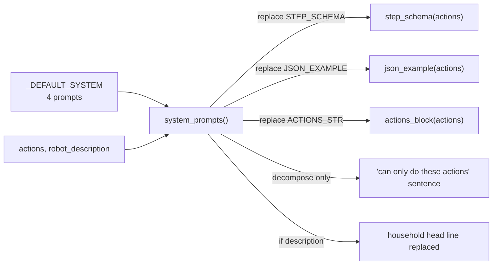

# Prompt building

This page shows the three text fragments that almost every planner puts in its system prompt, and the small module that rewrites them for a robot with its own actions. You learn what each fragment says, which planners use it, how `robot_prompt.py` swaps the fragments for a custom action list, and which test keeps the default prompts unchanged.

!!! abstract "In this page"
    - `base.py` defines three shared fragments: `ACTIONS_STR` (the action list), `STEP_SCHEMA` (the rules) and `JSON_EXAMPLE` (two sample plans).
    - `robot_prompt.py` rewrites SAGE's four system prompts for a robot by **string replacement** of those exact fragments. Only SAGE uses it.
    - With no `actions` and no `robot_description`, the SAGE prompts are returned unchanged. A golden file and a test guard this.
    - The container example in `JSON_EXAMPLE` fails the default one-hand gate (`hand_full`). See [Action model](action-model.md).

!!! code "Where in the code"
    - [`embodiplan/base.py` L53-L138](https://github.com/mtbui2010/embodiplan/blob/a69064255c69/embodiplan/base.py#L53-L138): `ROBOT_ACTIONS`, `ACTIONS_STR`, `STEP_SCHEMA`, `JSON_EXAMPLE`.
    - [`embodiplan/robot_prompt.py`](https://github.com/mtbui2010/embodiplan/blob/a69064255c69/embodiplan/robot_prompt.py): `system_prompts` [L144-L164](https://github.com/mtbui2010/embodiplan/blob/a69064255c69/embodiplan/robot_prompt.py#L144-L164).
    - [`embodiplan/sage.py` L67-L119](https://github.com/mtbui2010/embodiplan/blob/a69064255c69/embodiplan/sage.py#L67-L119): the four default prompts and `_DEFAULT_SYSTEM`.

## The three fragments in `base.py`

| Fragment | What it holds | Real size (run) |
|---|---|---|
| `ACTIONS_STR` | the 14 names of `ROBOT_ACTIONS`, one per line, indented by two spaces ([L70](https://github.com/mtbui2010/embodiplan/blob/a69064255c69/embodiplan/base.py#L70)) | 14 lines |
| `STEP_SCHEMA` | the step format (two fields), one rule per action, a "Container rule", and two "Typical sequences" ([L72-L102](https://github.com/mtbui2010/embodiplan/blob/a69064255c69/embodiplan/base.py#L72-L102)) | 2039 characters |
| `JSON_EXAMPLE` | two sample plans in JSON: a simple grab-and-place and "Example with container" ([L118-L138](https://github.com/mtbui2010/embodiplan/blob/a69064255c69/embodiplan/base.py#L118-L138)) | 686 characters |

Two details to know:

- The extra actions `Heat`, `Cool`, `Clean` are off by default. If `EMBODIPLAN_EXTRA_ACTIONS` lists them before import, they are appended to `ROBOT_ACTIONS` and a "Cross-domain object-treatment actions" block is appended to `STEP_SCHEMA` ([L106-L116](https://github.com/mtbui2010/embodiplan/blob/a69064255c69/embodiplan/base.py#L106-L116)). The default strings stay as they are. This path was not run here.
- `STEP_SCHEMA` has rules for `MoveTo`, `Find`, `Pick`, `Open/Close/TurnOn/TurnOff` and `Place`. It has no rule text for `PutIn`, `Wash`, `Sit`, `LieOn`, `Serve` or `Wait`; those names appear only in `ACTIONS_STR`.

### Where they are used

Each planner file imports the fragments and puts them in an f-string, in this order: "Available robot actions", `{ACTIONS_STR}`, `{STEP_SCHEMA}`, then the JSON format and `{JSON_EXAMPLE}`. By grep of `embodiplan/`:

| Fragments | Used in |
|---|---|
| all three | `direct.py`, `cot.py`, `few_shot.py`, `self_refine.py`, `llmp.py`, `hierarchical.py`, `my_planner.py`, `sage.py` (three of its four prompts) |
| `ACTIONS_STR` and `STEP_SCHEMA` | `saycan.py` |
| `STEP_SCHEMA`, `JSON_EXAMPLE` and `ROBOT_ACTIONS` (joined with commas) | `utils.py` |
| `ACTIONS_STR` and `JSON_EXAMPLE` | `llm_router.py` (as a comma list) |
| `ACTIONS_STR` only | `react.py` |

SAGE's decompose prompt (`_DECOMPOSE_SYSTEM`) holds no fragment; its expand, refine and repair prompts do. See [SAGE](../planners/sage.md).

## How a robot's action list rewrites the prompts

By default SAGE plans for a generic household robot. A client that knows its robot passes two things to `SAGEPlanner`:

- `actions`: a list of entries, each a bare name (`"MoveTo"`) or a line that starts with the name (`"MoveTo <place>: drive there"`). The name is the first word.
- `robot_description`: one or two sentences about the body.

`SAGEPlanner.__init__` calls `system_prompts(_DEFAULT_SYSTEM, self.actions, robot_description)` once and stores the result in `self.system_prompts` ([`sage.py` L381-L386](https://github.com/mtbui2010/embodiplan/blob/a69064255c69/embodiplan/sage.py#L381-L386)). Then `_system(key)` reads from it.



The steps inside `system_prompts`, in order, for each of the four prompts:

1. If `actions` is a non-empty list: replace the exact text of `STEP_SCHEMA`, `JSON_EXAMPLE` and `ACTIONS_STR` with the robot's versions.
2. For the decompose prompt only: insert the sentence `The robot can only do these actions: ... Plan no sub-goal that needs another action.` before `Return ONLY valid JSON`.
3. If a description is given: replace the household head line (for example "You are a household task planner (high-level).") with "You are the high-level task planner of this robot: ...". The description's whitespace is collapsed first.

The helpers:

| Function | What it returns |
|---|---|
| `action_name(entry)` | the first word of an entry |
| `action_names(actions)` | the names, in order, without repeats |
| `actions_block(actions)` | one indented line per entry, as written (so the `<arg>: what it does` text stays) |
| `step_schema(actions)` | the schema head, plus only the rules whose actions the robot has. The container rule needs `Open`, `Find`, `Pick`, `MoveTo`. The two typical sequences need all their actions. |
| `json_example(actions)` | the full `JSON_EXAMPLE` if the robot has `MoveTo, Find, Pick, Place, Open, Close`; only the simple example if it has the first four; else a short example from the robot's first three actions |

For the default 14 actions, `step_schema(ROBOT_ACTIONS) == STEP_SCHEMA` and `json_example(ROBOT_ACTIONS) == JSON_EXAMPLE` (run: both `True`).

### Main function

Verbatim from `system_prompts` ([L144-L164](https://github.com/mtbui2010/embodiplan/blob/a69064255c69/embodiplan/robot_prompt.py#L144-L164)):

```python
def system_prompts(defaults: dict, actions=None, robot_description: str | None = None) -> dict:
    """``defaults`` ({decompose, expand, refine, repair} -> SAGE's default system
    prompt) for this robot. ``actions`` / ``robot_description`` None = unchanged."""
    out = dict(defaults)
    acts = [a for a in (actions or ()) if action_name(a)] if actions is not None else None
    desc = " ".join(str(robot_description or "").split())
    for key, text in out.items():
        if acts:
            text = (text.replace(STEP_SCHEMA, step_schema(acts))
                        .replace(JSON_EXAMPLE, json_example(acts))
                        .replace(ACTIONS_STR, actions_block(acts)))
            if key == "decompose":
                text = text.replace(
                    "\n\nReturn ONLY valid JSON",
                    "\n\nThe robot can only do these actions: " + ", ".join(action_names(acts))
                    + ". Plan no sub-goal that needs another action.\n\nReturn ONLY valid JSON", 1)
        if desc:
            old, new = _HEADS[key]
            text = text.replace(old, new.format(robot=desc), 1)
        out[key] = text
    return out
```

### Example (run offline, no LLM, no network)

```python
from embodiplan.robot_prompt import system_prompts, json_example, actions_block
from embodiplan.sage import _DEFAULT_SYSTEM

acts = ["MoveTo <place>: drive there", "Say <text>: say it"]
print(actions_block(acts))
print(json_example(["MoveTo", "Say"]))
out = system_prompts(_DEFAULT_SYSTEM, acts, "A delivery base without an arm.")
print(out["decompose"])
print(system_prompts(_DEFAULT_SYSTEM) == _DEFAULT_SYSTEM)
```

Output (real, unedited):

```text
  MoveTo <place>: drive there
  Say <text>: say it
{"steps": [
  {"action": "MoveTo", "object": "Kitchen"},
  {"action": "Say", "object": "Target"}
]}
You are the high-level task planner of this robot: A delivery base without an arm.
Study the retrieved examples to understand sub-goal granularity, then
break the given task into 2–5 ordered sub-goals (short natural-language
phrases). Each sub-goal should be a distinct phase the robot will
execute end-to-end before moving on.

The robot can only do these actions: MoveTo, Say. Plan no sub-goal that needs another action.

Return ONLY valid JSON — no markdown, no explanation:
{"subgoals": ["sub-goal 1", "sub-goal 2", ...]}
True
```

For the same robot the expand, refine and repair prompts are 955, 926 and 968 characters long (run), because they also carry the shorter action list and the `step_schema` text. `step_schema(acts)` for these two actions keeps the schema head and only the `MoveTo` rule (run); the `Say` action has no rule text, because the rules come from a fixed table in the module (`_RULES`), not from the entry.

## Tests and the golden file

[`tests/test_robot_prompt.py`](https://github.com/mtbui2010/embodiplan/blob/a69064255c69/tests/test_robot_prompt.py) has five tests. By reading the file:

| Test | What it checks |
|---|---|
| `test_default_prompts_unchanged` | a default `SAGEPlanner` has `system_prompts == _DEFAULT_SYSTEM`; `system_prompts(_DEFAULT_SYSTEM)` returns an equal dict; the expand prompt still holds `ACTIONS_STR` and the decompose prompt still says "household" |
| `test_base_robot_prompts_have_only_its_actions` | for a base without an arm, no prompt contains `Pick`, `Place`, `Open`, `TurnOn`, `Wash` or "household"; the description appears in all four; the action lines and the "can only do" list appear |
| `test_arm_robot_keeps_the_container_rules` | with `MoveTo, Find, Pick, Place, PutIn, Open, Close`, the expand prompt keeps the container rule and example, drops `TurnOn` and `Wash`, and keeps "household" when no description is given |
| `test_schema_and_example_follow_the_actions` | `step_schema` and `json_example` drop the container parts when `Open`/`Close` are missing; `Say` shows in the example; `action_names` removes repeats |
| `test_defaults_byte_identical_to_0_2_3` | joins the four default prompts with `"\n=====\n"` and compares with `tests/data/sage_prompts_0_2_3.txt` |

The golden file [`tests/data/sage_prompts_0_2_3.txt`](https://github.com/mtbui2010/embodiplan/blob/a69064255c69/tests/data/sage_prompts_0_2_3.txt) is the four default prompts as release 0.2.3 shipped them (9745 bytes). The last test fails if any default prompt differs by one character. So an edit to `ACTIONS_STR`, `STEP_SCHEMA` or `JSON_EXAMPLE` that changes SAGE's default text is caught. It is a guard for **SAGE's** prompts; the other planners' prompts have no golden file. No pytest result is claimed here (pytest is not installed in this environment).

## Failure modes

!!! warning "The container example fails the default one-hand gate"
    `JSON_EXAMPLE` teaches `Open Fridge`, `Pick Apple`, then `Close Fridge` while the apple is still in hand. The default body has one hand, so [`simulate`](action-model.md) reports `hand_full` at step 7. The "Object inside container" sequence in `STEP_SCHEMA` has the same shape. Pass `capabilities={"hands": 2}` to allow it. Details and a run are on the [Action model](action-model.md) page.

- **Two copies of the rule text.** `system_prompts` finds the fragments by their full text, and `step_schema` rebuilds the schema from its own copy of the rule text (`_RULES`, `_SCHEMA_HEAD` and others in `robot_prompt.py`). If `STEP_SCHEMA` in `base.py` is edited, the default prompts change with it, but a robot-specific schema keeps the old rule text. The golden test covers only the default path. This reading is from the code and was not run.
- **The gate does not know the robot's action names.** SAGE's `_simulate` calls `simulate(plan, capabilities=...)` and does not pass `actions=` ([`sage.py` L426-L428](https://github.com/mtbui2010/embodiplan/blob/a69064255c69/embodiplan/sage.py#L426-L428)). Run: a planner built with `actions=["MoveTo", "Say <text>: say it"]` and asked to simulate `[{"action": "Say", "object": "hi"}]` returns `ok False` with the code `unknown_action`. A robot with actions outside the 14 default names must handle this itself.
- **Only SAGE is rewritten.** Other planners always use the default fragments.
- **No match, no change.** If a default prompt did not contain a fragment, the replace does nothing and no error is raised.
- **Empty list.** `actions=[]` is falsy, so the prompts are not rewritten (only the description is applied). `actions=None` also leaves them unchanged.
